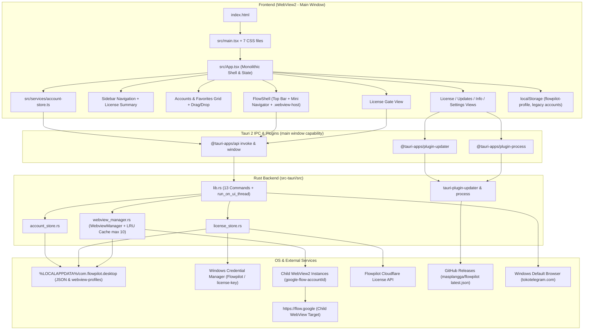
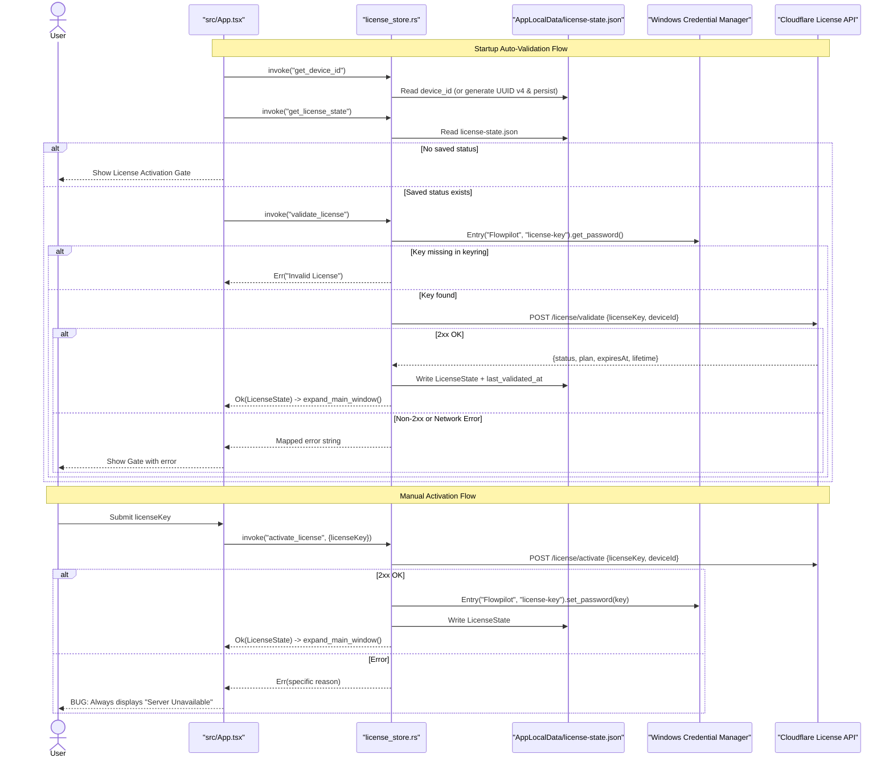
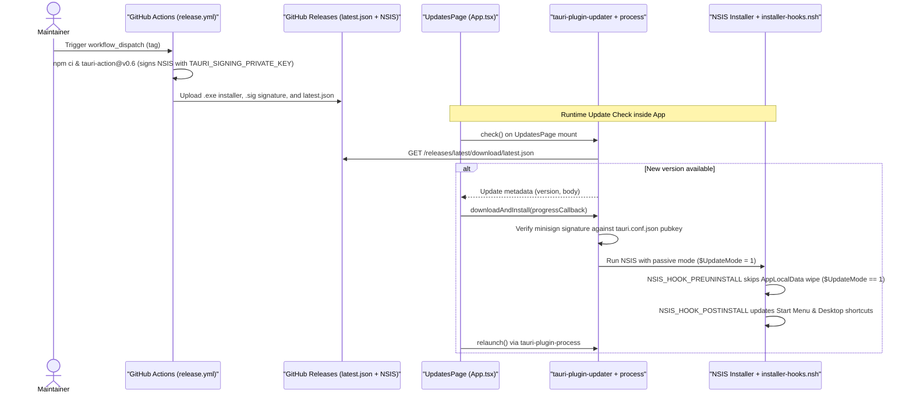
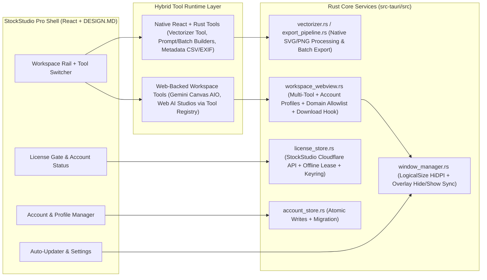

# StockStudio Pro v0.2.0-A: Flowpilot Repository Audit Report

**Audit Phase:** v0.2.0 Foundation & Repository Audit  
**Source Codebase Audited:** Flowpilot `v1.2.0` (`com.flowpilot.desktop`)  
**Target Product:** StockStudio Pro (Windows Desktop Application for Microstock Contributors)  
**Audit Nature:** Read-only inspection and architectural documentation (no source, dependency, configuration, or git mutations performed)

---

## Epistemic Legend

Throughout this document, statements are explicitly separated into:
- **Verified Fact:** Directly observed in repository files or local tool output during this audit.
- **Assumption / Requires Further Verification:** Behavior inferred from static analysis or external runtime constraints (not yet executed locally because `node_modules` and Rust toolchain are not installed).
- **Recommendation:** Engineering guidance for preparing and building StockStudio Pro.

---

## 1. Executive Summary

### Verified Facts
- **Codebase Baseline:** The workspace contains the complete source code for **Flowpilot v1.2.0** (`flowpilot` in `package.json` and `src-tauri/Cargo.toml`, identifier `com.flowpilot.desktop`), a Windows-focused **Tauri 2** (`tauri 2.11.5`) + **React 18.2.0** + **TypeScript 5.0.4** + **Vite 5.4.21** + **Rust (edition 2021)** desktop wrapper around Google Flow (`https://flow.google`).
- **Core Capabilities Already Implemented:**
  - **License Gate & Device Binding:** Startup and manual activation against a remote Cloudflare Workers API (`https://flowpilot-license-server.frangga-snow.workers.dev`), local state caching (`license-state.json`), UUID v4 device IDs, and Windows Credential Manager key storage via `keyring`.
  - **Multi-Account Native Persistence:** JSON persistence in `%LOCALAPPDATA%\com.flowpilot.desktop\accounts.json` with one-time migration from browser `localStorage`.
  - **Isolated Embedded WebViews:** Child `WebviewBuilder` instances per account (`tauri` `unstable` feature) with isolated `data_directory` profiles (`webview-profiles/<account_id>`), LRU eviction capped at 10 live WebViews, path-traversal guards, and UI-thread marshaling.
  - **Signed NSIS Auto-Updater:** `tauri-plugin-updater` + `tauri-plugin-process` integrated with `UpdatesPage`, Windows NSIS hooks (`installer-hooks.nsh`), and `.github/workflows/release.yml` using `tauri-apps/tauri-action@v0.6`.
- **Major Architectural & Engineering Gaps:**
  - **Monolithic Frontend:** All UI views, state, license screens, drag-and-drop logic, and WebView controls live inside a single 1,172-line file ([`src/App.tsx`](file:///e:/2.%20Microstock/TOOL/flowpilot-main/flowpilot-main/src/App.tsx)).
  - **Bloated / Unused Dependencies:** `package.json` locks 1,619 npm entries including unused Next.js, Storybook, Cypress, React Hook Form, Yup, Webpack, and unconfigured Tailwind/PostCSS packages.
  - **Disabled Security Boundaries:** Content Security Policy is disabled (`"csp": null`), child WebViews allow navigation to any `https://` origin, and `open_external_url` spawns `cmd.exe /C start`.
  - **Tightly Coupled Flowpilot Branding & Endpoints:** Hardcoded Flowpilot names, purchase URLs, Cloudflare Worker URL, GitHub repository updater endpoint, and upstream minisign public key exist across frontend, Rust, NSIS, and CI files.
  - **Missing Repository Infrastructure & Tooling:** No `.git` directory exists in this workspace, no `DESIGN.MD` or `README.md` is present, no automated tests or PR CI checks exist, `node_modules` and `src-tauri/target` are absent, and `rustc`/`cargo` are not installed on `PATH`.
  - **TTS / Storyboard Check:** Full codebase inspection confirmed **no TTS or Storyboard code or modules exist** in this Flowpilot `v1.2.0` snapshot.

### Recommendations
1. **Retain the core technical stack** (Tauri 2, React, TypeScript, Vite, Rust) and preserve the Rust backend concepts for multi-profile WebView isolation, Windows Credential Manager licensing, native `AppLocalData` storage, and signed NSIS auto-updating.
2. **Execute a clean foundation phase before feature work:** initialize Git, prune unused npm packages, replace Flowpilot branding/endpoints/signing keys, harden CSP/navigation/license client logic, and refactor `src/App.tsx` into modular features before applying `DESIGN.MD` and building the 7 StockStudio Pro modules.

---

## 2. Project Technology Stack

All versions below are **Verified Facts** inspected directly from [`package.json`](file:///e:/2.%20Microstock/TOOL/flowpilot-main/flowpilot-main/package.json), `package-lock.json`, [`src-tauri/Cargo.toml`](file:///e:/2.%20Microstock/TOOL/flowpilot-main/flowpilot-main/src-tauri/Cargo.toml), `src-tauri/Cargo.lock`, and local shell diagnostics.

| Layer | Technology | Declared Spec | Locked Version | Role / Status in Flowpilot |
| :--- | :--- | :--- | :--- | :--- |
| Desktop Runtime | Tauri 2 (`tauri`) | `2` (`features = ["unstable"]`) | `2.11.5` | Core desktop host, IPC, windowing, child WebView embedding (`wry 0.55.1`, `tao 0.35.3`, `webview2-com 0.38.2`) |
| Desktop JS Bridge | `@tauri-apps/api` | `^2.0.0` | `2.11.1` | `invoke`, `getVersion`, `getCurrentWindow`, `PhysicalSize` |
| Desktop CLI | `@tauri-apps/cli` | `^2.0.0` | `2.11.4` | Tauri dev/build CLI (`devDependencies`) |
| Auto-Updater | `tauri-plugin-updater` / `@tauri-apps/plugin-updater` | `2` / `^2.10.1` | `2.10.1` / `2.10.1` | Desktop-only update check, signature verify, NSIS download/install |
| Process Restart | `tauri-plugin-process` / `@tauri-apps/plugin-process` | `2` / `^2.3.1` | `2.3.1` / `2.3.1` | App relaunch after update install |
| UI Library | `react`, `react-dom` | `18.2.0` | `18.2.0` | Frontend rendering |
| Language (FE) | `typescript` | `5.0.4` | `5.0.4` | Static typing (`target: es5` in `tsconfig.json`) |
| Bundler | `vite`, `@vitejs/plugin-react` | `^5.4.8`, `^4.3.1` | `5.4.21`, `4.7.0` | Frontend build & dev HMR (`localhost:5173`) |
| Styling | Plain CSS (`src/styles/*.css`) | — | — | Custom dark theme CSS; `tailwindcss ^3.3.2` present in `package.json` without config |
| Language (BE) | Rust (`edition = "2021"`) | — | — | Native backend (`flowpilot` / `flowpilot_lib`) |
| Serialization | `serde`, `serde_json` | `1` | `1.0.229`, `1.0.151` | IPC payloads and local JSON persistence |
| HTTP Client | `reqwest` | `0.12` (`json`, `rustls-tls`) | `0.12.28` (+ `0.13.4` transitive) | License server HTTPS POST requests |
| Credential Store | `keyring` | `3` (`windows-native`) | `3.6.3` | Windows Credential Manager license key storage |
| Time & IDs | `chrono`, `uuid` | `0.4` (`clock`), `1` (`v4`) | `0.4.45`, `1.26.0` | RFC 3339 timestamps & UUID v4 device IDs |
| Installer | Windows NSIS | `targets = "nsis"` | — | Windows setup executable + custom `.nsh` hooks |
| CI/CD | GitHub Actions | `windows-latest` | `tauri-action@v0.6` | Manual `workflow_dispatch` signed release builds |

### Local Environment Check (Verified)
- **Node.js:** `v20.10.0` (installed)
- **npm:** `10.2.3` (installed)
- **Git:** `2.47.1.windows.2` (installed, but workspace has no `.git` folder)
- **Rust (`rustc` / `cargo`):** Not installed / not available on `PATH`
- **Install Artifacts:** `node_modules/` = absent (`False`), `src-tauri/target/` = absent (`False`)

---

## 3. Complete Project Directory Overview

### Verified Directory Tree

```text
flowpilot-main/
├── .github/
│   └── workflows/
│       └── release.yml                # Manual GitHub Actions Windows release & updater workflow
├── public/
│   ├── foursquare.png                 # 512x512 brand mark displayed in App Brand header
│   ├── google-flow.png                # 400x400 default account card & mini-navigator avatar
│   └── logo-preview.png               # 512x512 unused preview logo asset
├── src/
│   ├── services/
│   │   └── account-store.ts           # Native account load/save IPC wrapper + localStorage migration
│   ├── styles/
│   │   ├── account-menu.css           # Context menu, avatar sizing, sidebar license summary, cards
│   │   ├── cypress.css                # Orphaned CSS variable (--font-plus-jakarta-sans); unimported
│   │   ├── global.css                 # Core dark UI layout, Google Fonts import, dead @tailwind rules
│   │   ├── info-privacy.css           # Info page privacy notice styles
│   │   ├── license-restore.css        # Full-height license gate card overrides
│   │   ├── profile-license.css        # Sidebar bottom license info layout overrides
│   │   ├── scroll-layout.css          # Viewport height locking & independent content scrolling
│   │   └── updater.css                # Download progress text styling
│   ├── App.tsx                        # 1,172-line monolithic React app (all views, state, components)
│   ├── main.tsx                       # React root mount + CSS cascade import order
│   └── vite-env.d.ts                  # Vite client type reference
├── src-tauri/
│   ├── capabilities/
│   │   └── default.json               # Tauri 2 ACL permissions bound only to "main" window
│   ├── icons/
│   │   ├── android/                   # 17 Android launcher assets (unused on Windows NSIS build)
│   │   ├── ios/                       # 16 iOS AppIcon assets (unused on Windows NSIS build)
│   │   ├── 32x32.png, 64x64.png, 128x128.png, 128x128@2x.png
│   │   ├── icon.ico, icon.icns, icon.png (512x512)
│   │   └── Square*Logo.png, StoreLogo.png (10 Windows Store/AppX tile assets; unused by NSIS)
│   ├── src/
│   │   ├── account_store.rs           # Reads/writes accounts.json in BaseDirectory::AppLocalData
│   │   ├── lib.rs                     # Tauri builder, plugin registration, UI thread helper, IPC commands
│   │   ├── license_store.rs           # Device ID, keyring secret, license API HTTP calls, state cache
│   │   ├── main.rs                    # Desktop executable entrypoint calling flowpilot_lib::run()
│   │   └── webview_manager.rs         # Child WebView lifecycle, profile directories, LRU cache (max 10)
│   ├── build.rs                       # Calls tauri_build::build()
│   ├── Cargo.lock                     # 493 locked Rust crates
│   ├── Cargo.toml                     # Rust package manifest & feature definitions
│   ├── installer-hooks.nsh            # NSIS post-install shortcuts & pre-uninstall AppLocalData prompt
│   └── tauri.conf.json                # Tauri 2 config: window, bundle, NSIS, updater endpoint/pubkey
├── .gitignore                         # Ignore rules (includes Next.js/Vercel remnants)
├── index.html                         # 1-line HTML root container (<div id="root"></div>)
├── package-lock.json                  # npm lockfile v3 (1,619 entries)
├── package.json                       # Scripts and 39 npm dependencies/devDependencies
├── tsconfig.json                      # TypeScript compiler options
└── vite.config.ts                     # Vite React plugin + "@" -> "./src" alias
```

### Module Responsibility Summary

| File / Directory | Responsibility |
| :--- | :--- |
| [`src/main.tsx`](file:///e:/2.%20Microstock/TOOL/flowpilot-main/flowpilot-main/src/main.tsx) | Mounts `<App />` in `React.StrictMode`; establishes override order of 7 stylesheets. |
| [`src/App.tsx`](file:///e:/2.%20Microstock/TOOL/flowpilot-main/flowpilot-main/src/App.tsx) | Implements license gate, sidebar, account CRUD/drag-drop, favorites, license catalog, updates UI, info guide, settings, and embedded `FlowShell`. |
| [`src/services/account-store.ts`](file:///e:/2.%20Microstock/TOOL/flowpilot-main/flowpilot-main/src/services/account-store.ts) | Validates `StoredAccount[]` schema, calls Rust `load_accounts` / `save_accounts`, migrates legacy `localStorage["flowpilot-accounts"]`. |
| [`src-tauri/src/lib.rs`](file:///e:/2.%20Microstock/TOOL/flowpilot-main/flowpilot-main/src-tauri/src/lib.rs) | Configures Tauri plugins (`process`, `updater`), injects `WebviewManager` state, marshals WebView ops onto main thread, exports 13 commands. |
| [`src-tauri/src/webview_manager.rs`](file:///e:/2.%20Microstock/TOOL/flowpilot-main/flowpilot-main/src-tauri/src/webview_manager.rs) | Manages child WebViews (`google-flow-<id>`), per-account profile folders, bounds validation, LRU eviction, navigation/popup restrictions. |
| [`src-tauri/src/license_store.rs`](file:///e:/2.%20Microstock/TOOL/flowpilot-main/flowpilot-main/src-tauri/src/license_store.rs) | Generates UUID v4 `device_id`, reads/writes `license-state.json`, stores license key in OS keyring, posts to remote license server. |
| [`src-tauri/src/account_store.rs`](file:///e:/2.%20Microstock/TOOL/flowpilot-main/flowpilot-main/src-tauri/src/account_store.rs) | Persists arbitrary JSON account arrays in `AppLocalData/accounts.json`. |
| [`src-tauri/capabilities/default.json`](file:///e:/2.%20Microstock/TOOL/flowpilot-main/flowpilot-main/src-tauri/capabilities/default.json) | Restricts Tauri IPC permissions exclusively to the `"main"` window (`core:default`, `updater:default`, `process:allow-restart`). |
| [`src-tauri/installer-hooks.nsh`](file:///e:/2.%20Microstock/TOOL/flowpilot-main/flowpilot-main/src-tauri/installer-hooks.nsh) | Creates Start Menu/Desktop shortcuts on install; conditionally prompts to wipe `$LOCALAPPDATA\com.flowpilot.desktop` on full uninstall. |
| [`public/logo-preview.png`](file:///e:/2.%20Microstock/TOOL/flowpilot-main/flowpilot-main/public/logo-preview.png), [`src/styles/cypress.css`](file:///e:/2.%20Microstock/TOOL/flowpilot-main/flowpilot-main/src/styles/cypress.css) | Unused assets/stylesheets left in the repository. |

---

## 4. Frontend Architecture

### Existing Application Architecture Diagram



### Verified Component & Module Inspection

1. **Entry Point (`index.html`, `src/main.tsx`):**
   - [`index.html`](file:///e:/2.%20Microstock/TOOL/flowpilot-main/flowpilot-main/index.html) is a single-line HTML fragment (`<div id="root"></div><script type="module" src="/src/main.tsx"></script>`) lacking `<!DOCTYPE html>`, `<html>`, `<head>`, `<meta charset>`, `<meta name="viewport">`, and `<title>`. Browsers/WebView2 implicitly enter quirks-like or inferred DOM wrap behavior; `tauri.conf.json` supplies the native window title `"Flowpilot"`.
   - [`src/main.tsx`](file:///e:/2.%20Microstock/TOOL/flowpilot-main/flowpilot-main/src/main.tsx) mounts `<React.StrictMode><App /></React.StrictMode>` and imports 7 CSS files sequentially (`global.css` → `license-restore.css` → `account-menu.css` → `info-privacy.css` → `scroll-layout.css` → `profile-license.css` → `updater.css`).

2. **Monolithic Concentration (`src/App.tsx`):**
   - **Verified Fact:** All UI components are concentrated in [`src/App.tsx`](file:///e:/2.%20Microstock/TOOL/flowpilot-main/flowpilot-main/src/App.tsx) (`1,172` lines, `43,449` bytes). Aside from `src/services/account-store.ts`, there are **zero** component files, custom hooks, type modules, or routers.
   - `src/App.tsx` contains the default `App` export plus 11 local function components: `Brand`, `Sidebar`, `SidebarIcon`, `LicensePage`, `UpdatesPage`, `InfoPage`, `AddAccountCard`, `Card`, `DragPreview`, `Settings`, and `FlowShell`.

3. **Navigation & Sidebar (`Sidebar`, `SidebarIcon`):**
   - `view` state supports 7 views: `"accounts" | "favorites" | "license" | "updates" | "info" | "settings" | "flow"`.
   - `Sidebar` renders `WORKSPACE` (`Accounts`, `Favorites`) and `GENERAL` (`License`, `Updates`, `Info`, `Settings`), plus a bottom user profile avatar (defaulting to initials `"YK"`) and live license status/plan/expiry summary. Below `800px` width, CSS collapses the sidebar to a `60px` icon rail.

4. **Account Management UI:**
   - Grid of `Card` items plus an `AddAccountCard` tile (`accounts` view only).
   - Search input filters by name/email; favorites toggle filters in `favorites` view.
   - Custom **pointer-capture drag-and-drop** (`beginPointerDrag`, window `pointermove`/`pointerup`/`pointercancel`, `DragPreview` portal-like fixed overlay) reorders cards on the `accounts` grid when search query is empty, normalizing `order` indices `0..n-1`.
   - Add Account uses an accessible modal (`role="dialog"`) validating trimmed non-empty names up to 80 characters. Delete Account uses a confirmation modal triggering `remove_google_flow_account`. Rename uses native `window.prompt()`.

5. **Workspace (`FlowShell`):**
   - Top bar (`.flow-bar`, `68px` height) with `‹ Accounts`, status text, mini account-switcher dropdown (`.mini-navigator`), and `Full View` / `Exit Full View` toggle (`Escape` key exits Full View).
   - **Airspace Workaround:** Because a native child WebView2 sits over the host DOM (`z-order` above HTML), opening the mini-navigator adds `.navigator-open` to `.flow-shell`, expanding `.flow-bar` height from `68px` to `280px` (`src/styles/global.css:12`), which shrinks `.webview-host` via layout/flex and triggers `ResizeObserver` → `resize_google_flow` so the dropdown menu is visible above the WebView!
   - Emits a custom DOM event `flowpilot-webview-ready` when `open_google_flow` resolves so `ResizeObserver` re-syncs bounds.

6. **Settings, License, Info, and Updates Views:**
   - `Settings`: Local profile avatar upload (reads image via `FileReader.readAsDataURL` into `localStorage["flowpilot-profile"]`), static privacy badge (`LOCAL ONLY`), and static About section (`APP_VERSION` from `package.json`). No theme toggle, workspace preferences, or license deactivation UI exists.
   - `LicensePage`: Displays 3 hardcoded Flowpilot IDR plans (`30 Days`, `1 Year`, `Lifetime`), opens purchase URL via `open_external_url`, and renders `Current License` stats (`Plan`, `Status`, `Expires`).
   - `UpdatesPage`: Automatically checks for updates on mount via `@tauri-apps/plugin-updater`, shows current/latest versions, release notes (`update.body`), download progress (`Started` / `Progress` / `Finished`), and calls `relaunch()` from `@tauri-apps/plugin-process`.
   - `InfoPage`: Displays 6 onboarding steps, 4 privacy cards, and a `Join Telegram Channel` button that is permanently `disabled` because `TELEGRAM_CHANNEL_URL = ""` (`App.tsx:21`).

7. **State Management & Styling System:**
   - Pure React hooks (`useState`, `useEffect`, `useMemo`, `useRef`) in `App.tsx`. No Redux, Zustand, React Query, Context API, or URL router.
   - Styling uses plain CSS across 7 imported files. **Critical finding:** `src/styles/global.css` lines 2–6 (`@tailwind base/components/utilities`), 25–42 (`@layer base`), and 52–165 (`@layer components`) rely on Tailwind CSS and custom tokens (`noble-black-*`, `stem-green-*`, `day-blue-*`, `glass-fill`) with **no `tailwind.config.*` or `postcss.config.*`** in the repository, leaving those blocks uncompiled/dead.

### Verified Frontend Bugs & Code Smells

| Severity | Location | Finding |
| :--- | :--- | :--- |
| **Bug** | [`App.tsx:329-335`](file:///e:/2.%20Microstock/TOOL/flowpilot-main/flowpilot-main/src/App.tsx#L329-L335) | `activateLicense` `catch` block discards the Rust error message and hardcodes `"Server Unavailable"`, masking `"Invalid License"`, `"License Expired"`, `"License Revoked"`, and `"Device Mismatch"`. |
| **Bug** | [`App.tsx:221`](file:///e:/2.%20Microstock/TOOL/flowpilot-main/flowpilot-main/src/App.tsx#L221) | Account search interpolates `` `${a.name} ${a.email}` `` without coalescing `null`; searching `"null"` matches every account whose `email` is `null`. |
| **Bug** | [`App.tsx:1087,1113-1129`](file:///e:/2.%20Microstock/TOOL/flowpilot-main/flowpilot-main/src/App.tsx#L1087-L1129) | `FlowShell` `ResizeObserver` effect omits `account.id` from its dependency array `[navigatorOpen, fullView]`, and `status` is never reset to `"Loading Google Flow..."` when switching accounts. |
| **Bug** | [`App.tsx:196-202`](file:///e:/2.%20Microstock/TOOL/flowpilot-main/flowpilot-main/src/App.tsx#L196-L202) & [`account-store.ts:42-45`](file:///e:/2.%20Microstock/TOOL/flowpilot-main/flowpilot-main/src/services/account-store.ts#L42-L45) | If `load_accounts` throws (e.g., corrupted `accounts.json`), `loadAccounts()` catches and returns `[]`, after which `accountsLoaded` becomes `true` and the save `useEffect` immediately overwrites `accounts.json` with `[]`. |
| **Bug** | [`App.tsx:145,186`](file:///e:/2.%20Microstock/TOOL/flowpilot-main/flowpilot-main/src/App.tsx#L145-L186) | Deleting an account does not re-index `order`; creating a new account sets `order: accounts.length`, causing duplicate `order` values. |
| **Smell** | [`App.tsx:128-133`](file:///e:/2.%20Microstock/TOOL/flowpilot-main/flowpilot-main/src/App.tsx#L128-L133) | `handleRename` uses blocking `window.prompt()` without trimming or 80-char validation. |
| **Smell** | [`App.tsx:191-195`](file:///e:/2.%20Microstock/TOOL/flowpilot-main/flowpilot-main/src/App.tsx#L191-L195) | `updateProfileAvatar` writes unbounded image DataURLs into `localStorage` without `try/catch` quota handling. |
| **Dead Code** | [`App.tsx:5,47-75`](file:///e:/2.%20Microstock/TOOL/flowpilot-main/flowpilot-main/src/App.tsx#L47-L75) | `PhysicalSize` import (`App.tsx:5`) and `starter` 3-account array (`App.tsx:47-75`) are completely unused; `import { invoke }` in [`account-store.ts:56`](file:///e:/2.%20Microstock/TOOL/flowpilot-main/flowpilot-main/src/services/account-store.ts#L56) is placed at the bottom of the file. |

---

## 5. Tauri and Rust Architecture

### Initialization & Registered Commands
[`src-tauri/src/main.rs`](file:///e:/2.%20Microstock/TOOL/flowpilot-main/flowpilot-main/src-tauri/src/main.rs) sets `#![cfg_attr(not(debug_assertions), windows_subsystem = "windows")]` and invokes `flowpilot_lib::run()`.  
[`src-tauri/src/lib.rs`](file:///e:/2.%20Microstock/TOOL/flowpilot-main/flowpilot-main/src-tauri/src/lib.rs) builds the Tauri runtime with:
- Plugins: `tauri_plugin_process::init()`, `tauri_plugin_updater::Builder::new().build()`
- Managed State: `webview_manager::WebviewManager::default()`
- **13 Registered IPC Commands:**

| Command | Rust Module | Execution Model | Caller in Frontend | Notes |
| :--- | :--- | :--- | :--- | :--- |
| `expand_main_window` | `lib.rs:96` | Sync | `App.tsx:122, 333` | Unlocks resize, sets `PhysicalSize(1280, 800)`, min `1000x700`, centers |
| `open_external_url` | `lib.rs:84` | Sync (`cmd /C start`) | `App.tsx:337` | Hardcoded allowlist: only `https://tokotelegram.com/toko/flowpilot` |
| `open_google_flow` | `lib.rs:28` | Async -> UI Thread | `App.tsx:1093` | Creates or shows & repositions child WebView |
| `close_google_flow` | `lib.rs:44` | Async -> UI Thread | `App.tsx:398, 1110` | Hides active child WebView (does NOT destroy it) |
| `resize_google_flow` | `lib.rs:56` | Async -> UI Thread | `App.tsx:1118` | Updates position & logical size if account is active |
| `remove_google_flow_account` | `lib.rs:72` | Async -> UI Thread | `App.tsx:142` | Closes child WebView and deletes profile folder; returns `bool` |
| `get_device_id` | `license_store.rs:69` | Sync | `App.tsx:122` | Reads or generates UUID v4 in `license-state.json` |
| `get_license_state` | `license_store.rs:73` | Sync | `App.tsx:122` | Reads cached `LicenseState` from `license-state.json` |
| `activate_license` | `license_store.rs:119` | Async (`reqwest`) | `App.tsx:332` | Calls `/license/activate`, stores key in OS keyring, writes state |
| `validate_license` | `license_store.rs:132` | Async (`reqwest`) | `App.tsx:122` | Reads OS keyring key, calls `/license/validate`, refreshes state |
| `clear_license_state` | `license_store.rs:139` | Sync | **Unused** | Deletes keyring entry and removes `license-state.json` (including `device_id`) |
| `load_accounts` | `account_store.rs:11` | Sync | `account-store.ts:26` | Reads `accounts.json` (`Option<Value>`) |
| `save_accounts` | `account_store.rs:22` | Sync | `account-store.ts:37, 50` | Writes `accounts.json` |

### UI-Thread Marshaling, Window Management, and Unstable APIs
- **UI-Thread Helper (`run_on_ui_thread`, [`lib.rs:8-25`](file:///e:/2.%20Microstock/TOOL/flowpilot-main/flowpilot-main/src-tauri/src/lib.rs#L8-L25)):** Dispatches WebView2 operations onto the main GUI thread via `app.run_on_main_thread(...)`, waiting up to **30 seconds** on an `mpsc::sync_channel(1)` inside `tauri::async_runtime::spawn_blocking`. This prevents WebView2 COM apartment/thread panics on Windows.
- **Unstable Tauri 2 API Dependency:** [`Cargo.toml:14`](file:///e:/2.%20Microstock/TOOL/flowpilot-main/flowpilot-main/src-tauri/Cargo.toml#L14) enables `tauri = { version = "2", features = ["unstable"] }`. This is required specifically for `tauri::webview::WebviewBuilder` and `Window::add_child(...)` in `webview_manager.rs` (multi-webview child embedding inside a single parent window). Tauri's `unstable` feature carries semver-breaking risk across minor Tauri 2 updates.
- **Window Sizing HiDPI Issue (`expand_main_window`, [`lib.rs:96-115`](file:///e:/2.%20Microstock/TOOL/flowpilot-main/flowpilot-main/src-tauri/src/lib.rs#L96-L115)):** Startup config in `tauri.conf.json:7` uses logical sizes (`540x620`), whereas `expand_main_window` uses `tauri::Size::Physical` (`1280x800`, min `1000x700`). On Windows 150%–200% DPI scaling displays, `1280x800` physical pixels shrinks to ~640×400–853×533 logical CSS pixels, making the expanded desktop UI abnormally small.

### WebView Management, Downloads, Native Storage, Credentials & Permissions
- **Browser Lifecycle & LRU Cache ([`webview_manager.rs`](file:///e:/2.%20Microstock/TOOL/flowpilot-main/flowpilot-main/src-tauri/src/webview_manager.rs)):**
  - `WebviewManager` tracks `active_account_id`, `visible`, `cached_accounts: HashMap<String, u64>`, `usage_counter`, and `operation: Mutex<()>`.
  - Up to `MAX_CACHED_WEBVIEWS = 10` WebViews stay alive (hidden when inactive) so switching accounts is instantaneous. Creating an 11th closes the least-recently-used non-active WebView (`webview.close()`).
  - **Minor State Bug (`webview_manager.rs:213-216`):** `close()` sets `*state.visible = false` unconditionally, even if `account_id` did not match `active_id`. Also `resize()` does not acquire `state.operation.lock()`.
- **Download Handling:** **Not implemented.** There is no `.on_download(...)` handler on `WebviewBuilder`, nor any Tauri `dialog`/`fs` plugin configured. WebView2 uses default Chromium/Edge WebView2 download behavior.
- **Native File Storage:** Uses `BaseDirectory::AppLocalData` (`%LOCALAPPDATA%\com.flowpilot.desktop` on Windows):
  - `accounts.json` (`account_store.rs`) — non-atomic `fs::write`
  - `license-state.json` (`license_store.rs`) — non-atomic `fs::write`
  - `webview-profiles/<account_id>/` (`webview_manager.rs`) — WebView2 user data directories
- **Secure Credential Storage:** Uses `keyring` `3.6.3` (`windows-native`) with `Entry::new("Flowpilot", "license-key")`, storing the license key in Windows Credential Manager rather than plaintext files.
- **Capabilities & Permissions ([`src-tauri/capabilities/default.json`](file:///e:/2.%20Microstock/TOOL/flowpilot-main/flowpilot-main/src-tauri/capabilities/default.json)):**
  - Bound to `"windows": ["main"]` with `["core:default", "updater:default", "process:allow-restart"]`.
  - Child WebViews (`google-flow-*`) are NOT listed in `windows`, so remote `https://flow.google` pages have zero access to Tauri IPC commands.
  - **Requires Further Verification:** `App.tsx:122,333` calls `getCurrentWindow().show()` and `setFocus()`, which in some Tauri 2 versions require explicit `core:window:allow-show` and `core:window:allow-set-focus` permissions if not included in `core:default`. Because `tauri.conf.json` creates `"main"` visible by default, an ACL rejection on `show()`/`setFocus()` during license validation could silently fall into `catch` (`Server Unavailable`)!

### Functionality to Preserve in StockStudio Pro
- `run_on_ui_thread` synchronization pattern for safe Windows WebView2 mutations.
- Isolated `data_directory` per profile with strict `validate_account_id` + `profile_path` parent-check path-traversal defense.
- LRU WebView pooling (with configurable limit) and `main`-only Tauri capability isolation.
- OS Credential Manager storage (`keyring`) and `AppLocalData` native JSON persistence.

---

## 6. Account and WebView Lifecycle

### Lifecycle Sequence Diagram

```mermaid
sequenceDiagram
    actor User
    participant UI as "App.tsx & FlowShell"
    participant StoreTS as "account-store.ts"
    participant Lib as "lib.rs (UI Thread)"
    participant WVM as "webview_manager.rs"
    participant Disk as "AppLocalData (JSON + Profiles)"
    participant WV2 as "WebView2 Child (flow.google)"

    Note over User,Disk: 1-2. Startup Load & Account Creation
    UI->>StoreTS: loadAccounts() on licensed=true
    StoreTS->>Lib: invoke("load_accounts")
    Lib->>Disk: Read accounts.json (migrate localStorage if null)
    User->>UI: Add Account (name <= 80 chars)
    UI->>StoreTS: saveAccounts(accounts) -> accounts.json

    Note over User,WV2: 3-4. Open & Reuse Profile
    User->>UI: Click "Open Google Flow"
    UI->>Lib: invoke("open_google_flow", accountId, bounds)
    Lib->>WVM: run_on_ui_thread -> open()
    WVM->>WVM: Validate ID & bounds; hide previous active WebView
    alt WebView already cached in memory
        WVM->>WV2: set_position, set_size, show()
    else Not cached
        WVM->>WVM: Evict LRU if cached.len() >= 10
        WVM->>Disk: Resolve webview-profiles/<accountId>
        WVM->>WV2: window.add_child(WebviewBuilder + data_directory)
        WV2->>WV2: Load https://flow.google (cookies/session persisted)
    end

    Note over User,WV2: 5-6. Switch & Close (Hide)
    User->>UI: Switch account in Mini Navigator
    UI->>Lib: cleanup close_google_flow(oldId) + open_google_flow(newId)
    User->>UI: Click "Accounts" Back button
    UI->>Lib: close_google_flow() -> webview.hide() (kept warm in cache)

    Note over User,Disk: 7. Remove Account & Profile
    User->>UI: Confirm Delete Account
    UI->>Lib: invoke("remove_google_flow_account", accountId)
    Lib->>WVM: close() child WebView, remove from LRU, remove_dir_all(profile)
    alt Files unlocked on Windows
        WVM-->>UI: true (profile deleted)
    else WebView2 process lock active
        WVM-->>UI: false ("profile cleanup pending")
    end
```

### Detailed 7-Stage Lifecycle Trace (Verified Facts)

1. **Adding an Account (`App.tsx:164-190`):**
   - Modal validates trimmed `newAccountName` is non-empty and `<= 80` chars.
   - Generates `id: crypto.randomUUID()` (matches `validate_account_id`: ASCII alphanumeric, `-`, `_`, `<= 128` chars), sets `email: null`, `avatarUrl: "/google-flow.png"`, `avatar: "NF"`, `favorite: false`, `order: accounts.length`.
   - Updating `accounts` triggers `useEffect` (`App.tsx:200-202`) → `saveAccounts` → `invoke("save_accounts")` → writes `%LOCALAPPDATA%\com.flowpilot.desktop\accounts.json`.
   - Profile folder on disk is **not** created until the account WebView is first opened.
2. **Loading Saved Accounts (`App.tsx:196-199`, `account-store.ts:24-46`):**
   - Runs once `licensed === true && !accountsLoaded`.
   - Calls `invoke("load_accounts")`. If `accounts.json` exists, validates every item via `isAccount`, removes legacy `localStorage["flowpilot-accounts"]`, and sorts ascending by `order`.
   - If `accounts.json` is absent (`null`), checks `localStorage["flowpilot-accounts"]`, migrates valid data via `save_accounts`, and removes the `localStorage` item.
3. **Opening an Account WebView (`App.tsx:1089-1112`, `webview_manager.rs:87-190`):**
   - Selecting a card sets `active` and `view = "flow"`, mounting `FlowShell`.
   - Mount effect reads `containerRef.current.getBoundingClientRect()` (logical CSS coordinates) and invokes `open_google_flow`.
   - Rust acquires `state.operation.lock()`, validates `account_id` and finite/non-negative/positive `bounds`, hides any previously active WebView, evicts LRU if `cached.len() >= 10`, resolves `AppLocalData/webview-profiles/<account_id>`, and calls `window.add_child(...)` with `WebviewUrl::External("https://flow.google")`, `.on_navigation(|url| url.scheme() == "https")`, and `.on_new_window(|_, _| Deny)`.
4. **Reusing an Existing WebView Profile:**
   - **Warm In-Memory Reuse (`webview_manager.rs:120-138`):** If `app.get_webview("google-flow-<account_id>")` exists (hidden in pool of up to 10), Rust simply calls `set_position`, `set_size`, `show()`, and updates `usage_counter`. Page DOM, scroll state, and active Google Flow workspace stay intact instantaneously.
   - **Cold Disk Reuse:** If previously evicted or opened in an earlier app session, WebView2 creates a new child WebView pointing at the existing `webview-profiles/<account_id>` `data_directory`, preserving cookies, local storage, and Google login sessions.
5. **Switching Between Accounts (`App.tsx:393-396, 1143-1163`):**
   - Opening the mini-navigator expands `.flow-bar` to `280px`, shrinking `.webview-host` and resizing the child WebView via `ResizeObserver` so the dropdown menu renders above the WebView boundary.
   - Selecting another account changes `active`, prompting `FlowShell`'s `[account.id]` cleanup to call `close_google_flow(oldId)` while the new effect calls `open_google_flow(newId)`. Both serialize via `state.operation.lock()`.
6. **Closing a WebView (`App.tsx:397-402, 1110`, `webview_manager.rs:192-219`):**
   - Clicking `‹ Accounts` calls `invoke("close_google_flow")` (with `accountId: undefined`) and sets `view = "accounts"`, unmounting `FlowShell` and triggering cleanup `invoke("close_google_flow", { accountId: account.id })` (a redundant double call).
   - `webview_manager::close` calls `webview.hide()`, **keeping the WebView process alive** in the LRU cache.
7. **Removing an Account & Its Browser Profile (`App.tsx:138-157`, `webview_manager.rs:250-294`):**
   - Calls `invoke("remove_google_flow_account", { accountId })`.
   - Rust closes the live child WebView (`webview.close()`), removes the ID from `cached_accounts`, clears `active_account_id`/`visible` if matching, and attempts `std::fs::remove_dir_all(&profile)`.
   - On Windows, WebView2 subprocesses (`msedgewebview2.exe`) frequently hold file locks briefly after `webview.close()`. If `remove_dir_all` fails, Rust logs to `stderr` and returns `Ok(false)`, removing the account from UI state while **leaving orphaned profile directories on disk** with no retry or startup garbage collector.

### Identified Limitations & Recommended Improvements
- **No startup orphan-profile sweeper:** Failed `remove_dir_all` calls leak multi-hundred-MB Chromium cache folders permanently until uninstall. Add startup reconciliation against `accounts.json`.
- **Single hardcoded URL (`https://flow.google`):** `open_google_flow` accepts no tool/URL parameter; StockStudio Pro will need multi-tool URL routing or tool type descriptors.
- **`on_new_window` denies all popups:** Google OAuth flows or external asset previews requiring popups may fail; evaluate controlled popup/OAuth handling or domain-scoped redirects.
- **No custom WebView2 download hook or navigation domain allowlist:** Needed for microstock asset exports and preventing arbitrary `https://` wandering.

---

## 7. License System Architecture

### Activation & Validation Sequence Diagram



### Verified License Implementation Details (`src-tauri/src/license_store.rs`)

> [!IMPORTANT]
> Per audit restrictions, the existing Flowpilot license server (`https://flowpilot-license-server.frangga-snow.workers.dev`) was **not contacted** and must **never** be reused for StockStudio Pro production.

1. **Server Endpoint & HTTP Client (`license_store.rs:7, 76-105`):**
   - Hardcoded constant: `const API: &str = "https://flowpilot-license-server.frangga-snow.workers.dev";`
   - Uses `reqwest::Client::new()` instantiated fresh on every call with **no request timeout**, **no custom `User-Agent`**, and **no retry logic**.
2. **Device ID Generation & Persistence (`license_store.rs:52-67`):**
   - Reads `device_id` from `license-state.json`. If missing or empty, generates a random `Uuid::new_v4()` and writes an empty-status `LicenseState` containing only `device_id` back to `license-state.json`.
   - **Limitation:** Deleting `%LOCALAPPDATA%\com.flowpilot.desktop\license-state.json` (including during an uninstall cleanup or calling `clear_license_state`) permanently destroys the `device_id`, causing a new UUID v4 to be generated and triggering `DEVICE_ALREADY_BOUND` (`"Device Mismatch"`) on reactivation unless the server supports device resets.
3. **Credential Storage (`license_store.rs:49-51, 128, 133-135, 140`):**
   - Uses OS keyring service `"Flowpilot"`, user `"license-key"` via `keyring` (`windows-native`).
   - Activation trims whitespace and writes to keyring **only after** `/license/activate` succeeds.
4. **API Request & Response Contracts (Verified from Rust `serde` Structs):**
   - **Endpoints:** `POST /license/activate` and `POST /license/validate`
   - **Request JSON:**
     ```json
     {
       "licenseKey": "<trimmed-license-key>",
       "deviceId": "<uuid-v4-string>"
     }
     ```
   - **Response JSON (`ServerResponse`, `license_store.rs:18-27`):**
     ```json
     {
       "status": "active",
       "plan": "thirty_days",
       "expiresAt": "2026-12-20T00:00:00Z",
       "lifetime": false,
       "error": null
     }
     ```
   - **Critical Deserialization Coupling:** In `ServerResponse`, `status`, `plan`, and `lifetime` are **non-optional** fields (`#[serde(default)]` is only on `error`). Even on HTTP 4xx/5xx error responses, the server **must** still return valid string/bool values for `status`, `plan`, and `lifetime` (e.g., `""`, `""`, `false`), or `r.json::<ServerResponse>()` fails at line 89–92 and degrades every error into `"Server Unavailable"`.
   - **Supported Plan Keys in Frontend (`App.tsx:24`):** `five_minutes`, `one_day`, `seven_days`, `thirty_days`, `one_year`, `lifetime`.
5. **Error Mapping (`license_store.rs:93-103`):**
   - `Some("LICENSE_REVOKED")` → `"License Revoked"`
   - `Some("LICENSE_EXPIRED")` → `"License Expired"`
   - `Some("DEVICE_ALREADY_BOUND")` → `"Device Mismatch"`
   - `Some("INVALID_LICENSE")` → `"Invalid License"`
   - `code >= 500` or network/JSON failure → `"Server Unavailable"`
   - Other non-2xx → `"Unexpected Server Response"`
   - Note: `App.tsx:334` ignores these returned errors during manual activation and always shows `"Server Unavailable"`.
6. **Expiration & Offline Handling:**
   - **Strict Online Gate:** There is **no offline grace window**. If the user has no internet connection at launch, `validate_license` fails and blocks access to the app, even if `license-state.json` shows a valid `lifetime: true` or future `expires_at`.
   - **No In-Session Re-Validation:** Once `licensed` becomes `true`, the app never re-checks `expires_at` or contacts the server again until the app restarts (relevant for `five_minutes` or short-lived plans).
   - **Unused Deactivation Command:** `clear_license_state` is registered in `lib.rs` but has no button/UI caller in `App.tsx`.

---

## 8. Auto Update Architecture

### Auto Update Workflow Diagram



### Detailed Audit of Updater Components (Verified Facts)

| Component | Current State | Evidence |
| :--- | :--- | :--- |
| Frontend Plugin | Installed & integrated | `@tauri-apps/plugin-updater: 2.10.1`, `@tauri-apps/plugin-process: 2.3.1`; `UpdatesPage` (`App.tsx:696-799`) uses `check()`, `downloadAndInstall()`, and `relaunch()`. |
| Rust Initialization | Registered on desktop only | `Cargo.toml:26-27` (`cfg(not(any(android, ios)))`), `lib.rs:120-121` registers `tauri_plugin_process` & `tauri_plugin_updater`. |
| Permissions | Enabled for `main` | `capabilities/default.json:6` grants `updater:default` and `process:allow-restart`. |
| Updater Pubkey | Configured (Flowpilot key) | `tauri.conf.json:11` contains base64 minisign public key `<REDACTED_BASE64_MINISIGN_PUBKEY — key ID 9883364C90076B4B>`. No private signing key exists in the repo. |
| Update Endpoint | Hardcoded to upstream GitHub | `tauri.conf.json:12`: `["https://github.com/masplangga/flowpilot/releases/latest/download/latest.json"]`. |
| Updater Artifacts | Enabled | `tauri.conf.json:8`: `"createUpdaterArtifacts": true`. |
| NSIS Config & Hooks | Configured for Flowpilot | `tauri.conf.json:8,13`: `targets: "nsis"`, `installMode: "passive"`, icons `icons/icon.ico`, `installerHooks: "installer-hooks.nsh"`. |
| NSIS Upgrade Data Safety | Implemented | `installer-hooks.nsh:8-13`: checks `${If} $UpdateMode <> 1` before prompting to delete `$LOCALAPPDATA\com.flowpilot.desktop`, preserving accounts/profiles during auto-updates. |
| Release Workflow | Implemented (manual dispatch) | `.github/workflows/release.yml` runs on `windows-latest`, generates `includeUpdaterJson: true`, signs with `secrets.TAURI_SIGNING_PRIVATE_KEY`. |

### Implemented vs. Needed for StockStudio Pro
- **Already Implemented:** Complete updater UI state machine (`checking`, `upToDate`, `available`, `downloading`, `installing`, `relaunching`, `error`), progress calculation, NSIS `$UpdateMode` preservation logic, shortcut creation, and `tauri-action` signing workflow structure.
- **Needs Configuration for StockStudio Pro:**
  1. Generate a brand-new StockStudio Pro minisign keypair offline (outside the repo) and store the private key/password in StockStudio Pro's GitHub Secrets (`TAURI_SIGNING_PRIVATE_KEY`, `TAURI_SIGNING_PRIVATE_KEY_PASSWORD`).
  2. Replace `plugins.updater.pubkey` and `plugins.updater.endpoints` in `tauri.conf.json` to point to StockStudio Pro's repository/CDN.
  3. Update `installer-hooks.nsh` prompt wording and `$LOCALAPPDATA\<new-identifier>` path.
  4. Decide whether startup should check silently for updates (currently updates are only checked when the user opens the `Updates` tab) and whether to enforce version alignment across `package.json`, `Cargo.toml`, and `tauri.conf.json`.

---

## 9. GitHub Actions and CI/CD Assessment

### Verified Git & Repository State
- **Git Status:** **Not a Git repository** (`Test-Path .git` = `False`; `git status`, `git branch`, `git remote`, `git log` all return `fatal: not a git repository`). No remotes, branches, or commit history exist in this working copy.
- **`.gitignore` (49 lines):**
  - **Solid Coverage:** Properly ignores `/node_modules`, `/dist`, `/src-tauri/target`, `/src-tauri/gen`, `*.pem`, `*.key`, `*.key.pub`, `.env`, `.env.production`, `.env.development`, `.env*.local`.
  - **Cleanup Needed:** Contains Next.js/Vercel remnants (`/.next/`, `/out/`, `next-env.d.ts`, `.vercel`) and duplicate entries (`.vercel` and `.env*.local` appear twice).
- **`.github/workflows/release.yml` (45 lines):**
  - Triggers **only** on `workflow_dispatch` with manual input `tag` (default `v1.2.0`). No `push` tag trigger (e.g. `v*`) and no PR build/typecheck/clippy CI workflow.
  - Uses `actions/checkout@v4`, `actions/setup-node@v4` (`node-version: 20`, `cache: npm`), `dtolnay/rust-toolchain@stable`, `npm ci`, and `tauri-apps/tauri-action@v0.6`.
  - Sets job-wide `permissions: contents: write` (better scoped at job level or limited) and uses mutable tags (`@v4`, `@v0.6`, `@stable`) rather than commit SHAs.
  - **Missing Steps:** Does not run `npx tsc` / tests / `cargo test` / `cargo clippy` prior to packaging, and does not perform Windows Authenticode code signing (`signtool`).

### GitHub-Specific References Requiring Update for StockStudio Pro
1. `src-tauri/tauri.conf.json:12` — `https://github.com/masplangga/flowpilot/releases/latest/download/latest.json`
2. `.github/workflows/release.yml:1` — `name: Release Flowpilot`
3. `.github/workflows/release.yml:9` — `default: v1.2.0`
4. `.github/workflows/release.yml:41` — `releaseName: Flowpilot ${{ inputs.tag }}`
5. `.github/workflows/release.yml:42` — `releaseBody: Signed Flowpilot release.`

---

## 10. Dependency Assessment

### Frontend Dependency Audit (`package.json` & `package-lock.json`)

Of **39** packages declared in `package.json` (resolving to **1,619** entries in `package-lock.json`), **26 packages (~67%) appear unused or misplaced** in the actual codebase (`src/` only imports `react`, `react-dom/client`, `@tauri-apps/*`, and `../package.json`).

| Category | Packages | Status & Findings |
| :--- | :--- | :--- |
| **Active Runtime (5)** | `react` (`18.2.0`), `react-dom` (`18.2.0`), `@tauri-apps/api` (`2.11.1`), `@tauri-apps/plugin-process` (`2.3.1`), `@tauri-apps/plugin-updater` (`2.10.1`) | Actively imported and required. |
| **Active Build / Types (6)** | `vite` (`5.4.21`), `@vitejs/plugin-react` (`4.7.0`), `@tauri-apps/cli` (`2.11.4`), `typescript` (`5.0.4`), `@types/react` (`18.2.6`), `@types/react-dom` (`18.2.4`) | Needed for build/IDE; **`typescript`, `@types/react`, `@types/react-dom`, `@types/node` are misplaced in `dependencies` instead of `devDependencies`**. |
| **Unused — Next.js / Webpack Remnants (6)** | `eslint-config-next` (`13.4.2`), `@storybook/nextjs` (`7.0.20`), `tsconfig-paths-webpack-plugin` (`4.0.1`), `url-loader` (`4.1.1`), `encoding` (`0.1.13`), `@types/node` (`20.1.4`) | Leftover from a Next.js template; `eslint-config-next` is in runtime `dependencies`! |
| **Unused — Storybook Suite (8)** | `storybook`, `@storybook/react`, `@storybook/blocks`, `@storybook/addon-essentials`, `@storybook/addon-interactions`, `@storybook/addon-links`, `@storybook/addon-styling`, `@storybook/testing-library` (all `7.0.20` / `1.3.0` / `0.0.14-next.2`), `eslint-plugin-storybook` (`0.6.12`) | No `.storybook/` folder or `*.stories.*` files exist; `storybook` scripts will fail. |
| **Unused — Testing / Forms (4)** | `cypress` (`12.12.0`), `react-hook-form` (`7.44.3`), `yup` (`1.2.0`), `@hookform/resolvers` (`3.1.1`) | No `cypress.config.*`, no test specs, and zero imports in `src/`. Form libraries sit in runtime `dependencies`. |
| **Unconfigured — Tailwind & Lint/Format (8)** | `tailwindcss` (`3.3.2`), `@tailwindcss/forms` (`0.5.3` in `dependencies`!), `postcss` (`8.5.26`), `autoprefixer` (`10.4.14`), `eslint` (`8.40.0` in `dependencies`!), `eslint-config-prettier` (`8.8.0`), `prettier` (`2.8.8`), `prettier-plugin-tailwindcss` (`0.3.0`), `cz-conventional-changelog` (`3.3.0`) | No `tailwind.config.*`, `postcss.config.*`, `.eslintrc*`, or `.prettierrc*` exists. |

### Build & TypeScript Configuration Issues
- **`tsconfig.json`:**
  - `"target": "es5"` (line 4) is needlessly antiquated for modern Windows WebView2 (Chromium) + Vite builds.
  - `"noImplicitAny": false` (line 16) weakens strictness despite `"strict": true` (`App.tsx:581` uses `setView: (v: any) => void`).
  - `"include": ["src/main.tsx", "src/App.tsx", "src/vite-env.d.ts"]` (line 23) omits `src/services/` (only pulled in transitively via import).
  - `package.json:7` runs `"tsc -b && vite build"` while `tsconfig.json` has `"noEmit": true` without `"composite": true` (`tsc -b` typically expects composite project references or `tsc --noEmit` — requires verification once `npm ci` runs).
- **`vite.config.ts`:** Minimal 5-line config defining React plugin and `@` alias, missing Tauri-recommended settings (`clearScreen: false`, `server.strictPort: true` for port `5173`).

### Rust Dependency Audit (`src-tauri/Cargo.toml` & `Cargo.lock`)
- **Total Locked Crates:** `493` entries in `Cargo.lock` (`36` crates have multiple versions resolved).
- **Direct Duplicate Conflict (`reqwest`):** `Cargo.toml:19` specifies `reqwest = "0.12"` (`0.12.28`), while `tauri 2.11.5` and `tauri-plugin-updater 2.10.1` depend on `reqwest 0.13.4`. Both full HTTP stacks (`reqwest 0.12.28` + `0.13.4`) compile into the binary! Aligning `Cargo.toml` to `reqwest = "0.13"` later eliminates duplicate HTTP/TLS dependencies.
- **Windows Crate Duplication:** Transitive crates pull 5 versions of `windows-sys` (`0.45.0`, `0.52.0`, `0.59.0`, `0.60.2`, `0.61.2`), 2 versions of `windows-core` (`0.61.2`, `0.62.2`), and 3 versions of `getrandom` (`0.2.17`, `0.3.4`, `0.4.3`), largely driven by `keyring 3.6.3` (`windows-sys 0.60.2`) and `wry`/`webview2-com 0.38.2`.

### Build Verification Results (Executed Checks)
- Executed read-only environment checks:
  - `node -v` → `v20.10.0`
  - `npm -v` → `10.2.3`
  - `git --version` → `2.47.1.windows.2`
  - `rustc --version` / `cargo --version` → **Command not found** (Rust toolchain not installed)
  - `Test-Path node_modules` → **`False`**
  - `Test-Path src-tauri/target` → **`False`**
- **Skipped Checks:** `npm run build`, `npx tsc --noEmit`, `cargo check`, `cargo clippy`, and `npm run tauri build` were **SKIPPED** (not run) because `node_modules` and the Rust toolchain are missing, and audit rules prohibit installing packages or modifying the workspace.

---

## 11. Security Findings

| Severity | Finding | Location & Evidence | Impact & Remediation Direction |
| :--- | :--- | :--- | :--- |
| **High** | **Disabled Content Security Policy (`csp: null`)** | `tauri.conf.json:7` (`"security": { "csp": null }`) | Disables XSS mitigation inside the privileged `"main"` window (which has access to all 13 Tauri commands, filesystem, keyring, and updater). Define a strict Tauri CSP (`default-src 'self'`, etc.) and self-host fonts. |
| **High** | **Upstream Updater Endpoint & Pubkey** | `tauri.conf.json:11-12` (`masplangga/flowpilot`, key ID `9883364C90076B4B`) | Shipping StockStudio Pro before replacing both endpoint and minisign pubkey grants the upstream Flowpilot repo remote code execution via auto-update. Replace immediately in early setup. |
| **Medium** | **Unrestricted `https://` Navigation in Child WebViews** | `webview_manager.rs:168` (`.on_navigation(\|url\| url.scheme() == "https")`) | Embedded WebView can navigate to any HTTPS site on the internet. Even though IPC is isolated from child WebViews, StockStudio Pro tools should enforce explicit domain allowlists (`url.host_str()`). |
| **Medium** | **Shell Invocation via `cmd.exe /C start`** | `lib.rs:84-93` (`open_external_url`) | Currently mitigated by exact string equality (`url != "https://tokotelegram.com/toko/flowpilot"`), but using `cmd /C start` is dangerous if the allowlist ever becomes dynamic (`&`, `|`, metacharacter injection). Replace with `tauri-plugin-opener`. |
| **Medium** | **External Font Import in CSS** | `src/styles/global.css:1` (`fonts.googleapis.com`) | Leaks user startup IP/timing to Google and breaks offline/CSP strictness. Self-host `Plus Jakarta Sans` (or StockStudio Pro's `DESIGN.MD` font) locally. |
| **Medium** | **No Authenticode Code Signing & Mutable CI Action Refs** | `.github/workflows/release.yml:19-34` | Unsigned `.exe` installers trigger Windows SmartScreen warnings; mutable action refs (`@v4`, `@v0.6`, `@stable`) weaken CI supply-chain pinning. |
| **Low** | **Non-Atomic JSON Persistence & Corruption Overwrite** | `account_store.rs:30-33`, `license_store.rs:47`, `account-store.ts:42-45` | Crash during `fs::write` can corrupt JSON; frontend fallback turns corrupted `accounts.json` into `[]` and overwrites it. Also `device_id` lives in user-editable plaintext JSON. |
| **Low / Verify** | **Potential Missing Window ACL Permissions** | `App.tsx:122,333`, `capabilities/default.json:6` | Verify at runtime whether `getCurrentWindow().show()` and `.setFocus()` require `core:window:allow-show` / `core:window:allow-set-focus` under `core:default`. |
| **Positive** | **No Embedded Secrets / Good Isolation Controls** | Full repo scan; `license_store.rs:50`; `capabilities/default.json:5`; `webview_manager.rs:51-73` | **Verified:** Zero private signing keys, API tokens, or hardcoded credentials exist in the codebase. License key is stored in Windows Credential Manager; child WebViews lack Tauri IPC capabilities; `profile_path` validates `account_id` charset and checks `profile.parent() == Some(root)`. |

### GitHub Actions Secret Requirements (Verified)
`.github/workflows/release.yml:36-38` requires:
- `GITHUB_TOKEN` (automatically provided by GitHub Actions with `contents: write`)
- `TAURI_SIGNING_PRIVATE_KEY` (minisign private key for updater artifacts)
- `TAURI_SIGNING_PRIVATE_KEY_PASSWORD` (passphrase decrypting the minisign private key)

*(All secret values remain external in GitHub Actions; none exist in the repository. Raw public key base64 from `tauri.conf.json:11` is redacted as `<REDACTED_BASE64_MINISIGN_PUBKEY — key ID 9883364C90076B4B>`.)*

---

## 12. Flowpilot-specific References Inventory

| Category | Reference / Value | Location | Classification | Notes |
| :--- | :--- | :--- | :--- | :--- |
| **App / Crate Name** | `"flowpilot"`, `"flowpilot_lib"` | `package.json:2`, `package-lock.json`, `src-tauri/Cargo.toml:2,7`, `src-tauri/Cargo.lock`, `src-tauri/src/main.rs:4` | **Rename or replace later** | Rename to `stockstudio-pro` / `stockstudio_pro_lib` |
| **Product Name & Title** | `"Flowpilot"`, `"FLOWPILOT"`, `Flowpilot <ver>` | `tauri.conf.json:3,7`, `App.tsx` (lines 93, 96, 339, 346, 355, 414, 431, 436, 440, 442, 515, 569, 570, 630, 804, 812, 852, 853, 862, 872, 882, 892, 1008, 1041, 1050, 1060), `lib.rs:139`, `capabilities/default.json:4` | **Rename or replace later** | Rebrand throughout to `StockStudio Pro` |
| **App Identifier** | `"com.flowpilot.desktop"` | `tauri.conf.json:5`, `installer-hooks.nsh:11` | **Rename or replace later** | E.g. `com.stockstudiopro.desktop` (must match in both files) |
| **Version Numbers** | `"1.2.0"`, `v1.2.0` | `package.json:3`, `package-lock.json`, `Cargo.toml:3`, `Cargo.lock`, `tauri.conf.json:4`, `.github/workflows/release.yml:9` | **Rename or replace later** | Align with StockStudio Pro `v0.2.0+` versioning |
| **Window Config** | `540x620` (initial), `1280x800` / min `1000x700` (`PhysicalSize`) | `tauri.conf.json:7`, `lib.rs:100-112` | **Requires further investigation** | Keep compact gate → expanded workspace pattern, but convert `PhysicalSize` to `LogicalSize` for HiDPI |
| **License Server URL** | `https://flowpilot-license-server.frangga-snow.workers.dev` | `src-tauri/src/license_store.rs:7` | **Rename or replace later** | Replace with StockStudio Pro Cloudflare Workers License API |
| **License Purchase URL** | `https://tokotelegram.com/toko/flowpilot` | `src/App.tsx:20`, `src-tauri/src/lib.rs:85` | **Rename or replace later** | Replace with StockStudio Pro checkout/store URL |
| **License Plans & Telegram** | IDR `plans` (`Rp25,000`–`Rp149.000`), `TELEGRAM_CHANNEL_URL = ""` | `src/App.tsx:21, 27-46` | **Rename or replace later** | Update pricing tiers & community link or remove disabled button |
| **Updater Endpoint** | `https://github.com/masplangga/flowpilot/releases/latest/download/latest.json` | `tauri.conf.json:12` | **Rename or replace later** | Point to StockStudio Pro GitHub Releases or Worker manifest |
| **Updater Public Key** | `<REDACTED_BASE64_MINISIGN_PUBKEY — key ID 9883364C90076B4B>` | `tauri.conf.json:11` | **Rename or replace later** | Replace with new StockStudio Pro minisign public key |
| **GitHub Workflow Strings** | `Release Flowpilot`, `Flowpilot ${{ inputs.tag }}`, `Signed Flowpilot release.` | `.github/workflows/release.yml:1,41,42` | **Rename or replace later** | Update workflow display text and release body |
| **Keyring Identifier** | `Entry::new("Flowpilot", "license-key")` | `src-tauri/src/license_store.rs:50` | **Rename or replace later** | Change service name to `"StockStudio Pro"` (or `com.stockstudiopro.desktop`) |
| **Storage & Event IDs** | `"flowpilot-accounts"`, `"flowpilot-profile"`, `"flowpilot-webview-ready"`, `"[flowpilot-webview]"` | `account-store.ts:10`, `App.tsx:92,194,1102,1121,1127`, `webview_manager.rs:290` | **Rename or replace later** | Rename storage keys, custom events, and log tags to `stockstudio-*` |
| **Native Data Filenames** | `accounts.json`, `license-state.json`, `webview-profiles` | `account_store.rs:6`, `license_store.rs:30`, `webview_manager.rs:66` | **Keep** | Clean generic names inside app-scoped `%LOCALAPPDATA%` directory |
| **Account Defaults & Dead Seed** | `starter` (`Flow Main`, `Client A`, `Backup`), `"YK"`, `"NF"`, `email: null` | `App.tsx:47-75, 184, 632, 1010` | **Remove later** | Remove unused `starter` and hardcoded `"YK"` / `"NF"` initials; derive initials dynamically |
| **Google Flow Specifics** | `https://flow.google`, `google-flow`, `*_google_flow*` commands, view `"flow"`, `FlowShell`, `Google Flow` copy | `webview_manager.rs:9-10`, `lib.rs:28,44,56,72,126-129`, `App.tsx` (throughout), `installer-hooks.nsh:10` | **Rename or replace later** | Generalize into multi-tool workspace/WebView commands (preserving profile isolation) |
| **Public Image Assets** | `public/foursquare.png` (512×512), `public/google-flow.png` (400×400) | `App.tsx:52,61,70,183,569,967,989,1145,1157` | **Rename or replace later** | Replace with StockStudio Pro branding & per-tool icons |
| **Unused Public Asset** | `public/logo-preview.png` (512×512) | `public/logo-preview.png` | **Remove later** | Unreferenced in code |
| **App Icons (Desktop)** | `src-tauri/icons/icon.ico`, `icon.png`, `32/64/128*` | `tauri.conf.json:8`, `src-tauri/icons/` | **Rename or replace later** | Regenerate from StockStudio Pro app icon (`npx tauri icon`) |
| **App Icons (Unused Platforms)** | `icon.icns`, `Square*Logo.png`, `StoreLogo.png`, `icons/android/*` (17), `icons/ios/*` (16) | `src-tauri/icons/` | **Remove later** | Unused by Windows NSIS target (or regenerate cleanly if cross-platform planned) |
| **Unused Dev/UI Remnants** | `src/styles/cypress.css`, `@tailwind`/`@apply` blocks in `global.css`, 26 unused npm packages, Next/Vercel `.gitignore` lines | `package.json`, `global.css:2-6,25-42,52-165`, `cypress.css`, `.gitignore` | **Remove later** | Prune bloat during dependency cleanup |
| **Dev URL & Font Allowlist** | `http://localhost:5173`, `fonts.googleapis.com`, `https://` WebView navigation | `tauri.conf.json:6`, `global.css:1`, `webview_manager.rs:168` | **Requires further investigation** | Keep `localhost:5173` for Vite dev; self-host fonts; restrict WebView navigation by domain |

---

## 13. Recommended Components to Preserve

1. **Tauri 2 + React + TypeScript + Vite + Rust Stack:** Well-suited for a Windows desktop workstation needing native file processing (Vectorizer Tool), OS keyring integration, NSIS auto-updating, and isolated browser sessions with low distribution footprint.
2. **Multi-Profile Child WebView Isolation (`webview_manager.rs`):** The `data_directory` per profile, `validate_account_id` + `profile_path` boundary checks, `operation` mutex serialization, LRU eviction, and `run_on_ui_thread` synchronization are solid engineering primitives that should be retained and generalized.
3. **Windows Credential Manager Storage (`keyring`):** Keeps license secrets out of plaintext JSON and `localStorage`.
4. **Native `AppLocalData` JSON Persistence (`account_store.rs`):** Superior to browser `localStorage` (survives cache clears, accessible to Rust). Enhance with atomic write-and-rename and corruption guards.
5. **Signed NSIS Auto-Updater Pipeline (`tauri-plugin-updater` + `installer-hooks.nsh`):** The `$UpdateMode <> 1` hook in `installer-hooks.nsh` already solves the critical Windows upgrade bug of wiping user profiles during updates.
6. **Main-Window-Only Capability Isolation (`capabilities/default.json`):** Restricting Tauri IPC exclusively to `"main"` ensures remote web pages in child WebViews cannot invoke Rust backend commands.
7. **Pointer-Capture Drag-and-Drop Pattern:** Clean, HTML5-DND-bug-free reordering UX in `App.tsx` (should be extracted into a reusable hook/component).

---

## 14. Recommended Components to Modify Later

1. **Decompose `src/App.tsx`:** Break the 1,172-line monolith into domain feature folders (`license`, `accounts`, `updater`, `settings`, `workspace/tools`) and reusable UI primitives before applying `DESIGN.MD`.
2. **Generalize `webview_manager.rs` for Multi-Tool Workspaces:** Parameterize target URL / tool IDs (e.g., Gemini Canvas or web-backed AI tools), add domain allowlists, implement `.on_download(...)`, add startup cleanup for orphaned `webview-profiles/`, and fix the `visible` flag desync on `close()`.
3. **Rework `license_store.rs` for StockStudio Pro Cloudflare API:** Replace endpoint/service ID, make `ServerResponse` error fields optional, unify `reqwest` to `0.13`, add HTTP timeouts (e.g. 10–15s), design an offline grace lease / signed token strategy, preserve `device_id` on license deactivation, and fix `activateLicense`'s error swallowing in `App.tsx`.
4. **Complete Rebranding & Updater Key Rotation:** Replace all Flowpilot IDs, assets, NSIS strings, GitHub updater endpoint, and generate new minisign keys.
5. **Dependency & Build Hygiene:** Remove the 26 unused npm packages, move `@types/*` and `typescript` to `devDependencies`, fix `tsconfig.json` (`target: ES2020+`, remove `noImplicitAny: false`, fix `tsc -b` vs `tsc --noEmit`), and configure `vite.config.ts` for Tauri (`clearScreen: false`, `strictPort: true`).
6. **Security & Bug Fixes:** Set a strict CSP in `tauri.conf.json`, self-host fonts, replace `cmd /C start` with `tauri-plugin-opener`, switch `expand_main_window` from `PhysicalSize` to `LogicalSize`, replace `window.prompt()` rename, fix `"null"` search bug, fix `accounts.json` corruption overwrite, and verify `w.show()`/`w.setFocus()` capabilities.
7. **Git & CI/CD Setup:** Initialize Git, clean `.gitignore`, add a PR verification workflow (`tsc`, tests, `cargo check`, `cargo clippy`), and modernize `release.yml`.

---

## 15. Technical Risks and Limitations

| Risk / Limitation | Likelihood | Impact | Root Cause & Mitigation |
| :--- | :--- | :--- | :--- |
| **Tauri `unstable` Multi-WebView Breaking Changes** | Medium | High | `WebviewBuilder` + `window.add_child` require `tauri` feature `"unstable"`. Pin/test Tauri 2 patch bumps in CI before upgrading; encapsulate all child WebView APIs inside one Rust module. |
| **Native WebView2 Airspace Z-Order Occlusion** | High | Medium | Native child WebViews always paint above HTML dropdowns/modals/toasts. Flowpilot's `.flow-bar` height-hack won't scale to modals or toolbars; StockStudio Pro must auto-hide active child WebViews whenever a modal/drawer opens or use dedicated Tauri sub-windows/native panels. |
| **High RAM/CPU with Multiple Live WebViews** | Medium | Medium | Up to 10 cached WebView2 processes can consume gigabytes of RAM alongside heavy local tooling (e.g. Vectorizer Tool). Lower default cache cap (e.g. 3–5) or expose a user setting / manual unload button. |
| **Windows File-Lock Orphaned Profiles** | High | Low–Med | `msedgewebview2.exe` locks profile files after `webview.close()`, causing `remove_dir_all` to fail. Queue pending deletions and sweep unused profile directories on app startup. |
| **Strict Online-Only Licensing & No HTTP Timeout** | High | High | Startup blocks forever or fails offline (`Server Unavailable`). Add `reqwest` timeouts and signed/cached offline grace period in the new Cloudflare License API design. |
| **Windows HiDPI Mis-Sizing** | High | Medium | `expand_main_window` uses `PhysicalSize(1280, 800)` instead of `LogicalSize`. Switch to `LogicalSize`. |
| **Missing Download Hook & Blocked Popups** | High | High | Microstock workflows require downloading/exporting generated assets & signing in via OAuth popups. Implement `.on_download(...)` + save routing and controlled OAuth popup handling. |
| **Corrupted `accounts.json` Data Loss** | Low | High | `account-store.ts` returns `[]` on parse error, triggering an immediate empty overwrite. Fail loudly with backup recovery instead of overwriting. |
| **Windows SmartScreen Warnings** | High | Medium | NSIS installer has no Authenticode code signing; document signing options (EV cert / Azure Trusted Signing) for public distribution. |
| **Missing Local Build Environment** | Confirmed | Immediate | `rustc`/`cargo` and `node_modules` are absent on this machine; must be installed before any build or runtime test can execute. |

---

## 16. Recommended Architecture for StockStudio Pro

StockStudio Pro's planned scope introduces 7 distinct tools:
- **5 Specialized Microstock Production Suites:** IconStock Pro, GroundStock Pro, PatternStock Pro, MascotStock Pro, SurrealStock Pro
- **1 Metadata Studio:** Gemini Canvas for AIO Metadata
- **1 Asset Conversion Engine:** Vectorizer Tool



### Architectural Guidance
1. **Modular Frontend Structure:** Organize `src/` cleanly into `app/` (shell, layout, modal WebView visibility coordinator), `features/license/`, `features/accounts/`, `features/updater/`, `features/settings/`, `features/tools/` (one folder per tool: `iconstock-pro`, `groundstock-pro`, `patternstock-pro`, `mascotstock-pro`, `surrealstock-pro`, `gemini-canvas`, `vectorizer`), `components/ui/` (implementing `DESIGN.MD` once ready), and `services/` (typed Tauri IPC clients).
2. **Hybrid Runtime Model:** Support both **native tools** (Rust-accelerated local processing like Vectorizer Tool, batch microstock CSV/XMP metadata export, structured prompt studios) and **account-isolated WebView tools** (such as Gemini Canvas or web generator workspaces) behind a unified tool registry (`ToolDefinition`: `id`, `kind: "native" | "webview"`, `allowedOrigins`, `requiresAccount`).
3. **Centralized Overlay Coordinator:** Wrap all modals/drawers in a single layout controller that automatically calls `hide_active_webview()` when native UI overlays open and restores bounds when closed, eliminating airspace bugs permanently.
4. **Native File & Download Pipeline:** Add `tauri-plugin-dialog` / `tauri-plugin-fs` (scoped) and WebView2 `.on_download(...)` handling so generated assets flow straight into contributor export folders for Vectorizer Tool and Gemini Canvas AIO Metadata.

---

## 17. Proposed Development Sequence

| Sequence | Phase | Key Scope & Deliverables |
| :--- | :--- | :--- |
| **1** | **v0.2.0-B: Environment, Git, Dependency & CI Baseline** | Verify/install Rust (`rustup`), run `npm ci`, initialize Git repo, remove 26 unused npm packages, unify `reqwest` 0.13, fix `tsconfig.json`/`vite.config.ts`, fix `index.html`, add PR check workflow (`tsc`, `cargo check`, `clippy`). |
| **2** | **v0.2.0-C: Rebranding & Security Hardening** | Rename identifiers (`com.stockstudiopro.desktop`, crate/service/storage keys), replace Flowpilot copy/assets/icons, enable strict CSP, self-host fonts, swap `cmd /C start` for `tauri-plugin-opener`, add atomic file writes, fix HiDPI `LogicalSize`, fix frontend bugs (`activateLicense` error display, `"null"` search, `accounts.json` corruption guard, inline rename). |
| **3** | **v0.2.0-D: StockStudio Pro Cloudflare License API** | Build & deploy StockStudio Pro Cloudflare Workers License API + D1/KV backend; update `license_store.rs` with timeouts, flexible error parsing, offline grace lease, license deactivation UI, and device reset support. |
| **4** | **v0.2.0-E: Signing Keys & Release Pipeline** | Generate StockStudio Pro minisign keys offline, configure `tauri.conf.json` updater pubkey/endpoint, update `installer-hooks.nsh`, configure GitHub Actions release secrets & automated tag builds. |
| **5** | **v0.3.0: Frontend Refactor & `DESIGN.MD` Implementation** | Split `src/App.tsx` into modular features and UI primitives, implement `DESIGN.MD` visual identity and navigation shell for the 7 StockStudio Pro tools. |
| **6** | **v0.4.0: Multi-Tool WebView & Export Engine** | Generalize `webview_manager.rs` for multi-tool routing, domain allowlists, `.on_download(...)` capture, startup orphan-profile cleanup, and centralized modal airspace coordinator. |
| **7** | **v0.5.0+: StockStudio Pro Tool Implementation** | Deliver tools incrementally: **Vectorizer Tool** (local Rust/JS SVG/EPS workflow), **Gemini Canvas for AIO Metadata** (metadata generation/CSV export), and the five Stock Pro workflows (**IconStock Pro**, **GroundStock Pro**, **PatternStock Pro**, **MascotStock Pro**, **SurrealStock Pro**). |
