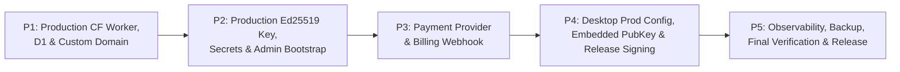

# StockStudio Pro v0.2.0: Production Readiness Roadmap

- **Produk:** StockStudio Pro (`com.stockstudiopro.desktop`)
- **Versi Target:** `v0.2.0`
- **Prasyarat Terpenuhi:** Fase `C` (Rebranding & Security Hardening), Fase `D` (License Architecture, Worker API, & Rust Client), dan Fase `E` (Cloudflare Staging Deployment & Live E2E Verification — [`v0.2.0-E-E-staging-final-assessment.md`](docs/license/v0.2.0-E-E-staging-final-assessment.md)).
- **Status Dokumen:** Rencana Eksekusi Production Preparation *(belum ada resource production yang dibuat atau dideploy)*.

---

## Urutan Tahapan Menuju Production

---

### Tahap P1: Production Cloudflare Worker, D1 Terpisah, & Custom Domain Resmi
1. **Provisioning Domain Resmi:**
   - Daftarkan domain resmi StockStudio Pro di Cloudflare DNS (mis. `license.<domain-resmi>`).
   - **Kritis (Temuan `E-C`):** Production **wajib** memakai custom domain (bukan `*.workers.dev`) agar bebas dari pemblokiran DNS ISP Indonesia (`blockpage.xlaxiata.id` dkk.).
2. **Pembuatan Database D1 Production Terpisah:**
   - Buat database baru `stockstudio-pro-licenses-prod` (`npx wrangler d1 create stockstudio-pro-licenses-prod`) — sepenuhnya terpisah dari staging (`870f9578-...`) dan lokal.
   - Tambahkan blok `[env.production]` pada `workers/license-api/wrangler.toml` dengan `name = "stockstudio-pro-license-api-prod"`, `workers_dev = false`, `routes = [{ pattern = "license.<domain-resmi>", custom_domain = true }]`, `ENVIRONMENT = "production"`, dan `LICENSE_SIGNING_KID = "sspro-ed25519-prod-01"`.
3. **Migrasi D1 Production:**
   - Terapkan `migrations/0001_initial_license_schema.sql` ke D1 production (`npx wrangler d1 migrations apply DB --env production --remote`) dan verifikasi 9 tabel bersih.

---

### Tahap P2: Production Ed25519 Signing Key, Secrets, & Admin Bootstrap
1. **Generasi Kunci & Secrets Independen Production:**
   - Buat pasangan kunci Ed25519 baru khusus production (`sspro-ed25519-prod-01`) dan 32-byte CSPRNG peppers baru (`LICENSE_KEY_PEPPER`, `ADMIN_TOKEN_PEPPER`, `IP_HASH_SALT`) yang tidak pernah dipakai di dev maupun staging.
   - Simpan backup terenkripsi *offline* (password manager / hardware vault) untuk kunci publik/metadata dan prosedur rotasi kunci (`kid` v2).
2. **Pemasangan Cloudflare Secrets Production:**
   - Unggah seluruh secret via `npx wrangler secret put <NAME> --env production`.
3. **Bootstrap Admin Production & RBAC:**
   - Seed `signing_keys` (`sspro-ed25519-prod-01`) dan minimal 2 principal terpisah di `admin_api_keys`:
     - `super_admin` (disimpan di vault pemilik produk untuk operasi darurat/audit).
     - `billing_system` (khusus otomasi penerbitan/perpanjangan lisensi).
4. **Deploy & Live Smoke Test Production:**
   - Deploy Worker dengan `npx wrangler deploy --env production`, verifikasi `GET https://license.<domain-resmi>/v1/health` (`200 OK`, TLS valid langsung dari ISP Indonesia tanpa DoH workaround).

---

### Tahap P3: Payment Provider Integration & Billing Webhook
1. **Pemilihan Payment Gateway:**
   - Pilih payment provider resmi (mis. Midtrans / Xendit untuk IDR lokal, atau LemonSqueezy / Paddle / Stripe untuk global).
2. **Implementasi Adapter Normalizer & Secret Webhook:**
   - Petakan payload provider terpilih ke `CanonicalBillingEvent` pada `POST /v1/billing/webhooks/:provider` (`payment.succeeded`, `subscription.renewed`, `payment.failed`, `subscription.canceled`, `payment.refunded`, `payment.chargeback`).
   - Pasang secret verifikasi webhook pada `BILLING_WEBHOOK_SECRETS_JSON` (`--env production`).
3. **Pengujian Sandbox Payment Gateway:**
   - Uji *end-to-end* siklus `subscription` (`monthly` & `yearly`): pembelian baru → penerbitan lisensi otomatis → perpanjangan idempoten → gagal bayar (`past_due`) → refund (`revoked`).
4. **Pengaktifan URL Pembelian di Desktop (`src/App.tsx` & `src-tauri/src/lib.rs`):**
   - Isi `LICENSE_PURCHASE_URL` (dan `TELEGRAM_CHANNEL_URL` jika tersedia) dengan URL HTTPS resmi StockStudio Pro dan daftarkan URL eksak tersebut pada `ALLOWED_EXTERNAL_URLS` di `src-tauri/src/lib.rs`.

---

### Tahap P4: Production Desktop Configuration, Updater, & Release Signing
1. **Konfigurasi Endpoint & Public Key Verifikasi Desktop (`src-tauri/src/license_store.rs`):**
   - Sematkan public key Ed25519 production (`sspro-ed25519-prod-01`, **public key 32-byte saja — bukan private key**) pada `EMBEDDED_VERIFYING_KEYS`.
   - Atur compile-time `STOCKSTUDIO_LICENSE_API_URL=https://license.<domain-resmi>` pada pipeline build release (`.github/workflows/release.yml`).
2. **Penggantian Infrastruktur Tauri Updater (`src-tauri/tauri.conf.json`):**
   - Buat pasangan kunci Minisign baru milik StockStudio Pro (`tauri signer generate`) untuk menggantikan kunci legacy Flowpilot (`key ID 9883364C90076B4B`).
   - Ganti `plugins.updater.endpoints` dari repositori Flowpilot ke repositori/CDN rilis resmi StockStudio Pro.
   - Simpan private key Minisign hanya di GitHub Actions Secrets (`TAURI_SIGNING_PRIVATE_KEY` & `TAURI_SIGNING_PRIVATE_KEY_PASSWORD`).
3. **Code Signing Windows (Disarankan):**
   - Siapkan sertifikat Authenticode Windows (EV / OV / Azure Trusted Signing) untuk installer NSIS `stockstudio-pro.exe` agar meminimalkan peringatan Windows SmartScreen.

---

### Tahap P5: Observability, Backup, & Final Release Checklist
1. **Monitoring, Backup, & Prosedur Pemulihan Production:**
   - Aktifkan Cloudflare Workers Logs / Logpush & alert untuk lonjakan `5xx` atau `429 RATE_LIMITED`.
   - Jadwalkan backup berkala Cloudflare D1 (`wrangler d1 backup` / Time Travel restore verification) dan dokumentasikan runbook rotasi `LICENSE_SIGNING_KID` serta pemulihan insiden.
2. **Pengujian Final Pra-Rilis (Menutup Sisa Batasan `E-E`):**
   - Uji live *device limit* (`2/2` → `409 DEVICE_LIMIT_REACHED`) menggunakan 2–3 PC Windows nyata.
   - Uji live *runtime C-B-B* pasca-aktivasi: HiDPI `125%`/`150%`, CSP DevTools zero-violation, rendering font `Plus Jakarta Sans` offline, upload avatar `data:`, drag-and-drop `DragPreview`, dan Google Flow WebView Sign-In (untuk memverifikasi apakah hostname OAuth Google tambahan perlu dimasukkan ke `ALLOWED_NAVIGATION_HOSTS` berdasarkan bukti debug log).
   - Uji live *offline grace* dan *clock rollback* pada binary release Windows (`stockstudio-pro.exe`).
3. **Final Go-Live Checklist:**
   - [ ] `git status` bersih, `0` secret di repository, seluruh test (`cargo test --locked`, `npm test` Worker, `npm run build`) lulus 100%.
   - [ ] Tidak ada sisa URL/pubkey/identifier Flowpilot di `src-tauri/` maupun `src/`.
   - [ ] Custom domain production HTTPS dapat diakses langsung dari jaringan ISP Indonesia (XL / Telkomsel / Indihome) dengan TLS valid.
   - [ ] Installer NSIS `v0.2.0` terverifikasi berjalan pada Windows bersih (install, aktivasi, restart, update check, uninstall).
