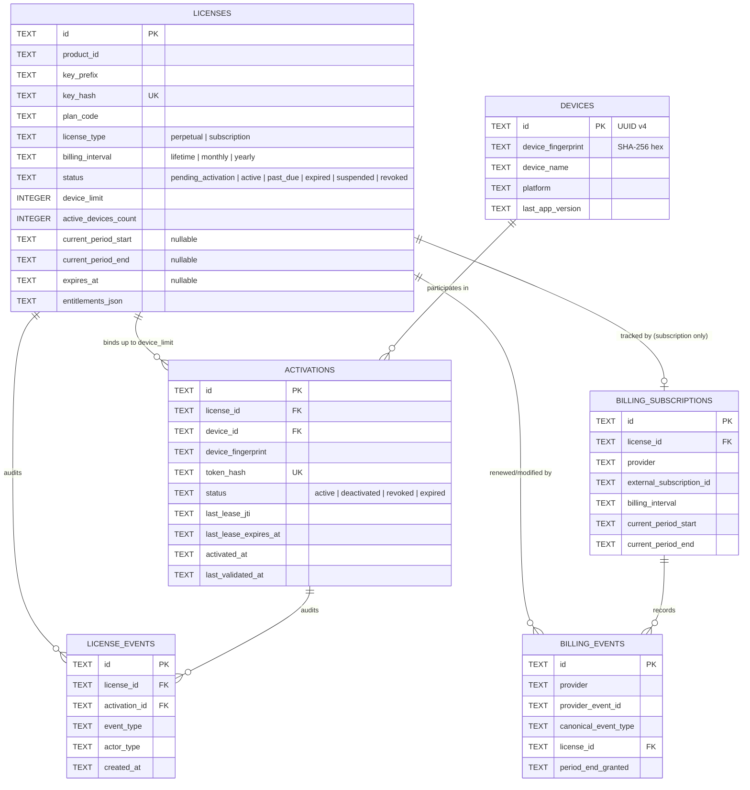
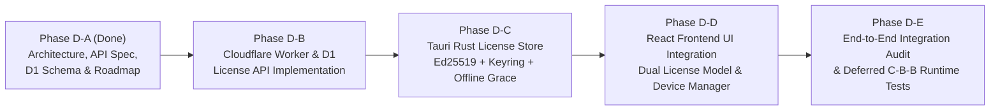

# StockStudio Pro v0.2.0-D-A: License System Implementation Roadmap

- **Produk:** StockStudio Pro (`com.stockstudiopro.desktop`)
- **Versi Target:** `v0.2.0`
- **Fase Saat Ini:** `v0.2.0-D-A` *(Completed Architecture & API Blueprint — READ-ONLY)*
- **Acuan Dokumen:**
  - [`docs/license/v0.2.0-D-A-license-architecture.md`](docs/license/v0.2.0-D-A-license-architecture.md)
  - [`docs/license/v0.2.0-D-A-api-specification.md`](docs/license/v0.2.0-D-A-api-specification.md)
  - [`docs/license/v0.2.0-D-A-database-schema.sql`](docs/license/v0.2.0-D-A-database-schema.sql)

---

## 1. Entity-Relationship Diagram (ERD) Database D1

---

## 2. Urutan Fase Implementasi (`Implementation Sequence`)

Implementasi dibagi menjadi **4 sub-fase berurutan (`D-B` s/d `D-E`)** dengan gerbang verifikasi yang jelas agar setiap lapisan dapat diuji secara terisolasi sebelum dihubungkan ke aplikasi desktop:

---

### Fase `D-B`: Cloudflare Worker & D1 Backend Implementation
**Tujuan:** Membangun service Cloudflare Worker mandiri untuk StockStudio Pro License API (`v1`) tanpa ketergantungan pada kode Flowpilot.

1. **WP-D-01 — Scaffolding Worker & Migrasi D1:**
   - Membuat direktori service terpisah (misal `services/license-api/` atau repositori/workspace terpisah sesuai instruksi) dengan `wrangler.toml`, TypeScript strict mode, dan migrasi `0001_initial_license_schema.sql` dari [`docs/license/v0.2.0-D-A-database-schema.sql`](docs/license/v0.2.0-D-A-database-schema.sql).
2. **WP-D-02 — Modul Kriptografi Server (Web Crypto API):**
   - Implementasi generator kunci lisensi `SSPRO-XXXX-XXXX-XXXX-XXXX` (CSPRNG Base32 Crockford).
   - Implementasi `HMAC-SHA256` untuk `key_hash` dan `admin_api_key` menggunakan `crypto.subtle`.
   - Implementasi penandatangan `lease_token` **Ed25519** (`crypto.subtle.sign("Ed25519", ...)`).
3. **WP-D-03 — Endpoint Publik Client (`/v1/licenses/*`):**
   - `POST /v1/licenses/activate` dengan transaksi D1 atomik (`active_devices_count < device_limit`), re-binding otomatis saat `device_fingerprint` cocok pada perangkat reinstall, dan penerbitan `activation_token` + `lease_token`.
   - `POST /v1/licenses/validate` dengan pemeriksaan transisi `expired` otomatis pada lisensi `subscription` dan pembaruan `lease_token` 7 hari.
   - `POST /v1/licenses/deactivate` dan `GET /v1/licenses/devices`.
4. **WP-D-04 — Endpoint Admin & Billing Adapter (`/v1/admin/*` & `/v1/billing/webhooks/:provider`):**
   - Implementasi RBAC middleware `admin_api_keys`.
   - Endpoint penerbitan lisensi (`perpetual` dan `subscription`), `suspend`, `reinstate`, `revoke`, `renew`, dan `force-deactivate`.
   - Implementasi normalizer `CanonicalBillingEvent` yang idempoten terhadap `billing_events`.
5. **WP-D-05 — Automated Worker Unit & Integration Tests:**
   - Pengujian otomatis menggunakan Vitest / Miniflare D1 lokal yang mencakup skenario `perpetual`, `subscription`, konkurensi `device_limit`, idempotensi webhook perpanjangan, pencabutan lisensi, dan verifikasi tanda tangan Ed25519.

---

### Fase `D-C`: Tauri Rust Client Migration (`src-tauri/src/license_store.rs`)
**Tujuan:** Mengganti client lisensi legacy di `src-tauri/src/license_store.rs` dengan implementasi StockStudio Pro v1 yang memverifikasi Ed25519 dan mendukung *offline grace period* 7 hari.

1. **WP-D-06 — Penambahan Crate Kriptografi Verifikasi:**
   - Menambahkan `ed25519-dalek = { version = "2", default-features = false, features = ["std"] }` dan `base64 = "0.22"` (serta `sha2 = "0.10"`) pada `src-tauri/Cargo.toml` (tetap mempertahankan `tauri` pada `2.11.5`).
2. **WP-D-07 — Dual-Anchored Device Identity & Hardware Fingerprint:**
   - Menyimpan `device_id` di Windows Credential Manager (`"StockStudioPro" / "device-id"`) agar tahan terhadap penghapusan `license-state.json`.
   - Membaca `MachineGuid` Windows dan menghitung `SHA-256` `device_fingerprint`.
3. **WP-D-08 — Verifikasi Lease Ed25519, Clock Rollback Guard, & Offline Grace Evaluator:**
   - Menyematkan Ed25519 Public Key StockStudio Pro (`VERIFYING_KEYS`) di `license_store.rs`.
   - Memverifikasi tanda tangan `lease_token` pada setiap respons server dan setiap pembacaan `license-state.json`.
   - Menyimpan `max_observed_utc` di Credential Manager (`"StockStudioPro" / "clock-anchor"`) untuk menolak masa tenggang offline jika jam sistem dimundurkan.
   - Mengizinkan masuk ke aplikasi selama 7 hari (`now_utc <= lease.exp`) saat terjadi kegagalan jaringan murni, namun langsung mencabut state lokal jika server mengembalikan `401`/`403` terminal.
4. **WP-D-09 — Ekspansi Tauri Commands & Unit Tests Rust:**
   - Memperbarui `activate_license`, `validate_license`, `get_license_state`, `get_device_id`, `clear_license_state`.
   - Menambahkan `deactivate_license` dan `list_license_devices` ke `tauri::generate_handler!` di `src-tauri/src/lib.rs`.
   - Menulis unit test Rust untuk verifikasi tanda tangan Ed25519, penolakan payload `license-state.json` yang dimodifikasi, deteksi clock rollback, evaluasi `perpetual` vs `subscription`, dan batas masa tenggang offline 7 hari.

---

### Fase `D-D`: React Frontend License UI Integration (`src/App.tsx`)
**Tujuan:** Menyambungkan UI aktivasi dan tab `License` di `src/App.tsx` dengan fitur dual-model (`Perpetual` & `Subscription`) serta manajemen slot perangkat.

1. **WP-D-10 — Pembaruan Layar Aktivasi & Penanganan Error Spesifik:**
   - Menampilkan pesan yang akurat untuk `DEVICE_LIMIT_REACHED`, `LICENSE_EXPIRED`, `LICENSE_SUSPENDED`, `LICENSE_REVOKED`, dan `CLOCK_ROLLBACK_DETECTED`.
   - Saat terjadi `DEVICE_LIMIT_REACHED` (`409`), menyediakan opsi bagi pengguna untuk melihat daftar perangkat aktif (`GET /v1/licenses/devices`) dan menonaktifkan perangkat lama (`POST /v1/licenses/deactivate`) langsung dari layar aktivasi.
2. **WP-D-11 — Pembaruan Tab `License` & Sidebar Status:**
   - Menampilkan `license_type` (`Perpetual` vs `Subscription`), `billing_interval` (`Lifetime`, `Monthly`, `Yearly`), tanggal perpanjangan/kedaluwarsa (`expires_at`), indikator `Offline Grace` (jika sedang offline), serta penggunaan slot perangkat (`1 of 2 Devices Active`).
   - Menambahkan tombol **Deactivate This Device** pada tab `License` / `Settings` agar pengguna dapat memindahkan lisensinya ke PC lain dengan mudah.

---

### Fase `D-E`: End-to-End Verification & Deferred C-B-B Runtime Testing
**Tujuan:** Setelah License API StockStudio Pro berjalan (baik di staging/local Worker maupun production Worker), menuntaskan seluruh pengujian runtime yang sebelumnya tertunda karena ketiadaan License API.

1. **WP-D-12 — End-to-End License Lifecycle Test:**
   - Uji aktivasi kunci `perpetual` dan kunci `subscription` (`monthly` & `yearly`).
   - Uji batas `device_limit` (`409 DEVICE_LIMIT_REACHED`) dan pelepasan slot melalui `deactivate_license`.
   - Uji mode *offline grace period* (mematikan jaringan setelah aktivasi dan memastikan aplikasi tetap terbuka; memundurkan jam sistem dan memastikan aplikasi mendeteksi rollback).
   - Uji pencabutan (`revoke`) dan pembekuan (`suspend`) dari endpoint admin serta memastikan desktop client langsung kembali ke layar aktivasi saat `validate_license`.
2. **WP-D-13 — Eksekusi Runtime Test `v0.2.0-C-B-B` yang Tertunda:**
   - Menjalankan seluruh 4 kelompok runtime test yang didokumentasikan pada [`docs/audit/v0.2.0-C-B-B-5-final-integration-audit.md`](docs/audit/v0.2.0-C-B-B-5-final-integration-audit.md#L156-L176):
     1. Transisi ukuran jendela `expand_main_window` (`540x620` → `1280x800` `LogicalSize`) pada monitor HiDPI.
     2. Verifikasi CSP runtime di DevTools WebView2, rendering font `Plus Jakarta Sans` offline, upload avatar `data:image/...`, dan `DragPreview` kartu akun.
     3. Verifikasi `open_external_url` (`tauri-plugin-opener`).
     4. Verifikasi Google Flow child WebView (`FlowShell`) dan observasi log navigasi OAuth Google Sign-In.

---

## 3. Informasi Esensial yang Diperlukan Sebelum Deployment Produksi (`Essential Inputs Needed Later`)

Seluruh pilihan teknis rutin telah ditetapkan dengan nilai default yang aman di dalam blueprint ini. Sebelum melakukan deployment ke lingkungan **produksi** pada fase `D-B` / `D-C`, hanya 3 informasi eksternal berikut yang perlu dikonfirmasi oleh pemilik produk:

1. **Domain Produksi License API (`STOCKSTUDIO_LICENSE_API_URL`):**
   - Contoh: `https://license.stockstudiopro.com` atau subdomain resmi milik StockStudio Pro. *(Untuk pengembangan dan pengujian lokal di fase `D-B`/`D-C`, kita dapat menggunakan `http://127.0.0.1:8787` pada mode dev atau subdomain `.workers.dev` staging baru milik StockStudio Pro).*
2. **Katalog Harga & Plan Resmi untuk Ditampilkan di Tab `License` (`src/App.tsx`):**
   - Saat ini `src/App.tsx` menampilkan 3 kartu: `30 Days` (`pro_monthly`), `1 Year` (`pro_yearly`), dan `Lifetime` (`lifetime`) dengan default `device_limit = 2`. Konfirmasi apakah kuota default `2` perangkat per lisensi sudah sesuai atau berbeda per tier (misal `Monthly = 1`, `Yearly = 2`, `Lifetime = 3`).
3. **URL Pembelian Resmi (`LICENSE_PURCHASE_URL`) & Payment Provider Pilihan (Ketika Siap):**
   - Karena lapisan billing sudah dirancang *provider-independent*, implementasi core License API (`D-B`) dan Rust client (`D-C`) **tidak terblokir** oleh pemilihan payment gateway dan dapat langsung dikerjakan menggunakan Admin Issuance API (`/v1/admin/licenses`).
