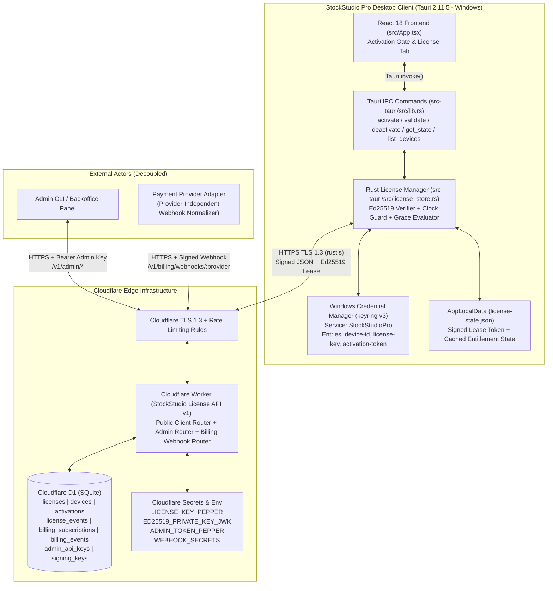
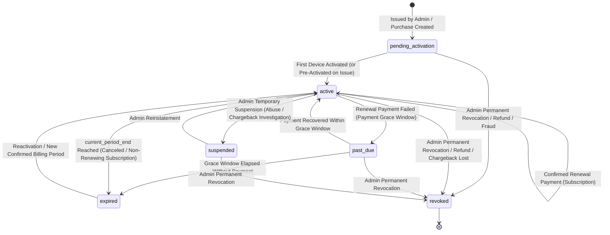
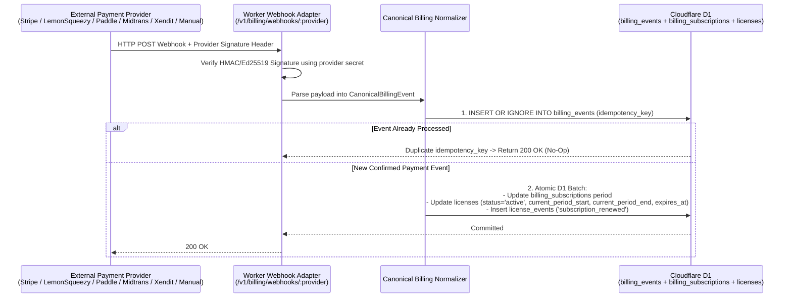
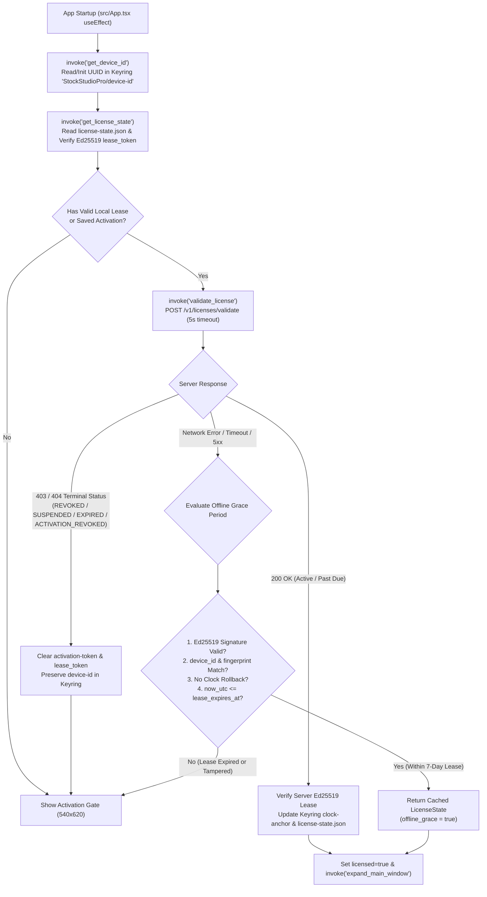

# StockStudio Pro v0.2.0-D-A: License System Architecture Blueprint

- **Produk:** StockStudio Pro (`com.stockstudiopro.desktop`)
- **Versi Target:** `v0.2.0`
- **Fase:** `v0.2.0-D-A` — *License System Architecture & API Blueprint (READ-ONLY)*
- **Baseline Git:** Branch `main` | Commit `a949639f2aa4a0f5d0206c28069a02ebed913915` (`feat: harden security and integrate self-hosted fonts`)
- **Target Backend:** Cloudflare Workers + Cloudflare D1 + Cloudflare Secrets (HTTPS REST API)
- **Target Desktop Client:** Tauri 2.11.5 (Rust backend + Windows Credential Manager via `keyring` v3 + React 18 / TypeScript frontend)

> [!IMPORTANT]
> **Isolasi Penuh dari Infrastruktur Legacy Flowpilot:**
> Arsitektur ini dirancang dari nol khusus untuk **StockStudio Pro**. Seluruh endpoint, database, kredensial, signing key, dan product identifier milik Flowpilot (`https://flowpilot-license-server.frangga-snow.workers.dev`) **dilarang digunakan**. Sampai domain produksi resmi disediakan oleh pemilik produk, konfigurasi menggunakan placeholder terkonfigurasi `https://license-api.stockstudiopro.invalid` (atau environment override `STOCKSTUDIO_LICENSE_API_URL`).

---

## 1. Analisis Kompatibilitas Codebase Saat Ini (`Existing Project Compatibility`)

Hasil inspeksi menyeluruh terhadap repositori pada commit `a949639f2aa4a0f5d0206c28069a02ebed913915`:

### 1.1 Inventaris Implementasi Lisensi Saat Ini

| Area | File & Baris | Implementasi Saat Ini | Ketergantungan Legacy / Kelemahan |
|---|---|---|---|
| **API Endpoint** | [`src-tauri/src/license_store.rs`](file:///e:/2.%20Microstock/TOOL/flowpilot-main/flowpilot-main/src-tauri/src/license_store.rs#L7) | `const API: &str = "https://flowpilot-license-server.frangga-snow.workers.dev";` | Masih menunjuk ke Cloudflare Worker milik Flowpilot (`/license/activate` dan `/license/validate`). |
| **Local State Schema** | [`src-tauri/src/license_store.rs`](file:///e:/2.%20Microstock/TOOL/flowpilot-main/flowpilot-main/src-tauri/src/license_store.rs#L9-L17) | `LicenseState { plan, status, expires_at, lifetime, last_validated_at, device_id }` disimpan sebagai plaintext JSON di `%LOCALAPPDATA%\com.stockstudiopro.desktop\license-state.json`. | Plaintext JSON tidak ditandatangani (mudah dimodifikasi lokal jika dijadikan sumber kebenaran), belum membedakan `license_type` (`perpetual` vs `subscription`) dan `billing_interval` (`lifetime`, `monthly`, `yearly`), serta belum memiliki *signed lease token* untuk masa tenggang offline (*offline grace period*). |
| **Credential Manager** | [`src-tauri/src/license_store.rs`](file:///e:/2.%20Microstock/TOOL/flowpilot-main/flowpilot-main/src-tauri/src/license_store.rs#L49-L51) | `Entry::new("StockStudioPro", "license-key")` via crate `keyring = { version = "3", features = ["windows-native"] }`. | Sudah direbranding ke service `"StockStudioPro"`. Namun saat ini hanya menyimpan raw `license-key` dan belum menyimpan `device_id` atau `activation_token` di Credential Manager. |
| **Device ID Generation** | [`src-tauri/src/license_store.rs`](file:///e:/2.%20Microstock/TOOL/flowpilot-main/flowpilot-main/src-tauri/src/license_store.rs#L52-L67) | Membuat `Uuid::new_v4()` dan menyimpannya hanya di `license-state.json`. | Jika `license-state.json` terhapus atau `clear_license_state` dipanggil (baris 139-145 menghapus seluruh file `license-state.json`), `device_id` ikut hilang dan menghasilkan UUID baru, yang dapat menghabiskan kuota slot perangkat (*device limit*) pengguna. |
| **Tauri Commands** | [`src-tauri/src/lib.rs`](file:///e:/2.%20Microstock/TOOL/flowpilot-main/flowpilot-main/src-tauri/src/lib.rs#L205-L209) | `get_device_id`, `get_license_state`, `activate_license`, `validate_license`, `clear_license_state`. | Belum memiliki command `deactivate_license` dan `list_license_devices` untuk manajemen slot perangkat mandiri oleh pengguna. |
| **Frontend Gate & UI** | [`src/App.tsx`](file:///e:/2.%20Microstock/TOOL/flowpilot-main/flowpilot-main/src/App.tsx#L20-L46), [`src/App.tsx`](file:///e:/2.%20Microstock/TOOL/flowpilot-main/flowpilot-main/src/App.tsx#L93), [`src/App.tsx`](file:///e:/2.%20Microstock/TOOL/flowpilot-main/flowpilot-main/src/App.tsx#L300-L356), [`src/App.tsx`](file:///e:/2.%20Microstock/TOOL/flowpilot-main/flowpilot-main/src/App.tsx#L638-L674) | Saat startup memanggil `get_device_id` → `get_license_state` → `validate_license` → `expand_main_window`. Jika `validate_license` gagal (termasuk saat offline), pengguna langsung terkunci di layar aktivasi (`!licensed`). | Tidak ada fallback *offline grace period*; belum menampilkan informasi `license_type` (`Perpetual` / `Subscription`), `billing_interval`, kuota perangkat (`devices_used / device_limit`), maupun tombol `Deactivate This Device`. |
| **Rust Crate Dependencies** | [`src-tauri/Cargo.toml`](file:///e:/2.%20Microstock/TOOL/flowpilot-main/flowpilot-main/src-tauri/Cargo.toml#L13-L24) | Memiliki `reqwest 0.12` (`json`, `rustls-tls`), `keyring 3` (`windows-native`), `uuid 1` (`v4`), `chrono 0.4`, `serde`, `serde_json`. | Belum memiliki crate verifikasi tanda tangan kriptografi (`ed25519-dalek` + `base64`) untuk memverifikasi *signed entitlement lease* dari server secara offline. |

### 1.2 Poin Penggantian & Migrasi Wajib (`Migration & Replacement Points`)

1. **Penggantian Endpoint & Path API:**
   - Ganti `const API` di `src-tauri/src/license_store.rs` dari URL Flowpilot ke endpoint v1 StockStudio Pro (`/v1/licenses/activate`, `/v1/licenses/validate`, `/v1/licenses/deactivate`, `/v1/licenses/devices`).
2. **Kompatibilitas Mundur (`Backward Compatibility`) ke Frontend (`src/App.tsx`):**
   - Pertahankan field yang sudah dikonsumsi `src/App.tsx` (`plan`, `status`, `expires_at`, `lifetime`, `last_validated_at`, `device_id`) sambil memperluas `LicenseState` dengan field baru (`license_type`, `billing_interval`, `current_period_start`, `current_period_end`, `cancel_at_period_end`, `device_limit`, `devices_used`, `entitlements`, `offline_grace_until`, `lease_valid`).
   - Dengan demikian, `licensePlanLabel`, `licenseStatusLabel`, dan `licenseExpiryLabel` di `src/App.tsx` tetap berfungsi tanpa merusak layout yang sudah ada.
3. **Pembersihan State Legacy:**
   - Karena StockStudio Pro v0.2.0 menggunakan profil data baru (`com.stockstudiopro.desktop`) dan keyring service baru (`StockStudioPro`), tidak ada lisensi Flowpilot yang valid untuk StockStudio Pro. Jika ditemukan file `license-state.json` tanpa `lease_token` versi `v1` (misalnya sisa percobaan sebelum API aktif), client otomatis meminta aktivasi ulang yang bersih sambil mempertahankan `device_id` yang sudah ada.

---

## 2. Arsitektur Sistem End-to-End

### 2.1 Diagram Arsitektur Komponen



---

## 3. Model Lisensi Ganda (`Perpetual` & `Subscription`)

Arsitektur ini mendukung **dua model lisensi utama** secara native dalam satu skema terpadu sejak hari pertama:

### 3.1 Perbandingan Model `Perpetual` vs `Subscription`

| Atribut | Model 1: `PERPETUAL` (Lifetime) | Model 2: `SUBSCRIPTION` (Berlangganan) |
|---|---|---|
| **`license_type`** | `"perpetual"` | `"subscription"` |
| **`billing_interval`** | `"lifetime"` | `"monthly"` \| `"yearly"` |
| **`plan_code` (contoh)** | `"lifetime"` | `"pro_monthly"`, `"pro_yearly"` (serta mendukung `"trial_7d"` / `"pass_30d"` jika diperlukan) |
| **`expires_at`** | `NULL` (tidak memiliki tanggal kedaluwarsa lisensi) | Timestamp ISO-8601 UTC (`NOT NULL`), wajib sama dengan `current_period_end` |
| **`current_period_start` / `end`** | `NULL` / `NULL` | Timestamp ISO-8601 UTC awal & akhir periode tagihan aktif |
| **Masa Berlaku** | Berlaku selamanya selama `status = 'active'` (hingga di-`suspended` atau `revoked` oleh admin). | Berlaku selama `status IN ('active', 'past_due')` dan waktu server $\le$ `expires_at` (atau dalam `grace_until`). |
| **Perpanjangan (`Renewal`)** | Tidak berlaku (opsional: `updates_until` terpisah untuk pembatasan versi mayor di masa depan). | **Hanya** dapat diperpanjang oleh event pembayaran terkonfirmasi (`payment.succeeded` / `invoice.paid`) melalui *Billing Integration Layer* atau tindakan eksplisit Admin dengan audit trail. |
| **Batas Perangkat (`device_limit`)** | Dikonfigurasi per lisensi (default: `2` perangkat aktif bersamaan). | Dikonfigurasi per lisensi (default: `2` perangkat aktif bersamaan). |
| **Update Entitlement** | `max_major_version` / `updates_expires_at` (`NULL` = semua update v0.x/v1.x termasuk). | Termasuk seluruh update aplikasi selama langganan aktif. |

### 3.2 Siklus Hidup Status Lisensi (`License Status State Machine`)



**Definisi Status Resmi:**
1. `pending_activation`: Lisensi telah diterbitkan tetapi belum pernah diaktifkan pada perangkat mana pun (atau periode dimulai saat aktivasi pertama).
2. `active`: Lisensi sah dan berhak digunakan oleh perangkat yang terikat.
3. `past_due`: Khusus `subscription` — pembayaran perpanjangan gagal, tetapi pengguna masih berada dalam masa tenggang pembayaran server (*billing retry window*, default 3 hari) sebelum diputus menjadi `expired`.
4. `expired`: Khusus `subscription` — masa aktif (`expires_at`) telah lewat tanpa pembayaran perpanjangan yang terkonfirmasi.
5. `suspended`: Dibekukan sementara oleh administrator (misal indikasi sharing kunci berlebihan atau investigasi sengketa). Dapat dipulihkan ke `active`.
6. `revoked`: Dicabut secara permanen (refund, chargeback, pembajakan). Tidak dapat diaktifkan atau divalidasi kembali.

---

## 4. Lapisan Integrasi Billing Independen (`Payment-Provider-Independent Billing Layer`)

Sesuai persyaratan, kita **tidak mengasumsikan payment gateway tertentu** telah dipilih. Arsitektur memisahkan **License Entitlement Engine** dari **Payment Provider Adapter**:



### Prinsip Desain Lapisan Billing:
1. **Entitas Terpisah:** Tabel `licenses` menyimpan *entitlement* (hak pakai aplikasi), sedangkan `billing_subscriptions` dan `billing_events` menyimpan referensi eksternal (`provider_name`, `external_customer_id`, `external_subscription_id`, `external_invoice_id`, `idempotency_key`).
2. **Idempotensi Mutlak:** Setiap event pembayaran wajib memiliki `(provider, provider_event_id)` unik di `billing_events`. Pengiriman ulang webhook yang sama tidak akan pernah menggandakan masa aktif langganan.
3. **Aturan Perpanjangan Ketat:** Hanya event kanonis bertipe `BILLING_PAYMENT_CONFIRMED` (`checkout.completed` / `invoice.paid`) yang boleh memajukan `current_period_end` dan `expires_at` pada lisensi bertipe `subscription`. Event `invoice.created` atau `payment.pending` tidak mengubah `expires_at`.

---

## 5. Keputusan Arsitektur Utama (`Key Architecture Decisions`)

### ADR-01: Format Kunci Lisensi & Penyimpanan Hash di Database (`License Key Format & Hashing at Rest`)
- **Format Kunci Pengguna:** `SSPRO-XXXX-XXXX-XXXX-XXXX` (awalan `SSPRO-` diikuti 4 grup × 4 karakter Base32 Crockford tanpa karakter ambigu `I, L, O, U`, menghasilkan $\approx 80\text{ bit}$ entropi kriptografis dari CSPRNG).
- **Penyimpanan di D1 (`Zero Plaintext Key at Rest`):**
  - Server **tidak pernah** menyimpan kunci lisensi secara utuh dalam plaintext.
  - Database hanya menyimpan:
    - `key_prefix`: 10 karakter pertama setelah normalisasi (misal `SSPRO-A9F3`) untuk kemudahan identifikasi oleh admin/dukungan pelanggan.
    - `key_hash`: `HMAC-SHA256(LICENSE_KEY_PEPPER, normalized_key)` dalam format hex lowercase (64 karakter), di mana `LICENSE_KEY_PEPPER` disimpan eksklusif di **Cloudflare Secrets** (32-byte high-entropy secret).
    - `key_pepper_version`: Integer versi pepper (default `1`) untuk mendukung rotasi secret pepper di masa depan.

### ADR-02: Model Signed Short-Lived License Entitlement Lease (`Ed25519 Offline Lease Token`)
- **Masalah:** Desktop client membutuhkan kemampuan *offline grace period* ketika pengguna kehilangan koneksi internet atau saat Worker sedang maintenance, tetapi aplikasi desktop tidak boleh mempercayai file JSON plaintext (`license-state.json`) yang mudah diedit pengguna, dan **tidak boleh** menyimpan private/symmetric signing key server di dalam binary aplikasi.
- **Keputusan:** Menggunakan **Asymmetric Ed25519 Signed Lease Token** (format JWS ringkas `v1.<base64url_payload>.<base64url_ed25519_signature>`):
  - **Cloudflare Worker** menandatangani payload entitlement menggunakan **Ed25519 Private Key** yang tersimpan di Cloudflare Secrets (`LICENSE_SIGNING_PRIVATE_KEY_JWK`, dengan `kid` mis. `"sspro-ed25519-2026-01"`).
  - **Rust Desktop Client (`src-tauri`)** hanya menyematkan **Ed25519 Public Key** (daftar `[kid -> 32-byte public key]` untuk mendukung rotasi kunci). Bahkan jika binary aplikasi di-reverse-engineer, penyerang hanya mendapatkan *public key* dan tidak dapat memalsukan tanda tangan server.
- **Masa Berlaku Lease vs Masa Berlaku Lisensi:**
  - Setiap kali `/v1/licenses/activate` atau `/v1/licenses/validate` sukses, server menerbitkan `lease_token` dengan:
    - `issued_at` (`iat`): Waktu server saat ini.
    - `lease_expires_at` (`exp`):
      - Untuk `perpetual`: `min(server_now + 7 hari)` (karena `expires_at` adalah `null`).
      - Untuk `subscription`: `min(server_now + 7 hari, license.expires_at)`.
  - Artinya, masa tenggang offline tidak pernah melebihi tanggal kedaluwarsa langganan (`expires_at`).

### ADR-03: Strategi Identitas Perangkat yang Aman & Tahan Reinstall (`Secure Device Identity Strategy`)
- **Kelemahan Saat Ini:** `device_id` hanya disimpan di `license-state.json`. Jika file tersebut dihapus, UUID perangkat hilang.
- **Keputusan Dua-Lapis (`Dual-Anchored Device Identity`):**
  1. **Install-Persistent `device_id` (UUID v4):**
     - Saat pertama kali dijalankan, Rust memeriksa Windows Credential Manager pada service `"StockStudioPro"`, akun `"device-id"`.
     - Jika belum ada (atau di `license-state.json` sudah ada dari sesi sebelumnya), Rust menyimpannya ke Windows Credential Manager (`"StockStudioPro" / "device-id"`) **dan** mencerminkannya ke `license-state.json`.
     - `clear_license_state` hanya menghapus `"license-key"`, `"activation-token"`, dan state lisensi, tetapi **tidak pernah menghapus** `"device-id"` dari Credential Manager. Dengan demikian, aktivasi ulang pada PC yang sama selalu mengenali perangkat yang sama.
  2. **Deterministic Hardware Fingerprint Hash (`device_fingerprint`):**
     - Rust membaca `MachineGuid` Windows dari registry `HKEY_LOCAL_MACHINE\SOFTWARE\Microsoft\Cryptography\MachineGuid` (read-only, tanpa membutuhkan hak Administrator) dan menghitung `SHA-256("StockStudioPro:v1:device-fp:" + machine_guid + ":" + os_arch)`.
     - Saat memanggil `/v1/licenses/activate`, client mengirimkan `device_id` (UUID) beserta `device_fingerprint` (hash SHA-256 satu arah, bukan data pribadi mentah), `device_name` (hostname yang disanitasi), `platform` (`"windows"`), dan `app_version` (`"0.2.0"`).
  3. **Penanganan Reinstall OS / Kehilangan Credential Manager (`Safe Reinstall Recovery`):**
     - Jika pengguna menginstal ulang aplikasi atau profil lokalnya terhapus sehingga `device_id` baru terbuat, namun `device_fingerprint` cocok dengan salah satu aktivasi aktif pada lisensi yang sama, server secara otomatis melakukan **Idempotent Device Re-bind** (menggantikan slot aktivasi perangkat tersebut tanpa menambah jumlah `active_devices_count`).
     - Jika pengguna mengganti PC atau menginstal ulang Windows secara total (sehingga `MachineGuid` juga berubah), pengguna atau admin dapat menonaktifkan perangkat lama melalui endpoint `GET /v1/licenses/devices` + `POST /v1/licenses/deactivate` (menggunakan `license_key` sebagai bukti kepemilikan) atau melalui portal/admin.

### ADR-04: Masa Tenggang Offline & Perlindungan Manipulasi Jam (`Offline Grace Period & Clock Tampering Protection`)
- **Kebijakan Masa Tenggang Offline (`Offline Grace Period`):**
  - **Durasi:** **7 hari (168 jam)** sejak `last_validated_at` (`lease.issued_at`), dipotong oleh `license.expires_at` untuk lisensi `subscription`.
  - **Jadwal Validasi Online:**
    - Saat aplikasi dibuka (*startup*): mencoba `validate_license` ke server dengan timeout singkat (`5 detik`).
    - Selama aplikasi berjalan: melakukan *background heartbeat validation* setiap **12 jam**.
  - **Perilaku Saat Offline / Server Gangguan:**
    - Jika `validate_license` gagal karena kesalahan jaringan (`reqwest` timeout / DNS / 5xx server error), Rust **tidak langsung mengunci pengguna**.
    - Rust memverifikasi tanda tangan Ed25519 pada `lease_token` lokal di `license-state.json`.
    - Jika tanda tangan valid, `device_id` cocok, `device_fingerprint` cocok, dan waktu saat ini masih berada dalam `lease_expires_at` (7 hari), aplikasi tetap masuk ke dashboard dalam mode `active (offline_grace)`.
    - Jika server merespons secara eksplisit dengan status penolakan otoritatif (`403 LICENSE_REVOKED`, `403 LICENSE_SUSPENDED`, `403 LICENSE_EXPIRED`, `403 ACTIVATION_REVOKED`), maka cache lokal **langsung dibatalkan** dan aplikasi kembali ke layar aktivasi.
- **Perlindungan Manipulasi Jam Sistem (`Clock Rollback Detection`):**
  - Setiap kali validasi online berhasil atau aplikasi berjalan, Rust mencatat `max_observed_utc` di dalam state yang disimpan di Windows Credential Manager (`"StockStudioPro" / "clock-anchor"`).
  - Saat evaluasi offline:
    - Jika `system_now_utc + 5 menit < lease.issued_at` ATAU `system_now_utc + 5 menit < max_observed_utc`, Rust mendeteksi adanya **manipulasi mundur jam sistem (`CLOCK_ROLLBACK_DETECTED`)**.
    - Dalam kondisi `CLOCK_ROLLBACK_DETECTED`, masa tenggang offline **ditolak** dan client wajib melakukan validasi online ke server untuk menyinkronkan waktu otoritatif.

### ADR-05: Aktivasi Perangkat Atomik Tanpa Melebihi Batas (`Atomic Device Limit Enforcement`)
- **Masalah:** Jika dua perangkat mengirim `POST /v1/licenses/activate` secara bersamaan pada lisensi dengan `device_limit = 2` (saat 1 perangkat sudah aktif), pendekatan *read-then-insert* biasa di aplikasi dapat mengalami *race condition* dan meloloskan 3 perangkat aktif.
- **Keputusan di Cloudflare D1 (SQLite):**
  1. **Idempotent Fast-Path:** Cek apakah `(license_id, device_id)` atau `(license_id, device_fingerprint)` sudah berstatus `active`. Jika sudah, perbarui `last_seen_at`, rotasi/perbarui `lease_token`, dan kembalikan `200 OK` tanpa menambah slot.
  2. **Atomic Conditional Insert + Counter Update dalam `db.batch([...])`:**
     - Gunakan kolom penghitung denormalisasi terindeks `active_devices_count` pada tabel `licenses` yang dijaga konsistensinya, ATAU pernyataan SQL atomik bersyarat:
       ```sql
       UPDATE licenses
       SET active_devices_count = active_devices_count + 1,
           status = CASE WHEN status = 'pending_activation' THEN 'active' ELSE status END,
           activated_at = COALESCE(activated_at, ?2),
           updated_at = ?2
       WHERE id = ?1
         AND status IN ('pending_activation', 'active', 'past_due')
         AND (expires_at IS NULL OR expires_at > ?2)
         AND active_devices_count < device_limit;
       ```
     - Di Cloudflare D1, pemeriksaan `meta.changes === 1` pada `UPDATE` di atas bersifat **100% atomik** karena D1 mengeksekusi query pada instance SQLite tunggal secara serial per database. Jika `meta.changes === 0`, Worker memeriksa apakah karena status/expired atau karena `active_devices_count >= device_limit` (`409 DEVICE_LIMIT_REACHED`), dan membatalkan penyisipan `activations`.

---

## 6. Model Keamanan Menyeluruh (`Comprehensive Security Model`)

| Ancaman / Kebutuhan | Kontrol Keamanan yang Diterapkan |
|---|---|
| **1. License Key Hashing at Rest** | Kunci lisensi tidak pernah disimpan plaintext di D1. Hanya `key_prefix` (`SSPRO-XXXX`) dan `HMAC-SHA256(LICENSE_KEY_PEPPER, canonical_key)` yang disimpan. |
| **2. Rate Limiting** | Tiga lapis pembatasan laju: (a) Cloudflare WAF Rate Limiting per IP pada `/v1/licenses/*`; (b) Worker Rate Limiter berbasis IP (`20 req / menit` untuk `activate`, `60 req / menit` untuk `validate`); (c) Lockout berbasis `key_prefix` setelah 10 percobaan aktivasi gagal berturut-turut dalam 15 menit (`429 RATE_LIMITED`). |
| **3. Device Binding & Session Auth** | Saat aktivasi berhasil, server mengeluarkan `activation_token` acak 256-bit (`ssact_<base64url>`) yang di-hash dengan SHA-256 di tabel `activations` (`token_hash`) dan disimpan oleh desktop client di Windows Credential Manager (`"StockStudioPro" / "activation-token"`). Semua panggilan `validate` dan `deactivate` menggunakan `activation_token` + `device_id` + `device_fingerprint` sehingga client tidak perlu terus-menerus mengirimkan raw `license_key` melalui jaringan. |
| **4. Replay Prevention** | Setiap request client menyertakan header `X-Request-Timestamp` (epoch detik UTC) dan `X-Request-Nonce` (UUID v4). Server menolak request dengan selisih waktu $> 300\text{ detik}$ dari jam server (`400 CLOCK_SKEW_TOO_LARGE`). Setiap `lease_token` yang ditandatangani server menyertakan `jti` unik, `iat`, `exp`, `license_id`, `activation_id`, `device_id`, dan `device_fingerprint`. |
| **5. Signed License Responses** | Seluruh respons `activate` dan `validate` menyertakan objek `lease` dan `lease_token` yang ditandatangani dengan **Ed25519** (`kid` + tanda tangan 64-byte atas payload kanonis). Rust memverifikasi tanda tangan ini sebelum menyimpan atau mempercayai respons. |
| **6. Never Embed Server Secrets** | Desktop client **hanya** berisi 32-byte Ed25519 **Public Key** (`VERIFYING_KEYS`). Private key Ed25519, `LICENSE_KEY_PEPPER`, `ADMIN_TOKEN_PEPPER`, dan webhook secret disimpan eksklusif di **Cloudflare Secrets** (`wrangler secret put`). |
| **7. Client Is Not Authority** | Status lisensi otoritatif berada di Cloudflare D1. Desktop client hanya mengevaluasi `lease_token` bertanda tangan Ed25519 hingga batas waktu `lease_expires_at` maksimal 7 hari. |
| **8. TLS-Only Communication** | Desktop client menggunakan `reqwest` dengan `rustls-tls` dan menolak URL non-HTTPS. Worker menerapkan `Strict-Transport-Security: max-age=63072000; includeSubDomains; preload` dan menolak request HTTP non-TLS. |
| **9. Admin Authorization** | Endpoint `/v1/admin/*` dilindungi dengan Bearer token berformat `ssadm_<id>_<secret>` yang diverifikasi terhadap tabel `admin_api_keys` menggunakan `HMAC-SHA256(ADMIN_TOKEN_PEPPER, secret)` dengan perbandingan waktu konstan (`crypto.subtle.timingSafeEqual`), dilengkapi RBAC (`super_admin`, `support_admin`, `billing_system`, `read_only`) dan audit log wajib di `license_events`. |
| **10. Key Rotation** | Tabel `signing_keys` dan payload `lease` menyertakan `kid` (Key ID). Desktop client mendukung array konstanta `[Ed25519PublicKey; N]` sehingga kunci baru dapat digulirkan tanpa memutus client yang sudah terinstal. Pepper HMAC juga mendukung kolom `key_pepper_version`. |

---

## 7. Arsitektur Penyimpanan Lokal di Desktop Client (`Rust + Keyring + AppLocalData`)

### 7.1 Pemisahan Penyimpanan Sensitif vs Non-Sensitif

1. **Windows Credential Manager (`keyring` service `"StockStudioPro"`):**
   - `"device-id"`: UUID v4 unik perangkat yang bertahan melintasi reset state lisensi.
   - `"activation-token"`: Token sesi aktivasi perangkat (`ssact_...`) untuk autentikasi `/v1/licenses/validate` dan `/v1/licenses/deactivate`.
   - `"license-key"`: Kunci lisensi yang dinormalisasi (disimpan sebagai cadangan untuk pemulihan re-aktivasi otomatis dan manajemen perangkat mandiri).
   - `"clock-anchor"`: Timestamp UTC tertinggi yang pernah diamati (`max_observed_utc`) untuk mendeteksi rollback jam sistem.
2. **File `%LOCALAPPDATA%\com.stockstudiopro.desktop\license-state.json`:**
   - Menyimpan metadata UI non-rahasia beserta `lease_token` bertanda tangan Ed25519.
   - Jika pengguna memodifikasi `plan: "lifetime"` atau `expires_at` di dalam `license-state.json`, Rust akan menolak state tersebut karena Rust mem-parsing dan memverifikasi tanda tangan Ed25519 langsung dari `lease_token` setiap kali `get_license_state` atau evaluasi offline dijalankan.

### 7.2 Alur Startup & Validasi Desktop Client (`Online + Offline Grace Fallback`)



---

## 8. Strategi Migrasi dari Client Flowpilot Saat Ini (`Client Migration Strategy`)

Untuk menjaga arsitektur aplikasi yang sudah stabil di `v0.2.0-C-B-B`, perubahan pada desktop client dilakukan secara modular pada fase implementasi berikutnya (`D-B` / `D-C`):

1. **Pertahankan Kontrak Tauri Command yang Ada di `src-tauri/src/lib.rs`:**
   - `get_device_id` -> tetap mengembalikan `Result<String, String>`, namun di-anchor ke Windows Credential Manager (`"StockStudioPro" / "device-id"`).
   - `get_license_state` -> tetap mengembalikan `Result<Option<LicenseState>, String>`, namun memvalidasi integritas `lease_token` Ed25519 sebelum mengembalikan state.
   - `activate_license` -> memanggil `POST /v1/licenses/activate`, memverifikasi `lease_token` Ed25519, menyimpan `activation_token` dan `license_key` di Credential Manager, serta menyimpan `license-state.json`.
   - `validate_license` -> memanggil `POST /v1/licenses/validate` menggunakan `activation_token` (dengan fallback `license_key`), memperbarui `lease_token`, dan menerapkan fallback *offline grace period* 7 hari apabila jaringan tidak tersedia.
   - `clear_license_state` -> menghapus kredensial lisensi tanpa menghapus `"device-id"`.
2. **Tambahkan 2 Tauri Command Baru:**
   - `deactivate_license(target_activation_id: Option<String>) -> Result<(), String>`: menonaktifkan perangkat saat ini (atau perangkat lain milik lisensi yang sama) melalui `POST /v1/licenses/deactivate`.
   - `list_license_devices() -> Result<LicenseDevicesResponse, String>`: mengambil daftar perangkat aktif pada lisensi pengguna melalui `GET /v1/licenses/devices`.
3. **Struktur `LicenseState` yang Kompatibel Mundur (`Backward-Compatible Struct`):**
   ```rust
   #[derive(Clone, Debug, Default, Serialize, Deserialize)]
   pub struct LicenseState {
       // Existing fields consumed by src/App.tsx
       pub plan: String,
       pub status: String,
       pub expires_at: Option<String>,
       pub lifetime: bool,
       pub last_validated_at: String,
       pub device_id: String,

       // Extended v0.2.0 StockStudio Pro fields
       pub license_id: String,
       pub activation_id: String,
       pub license_type: String,          // "perpetual" | "subscription"
       pub billing_interval: String,      // "lifetime" | "monthly" | "yearly"
       pub current_period_start: Option<String>,
       pub current_period_end: Option<String>,
       pub cancel_at_period_end: bool,
       pub device_limit: u32,
       pub devices_used: u32,
       pub offline_grace_until: String,
       pub is_offline_grace: bool,
       pub lease_token: String,
   }
   ```
   Dengan struktur ini, kode UI yang sudah ada di `src/App.tsx` (`licensePlanLabel`, `licenseStatusLabel`, `licenseExpiryLabel`) langsung kompatibel 100% tanpa regresi.

---

## 9. Referensi Dokumen Pendamping

- **Spesifikasi REST API Lengkap:** [`docs/license/v0.2.0-D-A-api-specification.md`](file:///e:/2.%20Microstock/TOOL/flowpilot-main/flowpilot-main/docs/license/v0.2.0-D-A-api-specification.md)
- **Skema Database Cloudflare D1 (SQL):** [`docs/license/v0.2.0-D-A-database-schema.sql`](file:///e:/2.%20Microstock/TOOL/flowpilot-main/flowpilot-main/docs/license/v0.2.0-D-A-database-schema.sql)
- **Roadmap Implementasi & Pengujian:** [`docs/license/v0.2.0-D-A-implementation-roadmap.md`](file:///e:/2.%20Microstock/TOOL/flowpilot-main/flowpilot-main/docs/license/v0.2.0-D-A-implementation-roadmap.md)
