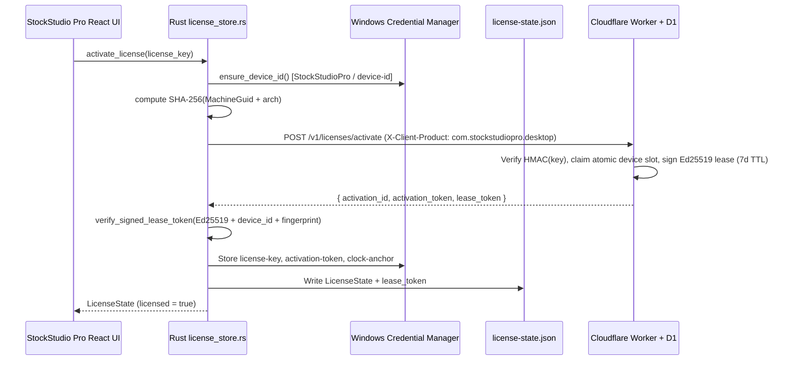
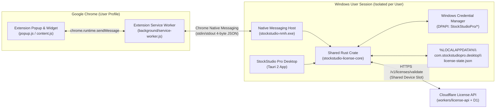

# TASK G-A: Unified Licensing Architecture
## StockStudio Pro Desktop + Vectorize.ai Download Chrome Extension

**Status:** Audit & Architecture Design (No code, extension, database, or Cloudflare deployment modified)  
**Scope:** StockStudio Pro Desktop (`com.stockstudiopro.desktop`) + `Vectorize.ai Download v1` Chrome Extension  
**Backend:** Cloudflare Workers + Cloudflare D1 (`workers/license-api/`)

---

## 1. Executive Summary & Final Acceptance Answers

| # | Acceptance Question | Answer |
| :--- | :--- | :--- |
| **1** | **Can one License Key authorize both applications?** | **Yes.** A single StockStudio Pro License Key (`SSPRO-XXXX-XXXX-XXXX-XXXX`) authorizes both `desktop` and `vectorizer_extension` via the existing `licenses.entitlements_json` field embedded in the Ed25519 signed lease. |
| **2** | **Can both applications share one device activation?** | **Yes.** Desktop activates the physical machine once (1 `activations` row bound to 1 `device_id` + 1 `device_fingerprint`). The Chrome Extension validates through a local Native Messaging Host (`stockstudio-nmh.exe`) that reads the **same** device activation, consuming **zero** additional device slots. |
| **3** | **Can the extension validate through Native Messaging without storing sensitive license credentials?** | **Yes.** The extension never receives or stores `license_key`, `activation_token`, `device_fingerprint`, private keys, or peppers. It receives only a minimal, ephemeral authorization verdict JSON over Chrome Native Messaging. |
| **4** | **Can the existing 7-day offline grace policy be preserved?** | **Yes.** `stockstudio-nmh.exe` shares the exact same Rust Ed25519 lease verification, 5-minute clock rollback check (`clock-anchor` in Windows Credential Manager), subscription `expires_at` cap, and 7-day hard offline grace ceiling (`OFFLINE_GRACE_MAX_SECONDS`) as `license_store.rs`. |
| **5** | **What exact changes are required?** | 1) Extract shared Rust license verification core (`stockstudio-license-core`).<br>2) Add lightweight Native Messaging Host binary (`stockstudio-nmh.exe`) bundled in NSIS installer + `HKCU` registry hook.<br>3) Pin a deterministic Chrome Extension ID (`manifest.json` `"key"` or Chrome Web Store ID) and add `"nativeMessaging"` permission + thin license gate in `background/service-worker.js`, `content/content.js`, and `popup/popup.js`.<br>4) Optional minimal backward-compatible additive entitlement field (`products: ["desktop", "vectorizer_extension"]`) in `workers/license-api/src/utils.ts` (zero destructive DB migrations). |
| **6** | **What is the safest implementation sequence?** | Phase 1: Shared Rust license core -> Phase 2: Native Messaging Host (`stockstudio-nmh.exe`) & NSIS registration -> Phase 3: Backend additive `products` entitlement (backward-compatible) -> Phase 4: Chrome Extension ID pinning & thin license gate -> Phase 5: End-to-end staging & offline/revocation verification. |

---

## 2. Actual Source Files Inspected

### Desktop Application (`E:\2. Microstock\TOOL\flowpilot-main\flowpilot-main`)
- [src-tauri/src/license_store.rs](file:///e:/2.%20Microstock/TOOL/flowpilot-main/flowpilot-main/src-tauri/src/license_store.rs) — Full Windows Credential Manager (`keyring` v3), `MachineGuid` SHA-256 fingerprint, Ed25519 lease verification, 7-day offline grace, clock rollback protection, and 7 Tauri commands.
- [src-tauri/src/lib.rs](file:///e:/2.%20Microstock/TOOL/flowpilot-main/flowpilot-main/src-tauri/src/lib.rs) — Command registration (`get_device_id`, `get_license_state`, `activate_license`, `validate_license`, `deactivate_license`, `list_license_devices`, `clear_license_state`).
- [src/App.tsx](file:///e:/2.%20Microstock/TOOL/flowpilot-main/flowpilot-main/src/App.tsx) — Startup `restoreLicenseSession()`, `classifyLicenseRecovery()`, activation gate UI, and `LicensePage`.
- [src-tauri/tauri.conf.json](file:///e:/2.%20Microstock/TOOL/flowpilot-main/flowpilot-main/src-tauri/tauri.conf.json) & [src-tauri/installer-hooks.nsh](file:///e:/2.%20Microstock/TOOL/flowpilot-main/flowpilot-main/src-tauri/installer-hooks.nsh) — NSIS installer target and post-install/pre-uninstall hooks.

### Cloudflare License Backend (`workers/license-api/`)
- [migrations/0001_initial_license_schema.sql](file:///e:/2.%20Microstock/TOOL/flowpilot-main/flowpilot-main/workers/license-api/migrations/0001_initial_license_schema.sql) — 9 D1 tables (`signing_keys`, `admin_api_keys`, `licenses`, `devices`, `activations`, `billing_subscriptions`, `billing_events`, `license_events`, `rate_limit_buckets`).
- [src/index.ts](file:///e:/2.%20Microstock/TOOL/flowpilot-main/flowpilot-main/workers/license-api/src/index.ts) — Worker router, TLS enforcement, `/v1/health`, `/v1/licenses/*`, `/v1/admin/*`, `/v1/billing/webhooks/*`.
- [src/client-handlers.ts](file:///e:/2.%20Microstock/TOOL/flowpilot-main/flowpilot-main/workers/license-api/src/client-handlers.ts) — Atomic device slot allocation, idempotent re-activation/reinstall rebinding, Bearer activation token validation, deactivation, device listing.
- [src/crypto.ts](file:///e:/2.%20Microstock/TOOL/flowpilot-main/flowpilot-main/workers/license-api/src/crypto.ts) — HMAC-SHA256 license key hashing, SHA-256 activation token hashing, Ed25519 lease signing (`v1.<payload>.<sig>`).
- [src/types.ts](file:///e:/2.%20Microstock/TOOL/flowpilot-main/flowpilot-main/workers/license-api/src/types.ts), [src/utils.ts](file:///e:/2.%20Microstock/TOOL/flowpilot-main/flowpilot-main/workers/license-api/src/utils.ts), [wrangler.toml](file:///e:/2.%20Microstock/TOOL/flowpilot-main/flowpilot-main/workers/license-api/wrangler.toml).

### Chrome Extension (`E:\2. Microstock\TOOL\Chrome Extension\Vectorize.ai Download v1`)
- `manifest.json` (MV3, permissions: `storage`, `activeTab`, `contextMenus`; host permissions: `vectorizer.ai`, `vectorize.ai`; no `"key"` field yet).
- `background/service-worker.js` (install defaults, context menu, badge status, error log messages).
- `content/content.js` & `content/content.css` (ISOLATED world overlay widget, batch engine, Pre-Crop & Error modal watchers, log ring buffer).
- `injected/inject.js` (MAIN world vector model script).
- `popup/popup.html`, `popup/popup.css`, `popup/popup.js` (action popup preview & export UI).
- `README.md`, `Design.md`.

---

## 3. Existing License Data Flow (Desktop + Cloudflare)



### Existing Startup Validation & Offline Grace Flow
1. `App.tsx` calls `get_device_id()` -> `get_license_state()` -> `validate_license()`.
2. `validate_license()` sends `POST /v1/licenses/validate` with `Authorization: Bearer ssact_...` and `{ activation_id, device }`.
3. **200 OK:** Re-verifies Ed25519 signature, updates `clock-anchor` in Credential Manager, persists refreshed `lease_token` to `license-state.json`.
4. **401/403 Terminal Rejection (`LICENSE_REVOKED`, `LICENSE_SUSPENDED`, `LICENSE_EXPIRED`, `ACTIVATION_REVOKED`, `DEVICE_MISMATCH`, `INVALID_LICENSE_KEY`, `UNAUTHORIZED_TOKEN`):** Immediately deletes `activation-token`, `license-key`, and `license-state.json` (preserving `device-id`) so the device cannot fall back to offline grace.
5. **Network Timeout / 5xx Transient Error:** Falls back to `evaluate_offline_lease()`, verifying Ed25519 signature, `device_id`, `device_fingerprint`, `status in ("active", "past_due")`, 5-minute clock rollback tolerance against `lease.iat` and `clock-anchor`, hard 7-day ceiling (`issued_at + 7d`), and subscription `expires_at`.

---

## 4. Unified Ecosystem Architecture (Desktop + Extension)



### Key Architectural Principles
1. **Single Device Identity & Single Activation Slot:** Both StockStudio Pro Desktop and `stockstudio-nmh.exe` execute as the same Windows user and call the exact same `stockstudio-license-core` library. They read the same `StockStudioPro / device-id`, compute the exact same `MachineGuid + arch` fingerprint, and share the exact same `activation_token` and `license-state.json`.
2. **Activation Owned by Desktop:** Users purchase one license key and activate it in StockStudio Pro Desktop. If the device is not yet activated, the Extension shows a clear "Activate in StockStudio Pro Desktop" prompt with zero credential entry inside Chrome.
3. **Works Even When Desktop GUI Is Closed:** Because `stockstudio-nmh.exe` links `stockstudio-license-core` directly, Chrome spawns it on demand, verifies the local signed lease (or refreshes online when stale), returns a minimal authorization verdict, and exits cleanly—even if the StockStudio Pro desktop window is closed.
4. **Zero Sensitive Data in Chrome:** The extension never touches `license_key`, `activation_token`, `device_fingerprint`, `clock-anchor`, or raw `lease_token`.

---

## 5. Unified Product Entitlement Model & Backend Schema Impact

### Proposed Product Identifiers
- `desktop` — StockStudio Pro Desktop workspace (Google Flow, Background/Mascot/Pattern Studios, Downloads).
- `vectorizer_extension` — `Vectorize.ai Download v1` Chrome Extension.

### Minimal, Backward-Compatible Backend Changes
Inspection of [0001_initial_license_schema.sql](file:///e:/2.%20Microstock/TOOL/flowpilot-main/flowpilot-main/workers/license-api/migrations/0001_initial_license_schema.sql) and [utils.ts](file:///e:/2.%20Microstock/TOOL/flowpilot-main/flowpilot-main/workers/license-api/src/utils.ts) reveals **no breaking database migration is required**:

1. **`licenses.entitlements_json` (Existing Column):** Already stores a JSON object serialized directly into `SignedLeasePayload.entitlements`:
   ```json
   {
     "products": ["desktop", "vectorizer_extension"],
     "features": [
       "google_flow_workspace",
       "multi_account_manager",
       "unlimited_accounts",
       "vectorizer_extension"
     ],
     "max_accounts": null,
     "updates_until": null,
     "max_app_version": null
   }
   ```
2. **Backward Compatibility for Existing Licenses:** In `parseEntitlements()` (`workers/license-api/src/utils.ts`) and Rust `LicenseEntitlements`, if `products` is omitted on a legacy license row, default it to `["desktop", "vectorizer_extension"]` (all StockStudio Pro licenses include both ecosystem products unless explicitly restricted by an admin).
3. **`licenses.product_id` & `X-Client-Product` Unchanged:** Keep `product_id = 'com.stockstudiopro.desktop'` and `X-Client-Product: com.stockstudiopro.desktop` because the desktop/NMH Rust core is the sole API client. Existing desktop v0.2.0 binaries continue working with zero breakage.
4. **Optional Audit Metadata Only (No Schema Change):** When `stockstudio-nmh.exe` performs an online validation refresh on behalf of the extension, it can optionally send an informational header `X-Client-Component: vectorizer_extension` that the Worker records inside `license_events.metadata_json` (`{ "client_component": "vectorizer_extension" }`) for support observability without changing `activations` or `devices` tables.
