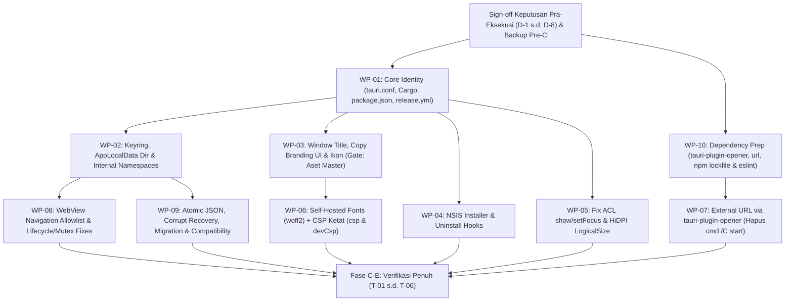

# StockStudio Pro v0.2.0-C-A: Rebranding & Security Implementation Blueprint

**Proyek:** StockStudio Pro (berbasis Flowpilot `v1.2.0`)  
**Fase:** `v0.2.0-C-A` — Rebranding & Security Implementation Blueprint *(READ-ONLY)*  
**Baseline Git:** Branch `main` | HEAD `3a1d465544fda8e6bde94bf9c1030cbf78bfc4c8` (`docs: record security and dependency risk assessment`) | Working tree bersih | Remote: tidak ada  
**Acuan Utama:** [`v0.2.0-B3-E-security-dependency-risk-assessment.md`](docs/audit/v0.2.0-B3-E-security-dependency-risk-assessment.md), [`v0.2.0-repository-audit.md`](docs/audit/v0.2.0-repository-audit.md), [`v0.2.0-B3-A`](docs/audit/v0.2.0-B3-A-dependency-config-analysis.md), [`v0.2.0-B3-B`](docs/audit/v0.2.0-B3-B-dependency-cleanup.md), [`v0.2.0-B3-D`](docs/audit/v0.2.0-B3-D-build-runtime-baseline.md), dan status `DESIGN.MD`  

> [!IMPORTANT]
> **Status `DESIGN.MD` (Transparansi Faktual):** Pemeriksaan disk langsung pada root repositori (``) maupun folder induk terdekat mengonfirmasi bahwa file **`DESIGN.MD` belum tersedia di dalam repositori ini** (konsisten dengan [`v0.2.0-repository-audit.md`](docs/audit/v0.2.0-repository-audit.md#L33)). Karena itu, ruang lingkup Fase C dibatasi pada **rebranding identitas aplikasi, penggantian aset dasar, dan self-hosting font `Plus Jakarta Sans` (`400`, `500`, `600`, `700`)** sambil tetap mempertahankan `preflight: false` di [`tailwind.config.cjs`](tailwind.config.cjs#L6). Implementasi desain penuh `DESIGN.MD` dan pemecahan komponen UI dijadwalkan di fase `v0.3.0`.

> [!NOTE]
> **Catatan Kebersihan Kriptografi:** Kunci publik minisign milik Flowpilot pada [`tauri.conf.json`](src-tauri/tauri.conf.json#L11) sengaja tidak dicantumkan mentah dan direferensikan sebagai `<REDACTED_BASE64_MINISIGN_PUBKEY — key ID 9883364C90076B4B>`.

---

## 1. Konteks Toolchain & Batas Ruang Lingkup Fase C

### 1.1 Environment Baseline Terverifikasi (`v0.2.0-B3-D`)
Seluruh eksekusi implementasi Fase C (`C-B` s.d. `C-E`) berjalan pada toolchain yang telah terverifikasi pada fase B3-D:
- **OS & Runtime Desktop:** Windows 11 Pro `10.0.26200` (`x86_64`), Microsoft Edge WebView2 Runtime `157.0.4341.60`
- **Native Toolchain:** Visual Studio Build Tools 2022 (`17.14.37906.3`), MSVC `cl.exe`/`link.exe`, Windows SDK `10.0.26100.0`, `rustc 1.100.0`, `cargo 1.100.0`, `rustup` (`stable-x86_64-pc-windows-msvc`)
- **Frontend Toolchain:** Node.js `v20.10.0`, npm `10.2.3`, Vite `5.4.21`, TypeScript `5.0.4`, Tailwind CSS `3.3.2`
- **Tauri Stack Terkunci:** `@tauri-apps/cli 2.11.4`, `@tauri-apps/api 2.11.1`, `tauri 2.11.5` (`features = ["unstable"]`), `tauri-utils 2.9.3`, `tauri-plugin-updater 2.10.1`, `tauri-plugin-process 2.3.1`, `keyring 3.6.3`, `reqwest 0.12.28` + `0.13.4`

### 1.2 Batas Ruang Lingkup (`In-Scope Fase C` vs. `Deferred`)

| Kategori Pekerjaan | Masuk Fase C (`C-B` s.d. `C-E`) | Ditunda ke Fase Berikutnya (Di Luar Fase C) | Alasan Teknis Pembatasan |
| :--- | :--- | :--- | :--- |
| **Application Identity** | `productName`, `identifier`, crate/binary/exe, window title, keyring service, NSIS hooks, ikon & brand UI/copy dasar, cleanup aset/CSS mati | **Fase E:** Rotasi minisign keypair, penggantian `updater.endpoints` & `pubkey`, Windows Authenticode code signing, GitHub Actions CI penuh | Menjaga perubahan identitas lokal dapat diuji tanpa menunggu infrastruktur rilis GitHub/sertifikat EV/OV. |
| **Tauri Security & Hardening** | Perbaikan ACL `show()`/`setFocus()`, fix HiDPI `LogicalSize`, CSP ketat (`csp` & `devCsp`) + font lokal, penggantian `cmd /C start` dengan `tauri-plugin-opener`, domain allowlist child WebView (`webview_manager.rs`), least-privilege capabilities | **v0.4.0+:** Generalisasi multi-tool WebView (7 tool StockStudio Pro), `.on_download(...)` pipeline, modal airspace coordinator, OAuth popup handler khusus tool baru | Mengamankan arsitektur eksisting terlebih dahulu tanpa memecah kontrak antarmuka `FlowShell` sebelum `v0.3.0`. |
| **Persistence, Migration & Bug** | Atomic write (`temp -> rename`) pada `accounts.json` & `license-state.json`, proteksi overwrite korup, `"null"` search fix, `FlowShell` hook & `close()`/`resize()` mutex fix, `localStorage` quota guard, kebijakan migrasi aman dari Flowpilot | **Fase D:** Cloudflare Workers License API milik StockStudio Pro, unifikasi `reqwest 0.13`, HTTP timeout, offline lease JWT/signed, perbaikan `ServerResponse` & error swallowing `activateLicense`, UI Deactivate License | Backend server lisensi StockStudio Pro belum dibangun; kontrak lisensi Flowpilot tidak diubah sepihak di Fase C agar kompatibel selama masa transisi. |
| **Dependencies & Build Hygiene** | Tambah `tauri-plugin-opener = "2"` & `url = "2"`, pin `tauri 2.11.5`, bersih-bersih `eslint@8.40.0` / `eslint-config-prettier`, refresh lockfile non-breaking (hapus sisa `@babel/traverse@7.21.5`, dll.), evaluasi `"type": "module"` & `tsc --noEmit` | **Fase D/E:** Upgrade `reqwest 0.13`, instalasi `cargo-audit` di CI, evaluasi upgrade mayor `vite` (yang memerlukan penyesuaian versi Node.js) | Menghindari risiko breaking change mayor (`reqwest 0.13` / `vite` major) bercampur dengan pekerjaan rebranding & security. |
| **UI & Modularisasi** | Rebranding teks/aset UI minimal di `src/App.tsx` tanpa ubah arsitektur tampilan | **v0.3.0:** Dekomposisi `src/App.tsx` (1.172 baris) & penerapan penuh `DESIGN.MD` | Pemisahan tanggung jawab mempermudah audit diff keamanan Fase C. |

### 1.3 Checklist Keputusan Pra-Eksekusi (Wajib Disetujui Sebelum `C-B`)

| No | Keputusan yang Dibutuhkan | Nilai Rekomendasi Blueprint | Alternatif / Opsi Lain | Konsekuensi Jika Tidak Konsisten |
| :-: | :--- | :--- | :--- | :--- |
| **D-1** | **`identifier` Resmi** | `com.stockstudiopro.desktop` | Nama reverse-DNS lain | Mengubah `%LOCALAPPDATA%\<identifier>\` (`accounts.json`, `license-state.json`, `webview-profiles/`, `EBWebView/`) & script `installer-hooks.nsh`. |
| **D-2** | **Nama Crate & Executable** | Crate/pkg `stockstudio-pro`, lib `stockstudio_pro_lib`, `.exe` -> `stockstudio-pro.exe` | `stockstudio` / `StockStudioPro` | Memengaruhi nama biner NSIS & artefak updater di Fase E. |
| **D-3** | **Nama Keyring Service Windows** | `com.stockstudiopro.desktop` (atau `"StockStudio Pro"`) | Disamakan dengan `identifier` agar unik di Windows Credential Manager | Mengganti nama ini memisahkan entri kredensial dari Flowpilot lama. |
| **D-4** | **Kebijakan Nomor Versi** | Align ke `"0.2.0"` di `package.json`, `Cargo.toml`, `tauri.conf.json`, `release.yml` (sesuai lini fase `v0.2.0`) | Pertahankan `"1.2.0"` agar di atas updater `v1.2.0` sementara | Jika masih terhubung ke endpoint updater `v1.2.0` sementara sebelum Fase E, versi `0.2.0` akan dianggap kalah baru jika user membuka tab Updates *(mitigasi: nonaktifkan/sesuaikan sementara atau prioritaskan Fase E)*. |
| **D-5** | **Aset Ikon Master & Brand UI** | Sediakan file master ikon StockStudio Pro (PNG/SVG min `1024x1024`) + logo sidebar/kartu sebelum `WP-03` | Gunakan placeholder internal sementara | `WP-03` **terblokir** untuk regenerasi `icon.ico` & penggantian `public/foursquare.png` hingga aset resmi diserahkan. |
| **D-6** | **Migrasi Data Flowpilot Lama** | Fresh profile WebView + opsi *copy-only* metadata `accounts.json` jika disetujui | Fresh install total (tanpa baca folder Flowpilot) atau salin penuh WebView profile | Risiko kehilangan sesi vs risiko *file-lock* / pembengkakan salinan ratusan MB saat startup. |
| **D-7** | **Status `eslint@8.40.0`** | **Hapus** `eslint` (8.40.0) & `eslint-config-prettier` (karena belum ada konfigurasi lint; tambah ESLint 9 di `v0.3.0`) | Pindahkan ke `devDependencies` (menyisakan 7 CVE dev) | Memengaruhi hasil `npm audit` Fase C (`2` CVE dev vs `9` CVE dev). |
| **D-8** | **URL Toko / Eksternal Sementara** | Placeholder non-Flowpilot atau URL resmi StockStudio Pro untuk `LICENSE_PURCHASE_URL` & host allowlist `open_external_url` | Kosongkan/nonaktifkan tombol Buy sementara hingga checkout StockStudio Pro siap | Mencegah aplikasi StockStudio Pro mengarahkan pembeli ke toko `tokotelegram.com/toko/flowpilot`. |

### 1.4 Diagram Dependensi Antar Pekerjaan (`Work Packages`)



---

## 2. Pilar 1 — Application Identity (`WP-01` s.d. `WP-04`)

### `WP-01`: `productName`, `identifier`, Executable & Rust Crate Metadata

1. **File yang terdampak:**
   - [`src-tauri/tauri.conf.json`](src-tauri/tauri.conf.json) (baris 3–5, 7)
   - [`package.json`](package.json) (baris 2–3) & [`package-lock.json`](package-lock.json) (root metadata)
   - [`src-tauri/Cargo.toml`](src-tauri/Cargo.toml) (baris 2–3, 7) & [`src-tauri/Cargo.lock`](src-tauri/Cargo.lock) (package entry lokal)
   - [`src-tauri/src/main.rs`](src-tauri/src/main.rs) (baris 4)
   - [`src-tauri/src/lib.rs`](src-tauri/src/lib.rs) (baris 139)
   - [`src-tauri/capabilities/default.json`](src-tauri/capabilities/default.json) (baris 4)
   - [`.github/workflows/release.yml`](.github/workflows/release.yml) (baris 1, 9, 41–42 — metadata teks saja)
2. **Perubahan yang direncanakan:**
   - Di `src-tauri/tauri.conf.json`: ubah `"productName": "Flowpilot"` -> `"StockStudio Pro"`, `"identifier": "com.flowpilot.desktop"` -> `"com.stockstudiopro.desktop"`, `"title": "Flowpilot"` -> `"StockStudio Pro"`, dan sinkronkan `"version"` sesuai keputusan `D-4` (`"0.2.0"` direkomendasikan). **Pertahankan** `plugins.updater.endpoints` dan `plugins.updater.pubkey` (`<REDACTED_BASE64_MINISIGN_PUBKEY — key ID 9883364C90076B4B>`) tetap tercatat untuk diganti di Fase E *(jangan meniru nilai palsu)*.
   - Di `src-tauri/Cargo.toml`: ubah `package.name = "stockstudio-pro"` (menghasilkan biner Windows `stockstudio-pro.exe`), `[lib] name = "stockstudio_pro_lib"`, dan `version` selaras `D-4`.
   - Di `src-tauri/src/main.rs:4`: ubah pemanggilan crate library dari `flowpilot_lib::run();` menjadi `stockstudio_pro_lib::run();`.
   - Di `src-tauri/src/lib.rs:139`: ubah `.expect("error while running Flowpilot")` menjadi `.expect("error while running StockStudio Pro")`.
   - Di `src-tauri/capabilities/default.json:4`: ubah `"description": "Default desktop permissions for StockStudio Pro"`.
   - Di `package.json`: ubah `"name": "stockstudio-pro"` dan `"version"` sesuai `D-4`; segarkan lockfile agar entri paket root ikut terbarui.
   - Di `.github/workflows/release.yml`: ubah `name: Release StockStudio Pro`, `default: v0.2.0` (mengikuti `D-4`), `releaseName: StockStudio Pro ${{ inputs.tag }}`, dan `releaseBody: Signed StockStudio Pro release.`.
3. **Risiko:**
   - **Tinggi (fungsional jika tidak serempak):** Jika `[lib] name` di `Cargo.toml` diganti tetapi `main.rs` masih memanggil `flowpilot_lib::run()`, kompilasi gagal (`unresolved crate`).
   - **Sedang (artefak build & installer):** Perubahan `productName` dan `package.name` mengubah path target debug (`target/debug/stockstudio-pro.exe`) serta nama installer NSIS; skrip atau shortcut lama ke `flowpilot.exe` menjadi yatim.
   - **Sedang (interaksi updater sebelum Fase E):** Jika `version` diturunkan dari `1.2.0` ke `0.2.0` sementara endpoint updater belum diganti di Fase E, mengeklik tab `Updates` di dev dapat membandingkan versi ke repo Flowpilot lama (`1.2.0`).
4. **Dependensi pekerjaan:** Menunggu keputusan `D-1`, `D-2`, `D-4`. Menjadi prasyarat bagi `WP-02`, `WP-03`, `WP-04`, `WP-05`, dan `WP-09`.
5. **Acceptance criteria:**
   - `cargo check --locked` dan `cargo build` menghasilkan `src-tauri/target/debug/stockstudio-pro.exe` dengan `0` error dan `0` warning.
   - `npx --no-install tauri info` mengenali proyek tanpa error skema konfigurasi.
   - Pencarian `rg -i "flowpilot"` di `package.json`, `Cargo.toml`, `main.rs`, `capabilities/default.json`, `release.yml`, serta field `productName`/`identifier`/`title` pada `tauri.conf.json` mengembalikan `0` temuan (selain blok `plugins.updater` yang memang ditandai `Deferred to Phase E`).
6. **Strategi rollback:** Kembalikan berkas konfigurasi & manifest lewat `git revert` commit `WP-01`, jalankan `cargo check --locked`, lalu hapus sisa biner `target/debug/stockstudio-pro.exe` bila perlu kembali ke `flowpilot.exe`.

---

### `WP-02`: Keyring Service, Storage Directory (`AppLocalData`), & Internal Namespace

1. **File yang terdampak:**
   - [`src-tauri/src/license_store.rs`](src-tauri/src/license_store.rs) (baris 49–51)
   - [`src-tauri/src/account_store.rs`](src-tauri/src/account_store.rs) (baris 4–8 — evaluasi jalur dinamis Tauri)
   - [`src-tauri/src/webview_manager.rs`](src-tauri/src/webview_manager.rs) (baris 10, 63–73, 290)
   - [`src/services/account-store.ts`](src/services/account-store.ts) (baris 10, 43, 53)
   - [`src/App.tsx`](src/App.tsx) (baris 92, 194, 1102, 1121, 1127)
2. **Perubahan yang direncanakan:**
   - **Keyring Service (`license_store.rs:49-51`):** Ganti `Entry::new("Flowpilot", "license-key")` dengan konstanta eksplisit `const KEYRING_SERVICE: &str = "com.stockstudiopro.desktop";` (atau `"StockStudio Pro"` sesuai `D-3`) dan `const KEYRING_ACCOUNT: &str = "license-key";`.
   - **Storage Directory (`BaseDirectory::AppLocalData`):** Dengan berubahnya `identifier` di `WP-01`, `app.path().resolve(..., BaseDirectory::AppLocalData)` otomatis mengisolasi seluruh data baru ke **`%LOCALAPPDATA%\com.stockstudiopro.desktop\`**:
     - `accounts.json` (`account_store.rs:6`)
     - `license-state.json` (`license_store.rs:30`)
     - `webview-profiles\<account_id>\` (`webview_manager.rs:66`)
     - `EBWebView\` (direktori otomatis runtime WebView2 jendela utama yang menyimpan `localStorage` baru)
   - **Namespace Internal & Log/Event:**
     - `webview_manager.rs:290`: ubah tag log `stderr` dari `[flowpilot-webview]` ke `[stockstudio-webview]`.
     - `webview_manager.rs:10`: pertahankan `WEBVIEW_LABEL_PREFIX` konsisten dengan tool aktif saat ini (`"google-flow"` atau ubah terpusat ke konstanta `WEBVIEW_LABEL_PREFIX` tanpa mematahkan `main`-only isolation). *(Catatan: generalisasi nama IPC command `*_google_flow` ke arsitektur multi-tool penuh direkomendasikan di `v0.4.0+`, atau cukup di-wrap bersih di Frontend service tanpa mengubah perilaku runtime Fase C.)*
     - `src/App.tsx:1102,1121,1127`: ubah event DOM custom `"flowpilot-webview-ready"` menjadi `"stockstudio-webview-ready"`.
     - `src/App.tsx:92,194` & `src/services/account-store.ts:10,43,53`: ubah key `localStorage` aktif menjadi `"stockstudio-profile"` dan `"stockstudio-accounts"`, ubah pesan log konsol ke `"StockStudio Pro account data could not be loaded/saved"`, serta tambahkan fallback pembacaan satu arah key lama bila diperlukan oleh kebijakan migrasi `WP-09`.
3. **Risiko:**
   - **Sedang:** Pengguna Flowpilot yang sudah pernah mengaktifkan lisensi di mesin yang sama tidak akan terbaca otomatis dari Windows Credential Manager `"Flowpilot"` maupun `%LOCALAPPDATA%\com.flowpilot.desktop\license-state.json`.
   - **Rendah:** `localStorage["flowpilot-profile"]` pada jendela utama lama berada di dalam `com.flowpilot.desktop\EBWebView`, sehingga pada profil `com.stockstudiopro.desktop\EBWebView` yang baru avatar profil akan kembali ke default jika tidak dimigrasi (`WP-09`).
4. **Dependensi pekerjaan:** Bergantung pada `WP-01` (`identifier`) & keputusan `D-3`, `D-6`. Menjadi prasyarat bagi `WP-08` dan `WP-09`.
5. **Acceptance criteria:**
   - Setelah menjalankan app baru, folder `C:\Users\<user>\AppData\Local\com.stockstudiopro.desktop\` terbentuk dan berisi `license-state.json` + `EBWebView\`, sementara `C:\Users\<user>\AppData\Local\com.flowpilot.desktop\` **tetap utuh 100%**.
   - Ketika `activate_license` dipanggil, entri Windows Credential Manager tersimpan di bawah target service baru (`com.stockstudiopro.desktop` / `license-key`), bukan `"Flowpilot"`.
   - Custom DOM event `stockstudio-webview-ready` memicu `ResizeObserver` `syncBounds()` tanpa error konsol.
6. **Strategi rollback:** `git revert` commit `WP-02`; bersihkan folder uji `%LOCALAPPDATA%\com.stockstudiopro.desktop\` dan hapus entri uji di Credential Manager secara manual bila pengujian selesai.

---

### `WP-03`: Window Title, Ikon Aplikasi, Aset Publik, & Copy Branding UI

1. **File yang terdampak:**
   - [`src-tauri/tauri.conf.json`](src-tauri/tauri.conf.json) (baris 7–8)
   - [`index.html`](index.html) (baris 6 — sudah `<title>StockStudio Pro</title>`, verifikasi tetap sinkron)
   - [`src-tauri/icons/*`](src-tauri/icons/) (`52` file ikon: 7 ikon root desktop, 10 `Square*Logo.png`/`StoreLogo.png`, 17 `android/*`, 18 `ios/*`)
   - [`public/foursquare.png`](public/foursquare.png), [`public/google-flow.png`](public/google-flow.png), [`public/logo-preview.png`](public/logo-preview.png)
   - [`src/styles/cypress.css`](src/styles/cypress.css) & [`src/styles/global.css`](src/styles/global.css) (baris 15, 46 — komentar; baris 49 `.brand-image`/`.window-bar img` jika ikon baru tidak membutuhkan `filter: invert(1)`)
   - [`src/App.tsx`](src/App.tsx) (baris 20–75, 93–96, 183–184, 339–446, 515, 566–573, 630–632, 801–896, 908, 967–974, 989–991, 1008–1010, 1041–1063)
2. **Perubahan yang direncanakan:**
   - **Window Title & Desktop Icons (`D-5` Gate):**
     - Verifikasi judul native `"StockStudio Pro"` tampil konsisten di title bar & taskbar Windows (`tauri.conf.json:7` + `index.html:6`).
     - Setelah ikon master StockStudio Pro disetujui (`>=1024x1024` PNG), jalankan `npx --no-install tauri icon <path-master-icon>` untuk meregenerasi `icon.ico` (dipakai executable, `bundle.icon`, `installerIcon`, `uninstallerIcon`), `icon.png`, dan ukuran `32x32`..`128x128@2x`.
     - Evaluasi penghapusan 35 file ikon platform yang tidak terpakai oleh target NSIS Windows (`src-tauri/icons/android/*` 17 file, `src-tauri/icons/ios/*` 18 file, serta `Square*Logo.png`/`StoreLogo.png`/`icon.icns` jika hanya menargetkan Windows NSIS) agar repositori bersih dari aset Flowpilot lama.
   - **Aset Publik (`public/`):**
     - Hapus [`public/logo-preview.png`](public/logo-preview.png) yang tidak pernah direferensikan (`9.684` byte).
     - Ganti [`public/foursquare.png`](public/foursquare.png) dengan ikon brand StockStudio Pro baru (mis. `public/stockstudio-mark.png`) dan periksa apakah `filter: invert(1) brightness(1.8)` di [`src/styles/global.css`](src/styles/global.css#L49) perlu dihapus agar ikon berwarna tidak rusak menjadi putih polos.
     - Pertahankan atau ganti ikon kartu akun default (`public/google-flow.png` atau ikon netral `public/workspace-account.png`) secara konsisten dengan fallback di `WP-09`.
   - **Copy Branding & Pembersihan Dead Code UI (`src/App.tsx` & `src/styles/`):**
     - Hapus file yatim [`src/styles/cypress.css`](src/styles/cypress.css) (tidak diimpor di `src/main.tsx`).
     - Perbarui komentar Flowpilot pada `src/styles/global.css:15,46`.
     - Ganti seluruh teks `"Flowpilot"` / `"FLOWPILOT"` di `App.tsx` menjadi `"StockStudio Pro"` / `"STOCKSTUDIO PRO"` (Brand header `L569-570`, License Gate `L339,346,355`, `plans` `L27-46`, Header & Breadcrumb `L414,431,436,440,442`, Delete modal `L515`, `InfoPage` `L801-896`, `Settings` `L1041,1050,1060`, dan profile default `L93,96`).
     - Hapus dead array `starter` (`App.tsx:47-75`) dan ganti inisial hardcoded `"YK"` (`L632,1010`) & `"NF"` (`L184`) menjadi inisial dinamis dari `profile.name` / nama akun (mis. fungsi `getInitials(name)`).
3. **Risiko:**
   - **Kritis (desain visual):** Jika `tauri icon` dijalankan dengan gambar di bawah `512x512` atau dengan `filter: invert(1)` masih aktif pada logo berwarna, tampilan titlebar/sidebar terlihat buram atau terbalik warnanya.
   - **Sedang (kompatibilitas kartu lama):** Jika `public/google-flow.png` dihapus sementara akun lama memiliki `avatarUrl: "/google-flow.png"`, kartu akun akan menampilkan gambar rusak (`broken img`). Mitigasi ada di `WP-09` (fallback `onError` + normalisasi saat load).
4. **Dependensi pekerjaan:** Bergantung pada `WP-01` dan penyerahan aset master (`D-5`). Harus selesai atau selaras dengan `WP-06` (agar aset baru diload via `'self'`) dan `WP-09` (fallback avatar akun lama).
5. **Acceptance criteria:**
   - Jendela app menampilkan judul `"StockStudio Pro"`, taskbar/executable menampilkan `icon.ico` baru, dan `dist/` tidak lagi memuat `logo-preview.png` atau aset yatim.
   - Tidak ada teks UI `"Flowpilot"` di seluruh layar (License Gate, Accounts, Favorites, License, Updates, Info, Settings, Delete Dialog).
   - Avatar tanpa gambar menampilkan inisial dinamis valid, bukan `"YK"` atau `"NF"`.
6. **Strategi rollback:** `git revert` commit `WP-03` untuk memulihkan seluruh berkas ikon biner, `public/*`, `src/styles/*`, dan teks UI.

---

### `WP-04`: NSIS Installer & Uninstall Behavior

1. **File yang terdampak:**
   - [`src-tauri/installer-hooks.nsh`](src-tauri/installer-hooks.nsh) (baris 1–14)
   - [`src-tauri/tauri.conf.json`](src-tauri/tauri.conf.json) (baris 8 — verifikasi jalur `installerIcon`, `uninstallerIcon`, `installerHooks`)
2. **Perubahan yang direncanakan:**
   - **Post-Install (`installer-hooks.nsh:1-6`):** Pertahankan `CreateShortcut "$SMPROGRAMS\${PRODUCTNAME}.lnk" "$INSTDIR\${MAINBINARYNAME}.exe"` dan `$DESKTOP\${PRODUCTNAME}.lnk` beserta `SetLnkAppUserModelId`. Variabel makro Tauri NSIS `${PRODUCTNAME}` dan `${MAINBINARYNAME}` otomatis terisi `StockStudio Pro` dan `stockstudio-pro` dari `WP-01`.
   - **Pre-Uninstall (`installer-hooks.nsh:8-14`):**
     - Pertahankan guard `${If} $UpdateMode <> 1` agar proses **auto-update pasif (`installMode: "passive"`) tidak pernah menghapus data pengguna**.
     - Ubah baris 10: `"Do you also want to remove Flowpilot account data and Google Flow sessions?"` -> `"Do you also want to remove StockStudio Pro account data, workspace sessions, and local settings?"` (atau wording ringkas setara StockStudio Pro).
     - Ubah baris 11: `RMDir /r "$LOCALAPPDATA\com.flowpilot.desktop"` -> `RMDir /r "$LOCALAPPDATA\com.stockstudiopro.desktop"` (wajib 100% identik dengan `identifier` di `tauri.conf.json:5`).
   - **Catatan Uninstall & Data Lisensi:** Dokumentasikan dalam release notes/testing bahwa jika pengguna memilih **Yes** pada penghapusan folder `$LOCALAPPDATA\com.stockstudiopro.desktop`, file `license-state.json` (yang menyimpan `device_id` UUID v4 saat ini) juga ikut terhapus, sementara kredensial di Windows Credential Manager tetap ada hingga `clear_license_state` dipanggil (yang berpotensi memicu `DEVICE_ALREADY_BOUND` saat instal ulang — perbaikan permanen ditangani di Fase D).
3. **Risiko:**
   - **Tinggi (kebocoran atau salah hapus data):** Salah ketik path `RMDir /r` di NSIS sangat berbahaya; menargetkan direktori lama bisa menghapus data instalasi Flowpilot asli milik pengguna, sedangkan typo folder baru membuat uninstaller gagal membersihkan disk saat user memilih Yes.
   - **Sedang:** Coexistence Flowpilot vs StockStudio Pro: kedua aplikasi kini memiliki shortcut dan folder instalasi (`%LOCALAPPDATA%\StockStudio Pro\`) serta `%LOCALAPPDATA%\com.stockstudiopro.desktop\` yang terpisah sehingga tidak saling menimpa.
4. **Dependensi pekerjaan:** Bergantung langsung pada `WP-01` (`D-1`, `D-2`) dan `WP-03` (`icons/icon.ico` untuk `installerIcon`/`uninstallerIcon`).
5. **Acceptance criteria:**
   - `npx --no-install tauri build --bundles nsis` (atau verifikasi `T-05`) menghasilkan installer `.exe` bernama `StockStudio Pro_<ver>_x64-setup.exe`.
   - Shortcut Desktop & Start Menu mengarah ke `stockstudio-pro.exe` dengan ikon StockStudio Pro.
   - Uninstall interaktif menampilkan dialog StockStudio Pro; memilih **No** mempertahankan `com.stockstudiopro.desktop`, memilih **Yes** hanya menghapus `com.stockstudiopro.desktop` dan **tidak menyentuh** `com.flowpilot.desktop`.
   - Simulasi auto-update (`$UpdateMode = 1` atau mode `/S` upgrade) mempertahankan `accounts.json`, `license-state.json`, dan `webview-profiles/`.
6. **Strategi rollback:** `git revert` commit `WP-04`, bangun ulang bundle NSIS dari state sebelumnya.

---

## 3. Pilar 2 — Tauri Security (`WP-05` s.d. `WP-08`)

### `WP-05`: Perbaikan ACL Mismatch (`show` & `setFocus`), HiDPI `LogicalSize`, & IPC Capabilities

1. **File yang terdampak:**
   - [`src-tauri/src/lib.rs`](src-tauri/src/lib.rs) (baris 95–115 — `expand_main_window`)
   - [`src/App.tsx`](src/App.tsx) (baris 3, 5, 122, 333)
   - [`src-tauri/capabilities/default.json`](src-tauri/capabilities/default.json) (verifikasi skema & daftar izin minimal)
2. **Perubahan yang direncanakan:**
   - **Bukti ACL Mismatch (`acl-manifests.json`):** `capabilities/default.json:6` hanya memberikan `core:default`, `updater:default`, dan `process:allow-restart`. Isi `core:window:default` pada `acl-manifests.json` terverifikasi hanya memiliki 28 izin baca/query + `allow-internal-toggle-maximize` dan **tidak menyertakan `core:window:allow-show` maupun `core:window:allow-set-focus`**. Akibatnya pemanggilan `await w.show(); await w.setFocus()` di `src/App.tsx:122,333` rentan gagal pada Tauri ACL dan masuk ke blok `catch` (`"Server Unavailable"`).
   - **Opsi A — Rust-Mediated Window Control *(DIREKOMENDASIKAN / Least Privilege)*:**
     - Di `src-tauri/src/lib.rs:96-115` (`expand_main_window`), tangani `window.show()` dan `window.set_focus()` langsung di backend Rust setelah `center()`.
     - Sekaligus selesaikan bug **HiDPI (`R-12`)**: ubah `tauri::Size::Physical(tauri::PhysicalSize { width: 1280, height: 800 })` menjadi `tauri::Size::Logical(tauri::LogicalSize { width: 1280.0, height: 800.0 })`, dan `min_size` menjadi `tauri::Size::Logical(tauri::LogicalSize { width: 1000.0, height: 700.0 })`. Pertahankan ukuran jendela License Gate (`540x620`) di `tauri.conf.json:7`.
     - Di `src/App.tsx:3,5,122,333`: hapus import `getCurrentWindow` (jika tidak ada caller lain) dan hapus dead import `PhysicalSize`; hapus `const w = getCurrentWindow(); await w.show(); await w.setFocus()` karena sudah dijalankan aman secara atomik oleh `invoke("expand_main_window")`.
     - Pertahankan `capabilities/default.json` tetap minimalis (`"windows": ["main"]`, `["core:default", "updater:default", "process:allow-restart"]`), meminimalkan permukaan API JS yang terbuka jika suatu saat terjadi injeksi DOM.
   - **Opsi B (Alternatif Pembanding jika kendali JS tetap diinginkan):** Tambahkan `"core:window:allow-show"` dan `"core:window:allow-set-focus"` secara eksplisit ke `capabilities/default.json` *(kurang direkomendasikan karena tetap memberi izin fokus/show ke lapisan JS dan tidak sekaligus merapikan urutan `expand -> show -> focus` atomik)*.
   - **Isolasi IPC Tambahan:** Pastikan `capabilities/default.json` tidak pernah memakai wildcard `"*"` pada `"windows"`; tetap `"windows": ["main"]` sehingga child WebView tidak mendapat akses ke 13 IPC command (`account_store`, `license_store`, `webview_manager`, `updater`, `process`).
3. **Risiko:**
   - **Rendah–Sedang:** Pada layar 1366×768 di Windows DPI 125% (`1092×614` logical pixels), `LogicalSize(1280, 800)` atau `min_size(1000, 700)` bisa melebihi tinggi viewport efektif desktop. Mitigasi: pertimbangkan batas clamping terhadap ukuran monitor aktif (`current_monitor()`) atau pastikan `resizable: true` mengizinkan user mengecilkan jendela dengan aman.
4. **Dependensi pekerjaan:** Tidak memblokir paket lain, tetapi harus diverifikasi bersama skema `src-tauri/gen/schemas/capabilities.json` pada build.
5. **Acceptance criteria:**
   - Alur startup validasi lisensi & aktivasi manual menyelesaikan `expand_main_window`, membesarkan jendela ke ukuran logis `1280×800`, menampilkan, dan memfokuskan jendela tanpa error ACL di konsol maupun palsu `"Server Unavailable"`.
   - `capabilities/default.json` hasil kompilasi (`src-tauri/gen/schemas/capabilities.json`) hanya mengikat jendela `"main"` dan tidak membuka izin shell/fs/window berlebih.
6. **Strategi rollback:** `git revert` commit `WP-05` mengembalikan `expand_main_window` dan `src/App.tsx`.

---

### `WP-06`: Content Security Policy (CSP) & Self-Hosted Fonts

1. **File yang terdampak:**
   - [`src-tauri/tauri.conf.json`](src-tauri/tauri.conf.json) (baris 7 — `app.security.csp` & `app.security.devCsp`)
   - [`src/styles/global.css`](src/styles/global.css) (baris 1 — hapus `@import url('https://fonts.googleapis.com/...')`)
   - **File baru:** `src/assets/fonts/PlusJakartaSans-{Regular,Medium,SemiBold,Bold}.woff2` (atau `plus-jakarta-sans-{400,500,600,700}-latin.woff2`) + `src/styles/fonts.css` dengan deklarasi `@font-face` lokal (`font-display: swap;`)
   - [`src/main.tsx`](src/main.tsx) (baris 4 — import `./styles/fonts.css` sebelum `./styles/global.css`)
   - Verifikasi [`src/App.tsx`](src/App.tsx) (baris 630, 987, 1008, 1019–1023 — pemakaian `data:` URI untuk avatar & `style={{ transform }}` di `DragPreview`)
2. **Perubahan yang direncanakan:**
   - **Self-Hosted Fonts (`Plus Jakarta Sans`):**
     - Hapus `@import url('https://fonts.googleapis.com/css2?family=Plus+Jakarta+Sans:wght@400;500;600;700&display=swap');` dari `src/styles/global.css:1`.
     - Sediakan file `.woff2` `Plus Jakarta Sans` (lisensi OFL 1.1) di `src/assets/fonts/` untuk ketebalan `400`, `500`, `600`, dan `700`, dan daftarkan via `@font-face` di `src/styles/fonts.css` (di-bundle langsung ke `dist/assets/` oleh Vite sebagai URL aset `'self'`).
     - Ini mempertahankan identik tipografi yang dikonfigurasi di `global.css:23` dan `tailwind.config.cjs:43` sekaligus menghilangkan kebocoran jaringan startup ke Google.
   - **Strict Production CSP & Dev CSP (`tauri-utils 2.9.3 SecurityConfig`):**
     - Pemeriksaan `SecurityConfig` di `tauri-utils 2.9.3` membuktikan Tauri 2 mendukung `app.security.csp` (otomatis menyuntikkan nonce/hash untuk skrip/style bundle produksi saat `compile-time`) dan `app.security.devCsp` (khusus mode `tauri dev`).
     - Konfigurasi **`app.security.csp` (Produksi)** di `tauri.conf.json`:
       ```json
       "security": {
         "csp": "default-src 'self'; script-src 'self'; style-src 'self'; font-src 'self'; img-src 'self' data:; connect-src ipc: http://ipc.localhost; object-src 'none'; base-uri 'self'; form-action 'none'; frame-ancestors 'none'",
         "devCsp": "default-src 'self'; script-src 'self' 'unsafe-inline' http://localhost:5173; style-src 'self' 'unsafe-inline' http://localhost:5173; font-src 'self' http://localhost:5173; img-src 'self' data: http://localhost:5173; connect-src ipc: http://ipc.localhost http://localhost:5173 ws://localhost:5173; object-src 'none'; base-uri 'self'; form-action 'none'"
       }
       ```
     - **Justifikasi tiap directive:**
       - `img-src 'self' data:`: Wajib agar upload avatar Settings (`FileReader.readAsDataURL` di `App.tsx:1019-1023` yang disimpan di `profile.avatar` dan dirender di `Sidebar` `L630` + `Settings` `L1008`) tetap bekerja tanpa melonggarkan `https:`.
       - `style-src 'self'` pada produksi: React `style={{ transform }}` di `DragPreview` (`App.tsx:987`) memodifikasi properti DOM CSSOM `element.style`, bukan atribut `<style>` / string HTML inline, sehingga pada umumnya lolos `style-src 'self'` tanpa `'unsafe-inline'`. *(Wajib diuji empiris saat `T-06`: drag kartu akun di build rilis `tauri build`, serta uji apakah Tauri runtime menginjeksi inline style atau nonce.)*
       - `connect-src ipc: http://ipc.localhost`: Diperlukan oleh protokol IPC Tauri 2 di WebView2 Windows (`tauri.localhost` / `http://ipc.localhost`). Permintaan HTTP `license_store.rs` dan `tauri-plugin-updater` dilakukan oleh **proses Rust**, sehingga **tidak** perlu membuka domain worker/GitHub di CSP browser WebView utama.
3. **Risiko:**
   - **Sedang:** Jika runtime Tauri atau injeksi internal WebView2 memblokir `ipc://localhost` atau `tauri://localhost` pada versi WebView2 tertentu, atau jika `style-src 'self'` menghalangi library/style dinamis, pelanggaran CSP akan muncul di DevTools console.
   - **Rendah:** Jika hanya subset karakter tertentu disalin tanpa subset Latin penuh, beberapa simbol/tanda baca UI dapat jatuh kembali ke font sistem `sans-serif`.
4. **Dependensi pekerjaan:** Bergantung pada struktur aset Vite (`WP-03` dan font vendor lokal). Diuji langsung oleh `T-01`, `T-03`, dan `T-06`.
5. **Acceptance criteria:**
   - Output CSS di `dist/assets/*.css` berisi `@font-face` menuju file `.woff2` lokal di `dist/assets/` dan **0 referensi** ke `fonts.googleapis.com` maupun `fonts.gstatic.com`.
   - Aplikasi dev (`npm run tauri dev`) maupun produksi (`tauri build`) berjalan dengan font `Plus Jakarta Sans` aktif meski koneksi internet dimatikan.
   - `T-06` mencatat `0` Console CSP violation di seluruh rute (`Gate`, `Accounts`, `Favorites`, `License`, `Updates`, `Info`, `Settings`, `FlowShell`, `DragPreview`, dan upload avatar `data:image/*`).
6. **Strategi rollback:** `git revert` commit `WP-06`; sementara darurat dapat melonggarkan directive spesifik di `devCsp`/`csp` dalam branch pengujian sebelum kembali mengetatkannya.

---

### `WP-07`: External URL Handling & Penggantian `cmd.exe /C start` dengan `tauri-plugin-opener`

1. **File yang terdampak:**
   - [`src-tauri/Cargo.toml`](src-tauri/Cargo.toml) (tambah `tauri-plugin-opener = "2"` & `url = "2"`)
   - [`src-tauri/Cargo.lock`](src-tauri/Cargo.lock) (entry `tauri-plugin-opener`)
   - [`src-tauri/src/lib.rs`](src-tauri/src/lib.rs) (baris 83–93, baris 119–138)
   - [`src/App.tsx`](src/App.tsx) (baris 20–21, baris 336–337, baris 895–897)
   - [`src-tauri/capabilities/default.json`](src-tauri/capabilities/default.json) *(tetap tidak perlu membuka `opener:allow-open-url` ke JS jika memakai Opsi A)*
2. **Perubahan yang direncanakan:**
   - **Opsi A — Rust-Mediated `tauri-plugin-opener` *(DIREKOMENDASIKAN)*:**
     - Daftarkan `.plugin(tauri_plugin_opener::init())` pada `tauri::Builder` di `src-tauri/src/lib.rs:119`.
     - Pada command `open_external_url(app: tauri::AppHandle, url: String)` (`lib.rs:84-93`), **hapus total** `std::process::Command::new("cmd").args(["/C", "start", "", &url])`.
     - Sebagai gantinya, parsing input dengan `url::Url::parse(&url)`:
       1. Tolak jika parsing gagal.
       2. Wajib `parsed.scheme() == "https"`.
       3. Wajib `parsed.username().is_empty()` dan `parsed.password().is_none()`.
       4. Wajib cocok dengan konstanta exact allowlist StockStudio Pro (mis. `const ALLOWED_EXTERNAL_URLS: &[&str] = &[...];` sesuai keputusan `D-8` — minimal URL pembelian lisensi baru & opsional URL channel Telegram resmi jika `TELEGRAM_CHANNEL_URL` diisi).
       5. Panggil API OS native tanpa shell interpreter via `use tauri_plugin_opener::OpenerExt; app.opener().open_url(parsed.as_str(), None::<&str>).map_err(|e| e.to_string())?;`.
     - Di `src/App.tsx:20-21`: perbarui `LICENSE_PURCHASE_URL` dan `TELEGRAM_CHANNEL_URL` sesuai keputusan `D-8`; bila URL kosong, tombol `Buy License` / `Join Telegram Channel` dibuat `disabled` dengan pesan jelas agar tidak memicu error allowlist.
   - **Opsi B (Alternatif Pembanding):** Memanggil `openUrl()` dari `@tauri-apps/plugin-opener` di frontend dan mengatur rule `"opener:allow-open-url"` di `capabilities/default.json`. *(Kurang disarankan dibanding Opsi A karena memerlukan paket npm baru, menjaga ACL JSON agar tidak terlalu longgar, serta validasi terpusat di Rust Opsi A lebih mudah diaudit.)*
3. **Risiko:**
   - **Tinggi (jika salah konfigurasi opener):** Jika menambahkan `opener:default` tanpa membatasi scope, JS dapat membuka skema lokal berbahaya (`file://`, `ms-msdt:`, dsb.). Dengan Opsi A (Rust-mediated + tidak membuka permission opener ke JS + exact URL allowlist), risiko ini tertutup sepenuhnya.
   - **Sedang:** Ketidakcocokan `D-8`: jika `LICENSE_PURCHASE_URL` di frontend berubah tetapi lupa didaftarkan di konstanta allowlist Rust `lib.rs`, klik `Buy License` akan gagal diam-diam (`openLicensePurchase` memanggil `invoke(...)` tanpa `catch` UI). Disarankan juga membungkus pemanggilan JS dengan feedback non-blokir jika URL ditolak.
4. **Dependensi pekerjaan:** Bergantung pada `WP-10` (penambahan `tauri-plugin-opener = "2"` & `url = "2"`) dan keputusan `D-8`.
5. **Acceptance criteria:**
   - Tidak ada lagi pemanggilan `std::process::Command::new("cmd")` atau argumen `"/C", "start"` di seluruh direktori `src-tauri/`.
   - URL allowlisted valid (`https://...`) terbuka di browser default Windows tanpa membuka jendela `cmd.exe` sesaat.
   - Payload negatif (`http://...`, `file:///C:/Windows/win.ini`, `javascript:alert(1)`, `https://tokotelegram.com/toko/flowpilot&calc.exe`, host tidak terdaftar) semuanya ditolak oleh `open_external_url` dengan error eksplisit sebelum mencapai `OpenerExt`.
6. **Strategi rollback:** `git revert` commit `WP-07` & `WP-10` untuk mengembalikan state `Cargo.toml`/`Cargo.lock`/`lib.rs`.

---

### `WP-08`: WebView Navigation Permissions, Lifecycle State, & Hardening

1. **File yang terdampak:**
   - [`src-tauri/src/webview_manager.rs`](src-tauri/src/webview_manager.rs) (baris 9–11, 160–177, 192–248, 250–294)
   - [`src/App.tsx`](src/App.tsx) (baris 1087–1129 — `FlowShell` status & `ResizeObserver` deps)
2. **Perubahan yang direncanakan:**
   - **Pembatasan Navigasi Host Child WebView (`webview_manager.rs:168`):**
     - Ganti aturan longgar `.on_navigation(|url| url.scheme() == "https")` dengan helper teruji unit `fn is_allowed_navigation_url(url: &tauri::Url) -> bool`.
     - Aturan allowlist Fase C (untuk URL tool terverifikasi `https://flow.google` pada `webview_manager.rs:9` + alur login Google):
       - Tolak seluruh skema non-HTTPS (kecuali verifikasi empiris apakah WebView2 membutuhkan `"about:blank"` saat inisialisasi/iframe redirect).
       - Izinkan hanya host eksak atau subdomain tepercaya (`url.host_str()`) yang terkonfirmasi selama `T-04`, berawal dari kandidat dasar:
         - Domain workspace tool aktif: `flow.google`, `labs.google` *(plus subdomain Google Labs/Flow resmi jika terjadi redirect yang terekam pada uji runtime `T-04`)*.
         - Kandidat domain autentikasi & aset Google Sign-In *(daftar final diverifikasi empiris lewat log debug `T-04`)*: `accounts.google.com`, `accounts.youtube.com`, `myaccount.google.com`, `consent.google.com`, `gds.google.com`, `ogs.google.com`, `*.googleusercontent.com`, `*.gstatic.com`.
       - Wajib validasi suffix subdomain dengan prefix titik (`.ends_with(".googleusercontent.com")`) agar domain palsu seperti `evil-googleusercontent.com` **pasti ditolak**.
       - Pada build debug (`#[cfg(debug_assertions)]`), catat log URL yang diblokir ke `stderr` (`[stockstudio-webview] blocked navigation host=...`) agar domain OAuth legitimate yang terlewat cepat terdeteksi saat QA.
   - **Penanganan `on_new_window` (`webview_manager.rs:169`):**
     - Pertahankan kebijakan default `tauri::webview::NewWindowResponse::Deny` agar jendela popup tak terkendali tidak memicu bypass ke luar shell aplikasi maupun mewarisi izin yang tidak diinginkan. Tambahkan debug log saat popup diblokir agar bila alur login Google membutuhkan host redirect in-window di masa depan dapat langsung teridentifikasi.
   - **Perbaikan Bug State & Mutex di `webview_manager.rs` + `FlowShell`:**
     - Perbaiki `close()` (`webview_manager.rs:203-217`): pindahkan `*state.visible.lock()... = false;` ke **dalam** kondisi `if requested_id == active_id` agar `close(oldId)` yang dipanggil terlambat tidak memalsukan status `visible` milik `newId` yang baru dibuka!
     - Perbaiki `resize()` (`webview_manager.rs:221-248`): akuisisi `let _operation = state.operation.lock().map_err(|_| "webview state unavailable")?;` sebagaimana di `open()`, `close()`, dan `remove()`.
     - Perbaiki [`src/App.tsx`](src/App.tsx#L1087-L1129): tambahkan `account.id` ke dependency array `ResizeObserver` `useEffect` (`L1129`) dan reset `setStatus("Loading workspace...")` setiap `account.id` berubah (`L1089`).
   - **Kontrol Keamanan yang Wajib Dipertahankan:**
     - Validasi ketat `validate_account_id` (alfanumerik ASCII/`-`/`_`, `<=128` char) & verifikasi `profile.parent() == Some(root.as_path())` anti-path-traversal (`L51-73`).
     - Child WebView label (`google-flow-<id>` / `stockstudio-<tool>-<id>`) **tidak boleh** dimasukkan ke `capabilities/default.json`, sehingga remote web tetap 100% terisolasi dari 13 IPC command.
3. **Risiko:**
   - **Tinggi (regressi login Google jika host OAuth terlewat):** Alur login Google modern kadang melompat ke subdomain sementara (mis. `accounts.google.co.id`, `challenge`, atau endpoint SSO institusi/2FA tertentu) yang jika diblokir oleh `.on_navigation` akan membuat layar login macet. *Mitigasi:* Uji skenario login penuh di `T-04` dengan log debug URL yang diblokir aktif.
   - **Sedang (`about:blank`):** Jika frame internal Chromium/WebView2 melakukan transisi `about:blank` saat create child WebView sebelum memuat `https://flow.google`, memblokir `about:blank` bisa membuat WebView putih kosong — verifikasi wajib dilakukan di `T-03`/`T-04`.
4. **Dependensi pekerjaan:** Bergantung pada `WP-02`. Diuji melalui `cargo test` (`T-02`) dan `T-04`.
5. **Acceptance criteria:**
   - Unit test `is_allowed_navigation_url` mencakup kasus positif (`flow.google`, `accounts.google.com`, `lh3.googleusercontent.com`) dan negatif (`http://flow.google`, `https://example.com`, `https://evil-google.com`, `https://flow.google.evil.com`, `file:///...`, `javascript:...`) lulus 100%.
   - Login Google dan penggunaan workspace tool berjalan normal di child WebView, sementara navigasi ke situs pihak ketiga sembarang diblokir.
   - Child WebView tidak memiliki `window.__TAURI_INTERNALS__` / akses IPC Tauri.
6. **Strategi rollback:** `git revert` commit `WP-08`; untuk hotfix darurat jika domain OAuth baru ditemukan di uji coba, cukup tambah satu baris konstanta host allowlist tanpa mencabut mekanisme validasi.

---

## 4. Pilar 3 — Compatibility & Migration (`WP-09`)

### `WP-09`: Perlindungan Data Pengguna, Strategi Migrasi, & Rollback Compatibility

1. **File yang terdampak:**
   - [`src-tauri/src/account_store.rs`](src-tauri/src/account_store.rs) (baris 1–35 — atomic write + backup file korup)
   - [`src-tauri/src/license_store.rs`](src-tauri/src/license_store.rs) (baris 28–67 — atomic write untuk `license-state.json`)
   - [`src-tauri/src/webview_manager.rs`](src-tauri/src/webview_manager.rs) (baris 283–294 + startup orphan cleanup opt-in/aman)
   - [`src/services/account-store.ts`](src/services/account-store.ts) (baris 1–56 — error handling tanpa silent `[]`, migrasi key lama aman)
   - [`src/App.tsx`](src/App.tsx) (baris 90–98, 128–133, 145, 186, 191–202, 216–224, 967, 989, 1145, 1157)
   - *(Opsional sesuai `D-6`)* Modul baru `src-tauri/src/migration.rs` + command `import_legacy_flowpilot_accounts` yang **strictly copy-only** & tidak berjalan tanpa izin/konfirmasi eksplisit.

2. **Analisis Matriks Kompatibilitas & Data Pengguna:**

| Aset / Data Pengguna | Lokasi Flowpilot Saat Ini (Terverifikasi) | Lokasi StockStudio Pro Baru | Kondisi & Risiko Utama | Strategi Fase C & Keputusan |
| :--- | :--- | :--- | :--- | :--- |
| **Daftar Akun (`accounts.json`)** | `%LOCALAPPDATA%\com.flowpilot.desktop\accounts.json` *(+ sisa `localStorage["flowpilot-accounts"]`)* | `%LOCALAPPDATA%\com.stockstudiopro.desktop\accounts.json` *(+ `stockstudio-accounts`)* | **Risiko Kritis (`R-11`):** (1) `fs::write` non-atomik; (2) bila `accounts.json` korup, `loadAccounts()` menimpa file dengan `[]`; (3) kartu lama punya `avatarUrl: "/google-flow.png"` yang mungkin berubah; (4) `delete` + `add` memicu duplikasi `order`; (5) cari `"null"` cocok semua akun (`R-12`). | Terapkan **atomic write**, pindahkan file korup ke `.corrupt.<ts>.bak` + hentikan auto-save menimpa data, tambah fallback gambar kartu + normalisasi, perbaiki re-index `order`, perbaiki null-coalescing search, dan dukung impor *copy-only* `accounts.json` bila `D-6` disetujui. |
| **WebView Profiles (`EBWebView` / sesi login)** | `<USER_HOME>\AppData\Local\com.flowpilot.desktop\EBWebView` & `webview-profiles/<id>/` | `%LOCALAPPDATA%\com.stockstudiopro.desktop\EBWebView` & `webview-profiles/<id>/` | Ukuran folder profil Chromium bisa ratusan MB–GB; `msedgewebview2.exe` Flowpilot yang masih berjalan mengunci file; memindah/move paksa berisiko merusak instalasi Flowpilot lama. | **Strategi 1 *(DIREKOMENDASIKAN)*:** Gunakan folder profil bersih per aplikasi (pengguna login Google 1× di StockStudio Pro). **JANGAN memindah/menghapus** `com.flowpilot.desktop`. Folder `webview-profiles` tetap terisolasi bersih per `account_id`. |
| **Device ID & License State** | `<USER_HOME>\AppData\Local\com.flowpilot.desktop\license-state.json` (`132` bytes) + Keyring `"Flowpilot"`/`"license-key"` | `%LOCALAPPDATA%\com.stockstudiopro.desktop\license-state.json` + Keyring `"com.stockstudiopro.desktop"`/`"license-key"` | StockStudio Pro akan punya License API sendiri di Fase D. Selama masa transisi Fase C (jika diuji terhadap endpoint lama), key lama terikat ke `device_id` lama sehingga UUID v4 baru pada `com.stockstudiopro.desktop` dapat memicu `DEVICE_ALREADY_BOUND`. | **Isolasi Penuh *(DIREKOMENDASIKAN)*:** Buat `device_id` & keyring baru yang terpisah agar key/device Flowpilot tidak pernah bocor/bentrok dengan infrastruktur lisensi StockStudio Pro di Fase D. Dokumentasikan kebutuhan key QA baru atau pengujian dev mock untuk QA Fase C. |
| **Profil Lokal (`avatar` & `name`)** | `localStorage["flowpilot-profile"]` di `com.flowpilot.desktop\EBWebView` | `localStorage["stockstudio-profile"]` di `com.stockstudiopro.desktop\EBWebView` | DataURL gambar di `localStorage` tanpa handler kuota (`App.tsx:194`) dapat melempar `QuotaExceededError` yang mematahkan update state atau crash; tidak terbawa otomatis lintas direktori `EBWebView`. | Bungkus `localStorage.setItem` dengan `try/catch` + batas ukuran file gambar (mis. tolak/kompres >1–2 MB), baca fallback `"flowpilot-profile"` bila muncul di origin dev yang sama (`localhost:5173`), serta tetap izinkan unggah ulang cepat di Settings. |

3. **Perubahan yang direncanakan:**
   - **Atomic Write (`account_store.rs` & `license_store.rs`):** Buat helper bersama menulis terlebih dulu ke `<target>.tmp.<pid>` di direktori induk yang sama, lakukan `sync_all()` jika perlu, lalu `fs::rename(&temp_path, &target_path)` (catatan Windows: `std::fs::rename` menimpa target di Windows secara atomik/terkendali pada NTFS, atau bila perlu tangani fallback aman tanpa meninggalkan file 0-byte).
   - **Proteksi Kehilangan `accounts.json` (`account_store.rs` & `account-store.ts` + `App.tsx`):**
     - Di `account_store.rs::load_accounts`: jika JSON parse gagal, salin/pindahkan berkas rusak ke `accounts.json.corrupt.<unix_ts>.bak` dan kembalikan error eksplisit ke frontend alih-alih diam-diam mengembalikan `Ok(None)`.
     - Di `src/services/account-store.ts:24-46` & `src/App.tsx:196-202`: tambahkan state `accountsError` atau status return terstruktur `{ accounts, loadFailed }`; jika pemuatan gagal, **jangan set `accountsLoaded = true` atau jangan panggil `saveAccounts([])`**, dan tampilkan pesan pemulihan yang aman agar `accounts.json` asli tidak pernah terhapus oleh efek samping React!
   - **Perbaikan Bug Fungsional Data Akun (`src/App.tsx`):**
     - Baris 221 (`query` filter): ganti `` `${a.name} ${a.email}` `` menjadi `` `${a.name} ${a.email ?? ""}` `` agar pencarian `"null"` tidak memunculkan seluruh akun.
     - Baris 145 & 186 (`order`): normalisasi ulang `order: index` setiap penghapusan/penambahan akun agar tidak terjadi duplikasi indeks pengurutan.
     - Baris 128–133 (`handleRename`): ganti `window.prompt()` dengan modal dialog konsisten milik aplikasi yang memvalidasi `.trim()`, non-empty, dan panjang `<= 80` karakter (selaras `createAccount`).
     - Fallback `avatarUrl` aman pada `Card`, `DragPreview`, dan `FlowShell` (`onError` handler ke aset ikon baru bila `avatarUrl` menunjuk aset lama yang telah dihapus).
   - **Kebijakan Migrasi Akun Lama (`D-6`):**
     - **Opsi Terpilih Secara Default (`Copy-Only Opt-In`):** Tambahkan fungsi baca-saja opsional yang hanya memeriksa apakah `%LOCALAPPDATA%\com.stockstudiopro.desktop\accounts.json` belum ada dan `%LOCALAPPDATA%\com.flowpilot.desktop\accounts.json` ada; bila user mengeklik *"Import Legacy Flowpilot Accounts"* (atau sesuai konfigurasi `D-6`), sistem menyalin daftar nama/favorit/urutan dengan `avatarUrl` dinormalisasi ke aset StockStudio Pro — **tanpa menyentuh folder sumber Flowpilot** dan tetap memulai `webview-profiles/` dalam keadaan bersih.
4. **Risiko:**
   - **Tinggi (jika salah implementasi `loadAccounts`):** Jika `accountsLoaded` diblokir permanen saat file baru memang belum ada (fresh install `Ok(None)`), user tidak akan bisa menyimpan akun pertama. *Mitigasi:* Bedakan tegas `Ok(None)` (file belum ada -> boleh auto-save) dengan `Err(...)` (file ada tapi korup/gagal baca -> blokir auto-save dan cadangkan `.corrupt.*.bak`).
   - **Sedang:** Penggunaan `tauri dev` di port `http://localhost:5173` berbagi origin `localStorage` dengan sesi dev sebelumnya, sedangkan build produksi memakai origin `http://tauri.localhost` yang berbeda dan terisolasi per `identifier`.
5. **Dependensi pekerjaan:** Bergantung pada `WP-02` dan `WP-03` + keputusan `D-6`.
6. **Acceptance criteria:**
   - Memasukkan JSON rusak ke `%LOCALAPPDATA%\com.stockstudiopro.desktop\accounts.json` tidak menimpanya dengan `[]`, melainkan membuat berkas cadangan `.corrupt.*.bak` dan menjaga data rusak tetap tersedia untuk pemulihan.
   - Mencari kata `"null"` di kolom search memfilter kosong (kecuali ada nama akun `"null"`).
   - Folder `<USER_HOME>\AppData\Local\com.flowpilot.desktop\` dan kredensial `"Flowpilot"` di Windows Credential Manager tidak pernah diubah, dipindah, atau dihapus oleh kode StockStudio Pro.
7. **Strategi rollback:** `git revert` commit `WP-09`; karena operasi migrasi bersifat *copy-only* dan `accounts.json.corrupt.*.bak` dicadangkan, data lama maupun baru tidak pernah hilang permanen.

---

### `WP-10`: Dependency Changes & Compatibility Guardrails

1. **File yang terdampak:**
   - [`src-tauri/Cargo.toml`](src-tauri/Cargo.toml) & [`src-tauri/Cargo.lock`](src-tauri/Cargo.lock)
   - [`package.json`](package.json) & [`package-lock.json`](package-lock.json)

2. **Perubahan yang direncanakan:**

| Ekosistem | Paket / Crate | Aksi Direncanakan | Versi / Spesifikasi Target | Alasan & Evaluasi Kompatibilitas |
| :--- | :--- | :--- | :--- | :--- |
| **Rust** | `tauri-plugin-opener` | **TAMBAH** *(Wajib)* | `"2"` (kompatibel `tauri 2.11.5`) | Dibutuhkan `WP-07` untuk mengganti `cmd.exe /C start`. Perlu dicek saat `cargo check`: jika `tauri-plugin-opener = "2"` terbaru memaksa minor upgrade `tauri > 2.11.5`, kunci atau evaluasi dampaknya pada fitur `unstable` `WebviewBuilder`/`add_child` sebelum mengubah `Cargo.lock`. |
| **Rust** | `url` | **TAMBAH** *(Direct dep)* | `"2"` (sudah terkunci `2.5.8`) | Sudah dipakai transitif oleh `tauri`; menambah ke `[dependencies]` untuk parsing URL aman di `WP-07` & `WP-08` **menambah 0 crate baru**. |
| **Rust** | `tauri`, `tauri-plugin-updater`, `tauri-plugin-process`, `keyring` | **TAHAN** | Tetap `2.11.5`, `2.10.1`, `2.3.1`, `3.6.3` | Menghindari regresi `unstable` WebView API dan menjaga kesesuaian minor plugin JS ↔ Rust selama Fase C. |
| **Rust** | `reqwest` (`0.12` -> `0.13`) | **TUNDA ke Fase D** | Tetap `"0.12"` di Fase C | Menghindari perubahan flag feature TLS (`rustls-tls` -> `rustls`/platform verifier) pada modul `license_store.rs` saat sistem lisensi belum ditulis ulang. |
| **npm** | `@tauri-apps/plugin-opener` | **TIDAK PERLU** *(jika Opsi A `WP-07`)* | — | Dengan `WP-07` Opsi A (Rust-mediated), JS tetap memanggil `invoke("open_external_url")` sehingga permukaan capability JS & ukuran bundle tidak bertambah. *(Hanya ditambah bila memilih Opsi B.)* |
| **npm** | Paket font npm (`@fontsource/*`) | **OPSIONAL / TIDAK WAJIB** | Prefer aset lokal `.woff2` di `src/assets/fonts/` | Menyimpan 4 file `.woff2` statis di `src/assets/fonts/` langsung menghasilkan `0` dependency npm baru dan verifikasi lisensi lebih ringkas. |
| **npm** | `eslint` (`8.40.0` di `dependencies`) & `eslint-config-prettier` (`^8.8.0`) | **HAPUS *(Rekomendasi)* / Pindah ke `devDependencies`** (`D-7`) | Hapus sementara hingga setup ESLint 9 di `v0.3.0` | `eslint@8.40.0` salah tempat di `dependencies`, tidak memiliki `.eslintrc*`/script `lint`, dan menyumbang **`7` CVE High/Moderate** di `npm audit`. Menghapusnya memangkas 7 CVE dev sekaligus membersihkan daftar `dependencies` menjadi **hanya 5 paket runtime murni** (`react`, `react-dom`, `@tauri-apps/api`, `@tauri-apps/plugin-process`, `@tauri-apps/plugin-updater`). |
| **npm** | Refresh `package-lock.json` non-breaking | **JALANKAN AMAN** | `npm update` terkontrol / regenerasi entri transitif `peer @babel/core` & `tailwindcss` subdeps | Pada `B3-E`, `@babel/traverse@7.21.5` (**1 Critical**), `@babel/core@7.21.8`, `semver`, `less@4.1.3`, `source-map-js@1.2.1`, dan 5 sub-dep `tailwindcss` adalah sisa lockfile non-breaking. Menyegarkannya tanpa mengubah versi paket utama memangkas CVE dari `19` ke **`2` dev-only (`vite` + `esbuild`)**, dengan **`0` CVE runtime produksi**. |
| **npm** | `package.json` `"type": "module"` & script `"build"` | **PERBAIKI** | Tambah `"type": "module"`; `"build": "tsc --noEmit && vite build"` | Menghilangkan warning Vite `The CJS build of Vite's Node API is deprecated` (konfigurasi [`postcss.config.cjs`](postcss.config.cjs) & [`tailwind.config.cjs`](tailwind.config.cjs) sudah berekstensi `.cjs` sejak B3-C!) serta mencegah pembuatan file sampah `tsconfig.tsbuildinfo` dari `tsc -b`. |
| **npm** | `vite` (`5.4.21`) & `esbuild` (`0.21.5`) | **TUNDA ke Fase E** | Tetap `vite@5.4.21` | `npm audit` menyarankan `vite@8.3.8` (**MAJOR**). Upgrade mayor `vite` memerlukan evaluasi kompatibilitas tersendiri terhadap **`Node v20.10.0`** yang terpasang lokal serta `@vitejs/plugin-react@4.7.0` (sesuai rekomendasi `v0.2.0-B3-E`). *(Kedua CVE ini dev-server only dan tidak dikirim di bundle produksi.)* |

3. **Risiko:**
   - **Sedang (`cargo update` tidak sengaja):** Menjalankan `cargo add tauri-plugin-opener` tanpa berhati-hati bisa meng-upgrade `tauri` atau crate lain di `Cargo.lock`. *Mitigasi:* Edit `Cargo.toml` manual lalu jalankan `cargo check` / `cargo update -p tauri-plugin-opener` saja sambil memeriksa diff `Cargo.lock` baris demi baris agar hanya `tauri-plugin-opener` (dan dependensi minimalnya) yang masuk.
   - **Sedang (`package-lock.json`):** Jika refresh lockfile menaikkan versi minor/patch `vite` atau `tailwindcss` melebihi kompatibilitas Node `v20.10.0`, build gagal. *Mitigasi:* Kunci versi langsung `react`, `react-dom`, `vite`, `@vitejs/plugin-react`, `tailwindcss`, `postcss`, `autoprefixer`, `typescript`, dan `@tauri-apps/*` agar tetap terpasang pada versi aman sebelumnya, dan audit diff `package-lock.json`.
   - **Rendah (`"type": "module"`):** Membutuhkan seluruh file JS konfigurasi Node memakai `.cjs` atau ESM; karena `postcss.config.cjs` dan `tailwind.config.cjs` sudah `.cjs`, sedangkan `vite.config.ts` sudah memakai `import`/`export`, risiko regresi sangat rendah.
4. **Dependensi pekerjaan:** Bergantung pada persetujuan `D-7`. Menjadi prasyarat teknis `WP-07` dan kebersihan audit sebelum `C-E`.
5. **Acceptance criteria:**
   - `Cargo.toml` hanya memuat `tauri-plugin-opener = "2"` dan `url = "2"` sebagai tambahan baru; `cargo check --locked` lulus dengan `0` error dan `0` warning.
   - Diff `Cargo.lock` memperlihatkan versi `tauri 2.11.5`, `wry 0.55.1`, `tao 0.35.3`, `tauri-plugin-updater 2.10.1`, `tauri-plugin-process 2.3.1` tetap terjaga (atau jika naik minor karena dependensi opener, telah terverifikasi kompatibel dengan `features = ["unstable"]`).
   - `npm ls --depth=0` exit code `0`, `npm run build` keluar tanpa warning `CJS build of Vite's Node API is deprecated`, `npm audit --json` mencatat `0` Critical & `0` CVE pada seluruh paket `dependencies` produksi, dan sisa CVE dev hanya berasal dari `vite` + `esbuild` yang tertunda terencana (atau `tailwindcss` subdeps bila ada batas peer).
6. **Strategi rollback:** `git checkout` / `git revert` `Cargo.toml`, `Cargo.lock`, `package.json`, `package-lock.json`, lalu jalankan `npm ci` dan `cargo check --locked`.

---

## 5. Pilar 4 — Rencana Pengujian & Verifikasi Lengkap (`T-01` s.d. `T-06`)

Seluruh verifikasi di bawah ini wajib dijalankan secara berurutan pada fase **C-E (Verifikasi Penuh)** serta secara bertahap pada setiap akhir gelombang pekerjaan:

| ID | Area Uji | Perintah / Skenario Pengujian Konkret | Kriteria Lulus (`Acceptance Criteria`) |
| :-: | :--- | :--- | :--- |
| **`T-01`** | **TypeScript & Vite Build** | 1. `npx --no-install tsc --noEmit --incremental false`<br>2. `npm run build` (yang menjalankan `tsc --noEmit && vite build`)<br>3. Inspeksi isi `dist/` & `dist/assets/*.css` | • Exit code `0` dengan `0` error TypeScript (termasuk seluruh file `src/services/`).<br>• Tidak ada warning Vite `CJS build deprecated`.<br>• CSS produksi `0` occurrence `@tailwind`, `0` `@apply`, `0` `fonts.googleapis.com`, dan memuat `@font-face` lokal menunjuk aset `.woff2` di `dist/assets/`.<br>• `dist/index.html` bertitel `StockStudio Pro`; `dist/logo-preview.png` absen. |
| **`T-02`** | **Rust `cargo check` & Unit Tests** | 1. `cargo check --locked --manifest-path src-tauri/Cargo.toml`<br>2. `cargo clippy --locked --manifest-path src-tauri/Cargo.toml -- -D warnings` *(opsional bila clippy terpasang)*<br>3. `cargo test --locked --manifest-path src-tauri/Cargo.toml`<br>4. `npx --no-install tauri info` | • `cargo check --locked` exit code `0` dengan `0` error & `0` warning.<br>• Unit test baru di Rust **lulus 100%** untuk:<br>  - `open_external_url` URL parser + allowlist (termasuk penolakan `&`, `|`, `http://`, `file://`, userinfo bypass).<br>  - `is_allowed_navigation_url` di `webview_manager.rs` (domain eksak, subdomain valid, penolakan spoof domain `.evil.com`).<br>  - Atomic write & pemulihan `accounts.json` korup menjadi `.corrupt.*.bak`.<br>  - `validate_account_id` + anti-traversal `profile_path`.<br>• `tauri info` melaporkan `bundler: Vite` dan tidak ada mismatch plugin JS/Rust. |
| **`T-03`** | **Tauri Development Runtime** | 1. Jalankan `npm run tauri dev`<br>2. Uji dalam kondisi jaringan **online** dan **offline** (putus Wi-Fi/adapter)<br>3. Uji pada Windows Display Scaling **`100%`**, **`125%`**, dan **`150%`/`200%`**<br>4. Verifikasi visual UI desktop interaktif oleh user | • Binary yang berjalan di Task Manager adalah `stockstudio-pro.exe` (bukan `flowpilot.exe`).<br>• Window startup berukuran `540×620` menampilkan judul & ikon **StockStudio Pro**.<br>• Render font `Plus Jakarta Sans` tetap aktif saat **offline**.<br>• `expand_main_window` berhasil me-resize jendela ke `1280×800` **logical** (`LogicalSize`) proporsional di scaling `150%`/`200%` **tanpa error ACL** (`show`/`setFocus`).<br>• Mengeklik link pembelian/eksternal membuka browser default tanpa spawn jendela `cmd.exe`. |
| **`T-04`** | **Account Persistence & WebView Isolation** | 1. Periksa `%LOCALAPPDATA%\com.stockstudiopro.desktop\` vs `%LOCALAPPDATA%\com.flowpilot.desktop\`<br>2. Tambah 2 akun -> buka keduanya -> login di akun A -> ganti ke akun B -> tutup app -> buka lagi<br>3. Uji drag-and-drop urutan kartu, rename (termasuk input >80 char / kosong), delete akun, dan search `"null"`<br>4. Suntikkan JSON rusak ke `accounts.json`, lalu nyalakan ulang app<br>5. Uji buka URL eksternal di luar allowlist (mis. klik tautan keluar dari halaman di dalam child WebView atau navigasi script) | • `com.flowpilot.desktop\` **tetap utuh byte-for-byte** (atau tidak dimodifikasi).<br>• Sesi cookie Google akun A terpisah total dari akun B; folder terpisah terbentuk di `webview-profiles/<account_id>/`.<br>• Pencarian `"null"` tidak memunculkan akun dengan `email: null`.<br>• File `accounts.json` korup otomatis dicadangkan ke `.corrupt.*.bak` dan **tidak tertimpa `[]`**.<br>• Child WebView menolak navigasi ke host non-allowlist, memblokir popup liar, dan `window.__TAURI_INTERNALS__` bernilai `undefined` di DevTools child WebView. |
| **`T-05`** | **NSIS Installer & Uninstall** | 1. Bangun paket produksi `npx --no-install tauri build --bundles nsis` (verifikasi signing/dev build lokal tanpa key jika Fase E belum jalan: `--config` / test bundle lokal sesuai kapabilitas lokal)<br>2. Instal `StockStudio Pro_<ver>_x64-setup.exe` di Windows Sandbox / VM atau akun uji terpisah<br>3. Uji shortcut Desktop & Start Menu<br>4. Uji simulasi upgrade (`$UpdateMode = 1` / instal ulang versi di atas versi lama)<br>5. Uji Uninstall penuh dengan opsi **No** (Keep Data) dan **Yes** (Remove Data) | • Shortcut terbuat atas nama **StockStudio Pro** mengarah ke `stockstudio-pro.exe` dengan ikon baru.<br>• Upgrade pasif (`$UpdateMode = 1`) mempertahankan `accounts.json`, `license-state.json`, dan `webview-profiles/`.<br>• Uninstall dialog menyebut **StockStudio Pro**.<br>• Pilih **No**: folder `com.stockstudiopro.desktop` utuh. Pilih **Yes**: hanya `com.stockstudiopro.desktop` yang terhapus, sedangkan **`com.flowpilot.desktop` tetap tidak tersentuh**. |
| **`T-06`** | **CSP & IPC Verification** | 1. Buka DevTools (`Ctrl+Shift+I` pada debug build) di jendela `"main"` pada mode `tauri dev` maupun build produksi<br>2. Jelajahi seluruh view, unggah avatar gambar (`data:image/...`), lakukan drag-and-drop kartu (`DragPreview`)<br>3. Jalankan uji negatif di Console DevTools jendela `"main"`:<br>   - `eval("1+1")`<br>   - Inject `<script>fetch('https://example.com')</script>` atau ``<br>   - `invoke("open_external_url", { url: "https://evil.com" })` & payload `"...&calc.exe"`<br>   - Periksa `src-tauri/gen/schemas/capabilities.json` | • `0` CSP violation pada alur normal aplikasi (termasuk render font lokal, render avatar `data:`, dan animasi `DragPreview`).<br>• CSP **memblokir** `eval()`, eksekusi skrip inline injeksi, fetch eksternal `https://`, dan pemuatan gambar `https://` liar.<br>• Seluruh payload negatif `open_external_url` ditolak Rust sebelum menyentuh OS (`OpenerExt`).<br>• Skema `capabilities.json` hanya memberi `"core:default"`, `"updater:default"`, `"process:allow-restart"` ke `"windows": ["main"]`. |

---

## 6. Rencana Urutan Eksekusi Fase C (Sub-Fase yang Direkomendasikan)

Agar perubahan mudah ditinjau, terisolasi per risiko, dan aman di-rollback per commit, Fase C disarankan dipecah menjadi empat gelombang kerja berurutan setelah persetujuan keputusan `D-1` s.d. `D-8`:

1. **Pre-Execution Snapshot & Decisions (`Pra-C-B`):**
   - Konfirmasi seluruh checklist keputusan `D-1` s.d. `D-8` dari pemilik proyek (termasuk penyerahan aset ikon/logo StockStudio Pro untuk `D-5`).
   - Buat backup penuh pra-Fase C ke `<workspace-root>\TOOL\stockstudio-pro-backups\v0.2.0-C-pre-impl-<timestamp>` (mengecualikan `node_modules/`, `.git/`, `dist/`, `src-tauri/target/`).
2. **Gelombang `v0.2.0-C-B`: Application Identity, UI Branding & NSIS (`WP-01`, `WP-02`, `WP-03`, `WP-04`):**
   - Terapkan seluruh pembaruan nama produk, `identifier`, crate/binary, keyring service, ikon/aset, copy UI, pembersihan aset mati (`logo-preview.png`, `cypress.css`, dead array `starter`), dan `installer-hooks.nsh`.
   - Verifikasi awal: `tsc --noEmit`, `vite build`, `cargo check --locked`, serta verifikasi startup runtime ke folder `%LOCALAPPDATA%\com.stockstudiopro.desktop\`.
3. **Gelombang `v0.2.0-C-C`: Tauri Security Hardening & Dependencies (`WP-10`, `WP-05`, `WP-06`, `WP-07`, `WP-08`):**
   - Tambah `tauri-plugin-opener = "2"` + `url = "2"`, rapikan `eslint`/lockfile npm & `"type": "module"`, pindah `show`/`setFocus` + `LogicalSize` ke `expand_main_window`, aktifkan self-hosted `Plus Jakarta Sans` + CSP ketat (`csp` & `devCsp`), ganti `cmd /C start`, dan pasang host allowlist + perbaikan mutex/state di `webview_manager.rs` & `FlowShell`.
   - Verifikasi awal: `T-01`, `T-02` (termasuk unit test allowlist), dan inspeksi Console CSP dev (`T-06`).
4. **Gelombang `v0.2.0-C-D`: Data Continuity, Migration Guardrails, & Bug Fixes (`WP-09`):**
   - Implementasi atomic JSON writes (`temp -> rename`), pemulihan file korup `.corrupt.<ts>.bak`, perbaikan bug `"null"` search, re-index `order`, modal rename pengganti `window.prompt()`, `localStorage` quota/fallback guard, dan mekanisme impor *copy-only* (bila `D-6` disetujui).
5. **Gelombang `v0.2.0-C-E`: End-to-End Verification & Sign-Off (`T-01` s.d. `T-06`):**
   - Eksekusi penuh seluruh skenario uji pada Section 5 (`T-01` s.d. `T-06`) termasuk uji HiDPI, offline font, isolasi multi-akun/WebView, CSP negatif pada build produksi, serta instalasi/upgrade/uninstall NSIS pada lingkungan uji aman, lalu dokumentasikan hasilnya sebelum masuk **Fase D (License API)** dan **Fase E (Updater Signing Keys & CI)**.
