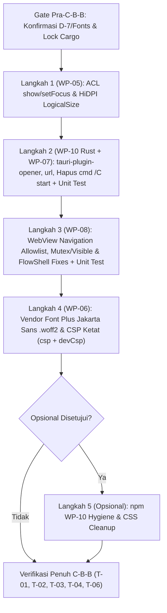

# StockStudio Pro v0.2.0-C-B-B: Blueprint Review & Implementation Plan

- **Proyek:** StockStudio Pro (`v0.2.0`)
- **Fase:** `v0.2.0-C-B-B-0` — Blueprint Review & Implementation Planning *(READ-ONLY)*
- **Baseline Git:** Branch `main` | HEAD `cbbfe6ea293664434e7fa4ecf803317f0b2d7dc0` (`cbbfe6e`: `feat: rebrand application as StockStudio Pro`) | Working tree bersih | Remote: tidak ada
- **Acuan Utama:** [`docs/planning/v0.2.0-C-A-implementation-blueprint.md`](docs/planning/v0.2.0-C-A-implementation-blueprint.md), [`docs/audit/v0.2.0-C-B-A-rebranding-report.md`](docs/audit/v0.2.0-C-B-A-rebranding-report.md), [`docs/audit/v0.2.0-B3-E-security-dependency-risk-assessment.md`](docs/audit/v0.2.0-B3-E-security-dependency-risk-assessment.md)

> [!NOTE]
> **Status Kebersihan Dokumen & Desain:** File `DESIGN.MD` masih belum tersedia di root repositori (sesuai catatan pada blueprint C-A), sehingga pembaruan visual di fase `v0.2.0-C` tetap dibatasi pada konsistensi baseline & self-hosting tipografi `Plus Jakarta Sans`. Kunci publik minisign milik Flowpilot pada [`tauri.conf.json`](src-tauri/tauri.conf.json#L11) tidak dicantumkan mentah dan direferensikan sebagai `<REDACTED_BASE64_MINISIGN_PUBKEY — key ID 9883364C90076B4B>`.

---

## 1. Blueprint Requirements Reviewed

Peninjauan penuh terhadap [`v0.2.0-C-A-implementation-blueprint.md`](docs/planning/v0.2.0-C-A-implementation-blueprint.md) (440 baris) mengonfirmasi struktur implementasi Fase C terbagi ke dalam **10 Work Package (`WP-01` s.d. `WP-10`)**, **8 Keputusan Pra-Eksekusi (`D-1` s.d. `D-8`)**, dan **6 Area Verifikasi (`T-01` s.d. `T-06`)**:

1. **Pilar 1 — Application Identity (`WP-01` s.d. `WP-04`):** Identitas inti (`productName`, `identifier`, crate/executable, metadata rilis), keyring service + fresh `%LOCALAPPDATA%` directory + internal namespace, window title + ikon Windows resmi + aset SVG + copy UI, dan hook NSIS install/uninstall.
2. **Pilar 2 — Tauri Security (`WP-05` s.d. `WP-08`):** Perbaikan ACL mismatch `show()`/`setFocus()` & bug HiDPI `LogicalSize` (`WP-05`), Content Security Policy (`csp` + `devCsp`) & self-hosted `Plus Jakarta Sans` (`WP-06`), penggantian `cmd.exe /C start` pada `open_external_url` dengan `tauri-plugin-opener` (`WP-07`), serta pembatasan navigasi host child WebView + perbaikan bug state/mutex `webview_manager.rs` & `FlowShell` (`WP-08`).
3. **Pilar 3 — Compatibility & Migration (`WP-09`):** Atomic write (`temp -> rename`), pemulihan file korup `.corrupt.<ts>.bak` tanpa menimpa `[]`, perbaikan bug pencarian `"null"`, re-index `order`, modal rename pengganti `window.prompt()`, `localStorage` quota guard, serta kebijakan isolasi/kompatibilitas profil lama.
4. **Pilar 4 — Dependency Changes (`WP-10`):** Penambahan `tauri-plugin-opener = "2"` & `url = "2"` untuk Rust (sambil menjaga `tauri 2.11.5` & menunda `reqwest 0.13` ke Fase D), serta pekerjaan opsional higienitas npm (`eslint@8.40.0` [`D-7`], refresh non-breaking `package-lock.json`, `"type": "module"`, script `tsc --noEmit && vite build`).
5. **Pilar 5 — Testing & Gelombang Sub-Fase (`T-01` s.d. `T-06`, gelombang `C-B` s.d. `C-E`):** Garis besar blueprint memetakan urutan setelah Identity (`C-B-A`) ke **Security Hardening + Rust Dependency (`C-B-B`)**, kemudian **Data Continuity & Bug Fixes (`C-B-C` / `C-D`)**, dan diakhiri **End-to-End Verification termasuk NSIS (`C-E`)**.

---

## 2. Completed vs. Pending Work Packages (Checkpoint: `cbbfe6e`)

Pemeriksaan riwayat Git menunjukkan commit **`cbbfe6ea293664434e7fa4ecf803317f0b2d7dc0`** (`cbbfe6e`: `feat: rebrand application as StockStudio Pro`, `75 files changed, 766 insertions(+), 125 deletions(-)`) dengan working tree bersih. Berikut pemetaan status aktual terhadap seluruh Work Package di blueprint:

| Work Package | Pilar / Prioritas Blueprint | Status di `cbbfe6e` | Bukti Aktual di Commit `cbbfe6e` & State Repo Saat Ini | Sisa yang Belum Dikerjakan |
| :--- | :--- | :---: | :--- | :--- |
| **`WP-01`** Core Identity | Pilar 1 (P0) | **SELESAI** | `productName: "StockStudio Pro"`, `identifier: "com.stockstudiopro.desktop"`, `version: "0.2.0"`, crate/pkg `stockstudio-pro` → `stockstudio-pro.exe`, lib `stockstudio_pro_lib`, `main.rs`, `lib.rs` panic string, `capabilities/default.json` description, & `release.yml` metadata terpasang. | Blok `plugins.updater` di [`tauri.conf.json:11-12`](src-tauri/tauri.conf.json#L11-L12) sengaja ditunda ke **Fase E**. |
| **`WP-02`** Keyring & Fresh Profile | Pilar 1 (P0) | **SELESAI** | Keyring service [`license_store.rs:50`](src-tauri/src/license_store.rs#L50) diubah ke `"StockStudioPro"`; profil baru terisolasi di `%LOCALAPPDATA%\com.stockstudiopro.desktop\` sementara `%LOCALAPPDATA%\com.flowpilot.desktop\` utuh; key storage `stockstudio-profile` / `stockstudio-accounts`, event `stockstudio-webview-ready`, tag log `[stockstudio-webview]`. | Tidak ada sisa untuk identitas & isolasi profil dasar. |
| **`WP-03`** Icons, Logos & UI Branding | Pilar 1 (P0) | **SELESAI *(1 cleanup kecil tersisa)*** | Window title `"StockStudio Pro"`, logo resmi [`iconssoren.svg`](src/assets/branding/iconssoren.svg) & [`iconssputih.svg`](src/assets/branding/iconssputih.svg) terintegrasi, filter CSS `invert()` dihapus, 50 file ikon diregenerasi via `tauri icon` (termasuk `icon.ico` 6 ukuran), `foursquare.png` & `logo-preview.png` & dead `starter` dihapus, copy UI diperbarui, & link pembelian lama dinonaktifkan (`LICENSE_PURCHASE_URL = ""`, `.link-disabled`, `disabled={!LICENSE_PURCHASE_URL}`). | File CSS mati [`src/styles/cypress.css`](src/styles/cypress.css) (tidak pernah diimpor) masih ada di disk. Pemangkasan ikon platform Android/iOS/Store tidak mendesak. |
| **`WP-04`** NSIS Hooks | Pilar 1 (P0) | **CONFIG SELESAI** *(Uji `T-05` di `C-E`)* | [`installer-hooks.nsh:10-11`](src-tauri/installer-hooks.nsh#L10-L11) diperbarui ke prompt StockStudio Pro dan target `$LOCALAPPDATA\com.stockstudiopro.desktop` dengan `${If} $UpdateMode <> 1` utuh. | Pengujian bundle installer/upgrade/uninstall NSIS penuh (`T-05`) menunggu fase verifikasi `C-E`. |
| **`WP-05`** ACL Fix & HiDPI | Pilar 2 (**P0**) | **PENDING** | [`src/App.tsx:3,5,95,306`](src/App.tsx#L95) masih memanggil `w.show()` & `w.setFocus()` dari JS walau `core:window:default` di `acl-manifests.json` (`28` izin) tidak mencakup keduanya; [`lib.rs:102,108`](src-tauri/src/lib.rs#L102) masih memakai `PhysicalSize`. | **Masuk Wajib C-B-B.** |
| **`WP-06`** CSP & Self-Hosted Fonts | Pilar 2 (**P0**) | **PENDING** | [`tauri.conf.json:7`](src-tauri/tauri.conf.json#L7) masih `"csp": null`; [`src/styles/global.css:1`](src/styles/global.css#L1) masih memuat `@import url('https://fonts.googleapis.com/...')`; `src/assets/fonts/` & `src/styles/fonts.css` belum ada. | **Masuk Wajib C-B-B.** |
| **`WP-07`** Opener & Hapus `cmd /C start` | Pilar 2 (**P1**) | **PENDING** | [`lib.rs:84-93`](src-tauri/src/lib.rs#L84-L93) masih memanggil `std::process::Command::new("cmd").args(["/C", "start", ...])` dan masih mengandung URL hardcoded Flowpilot `https://tokotelegram.com/toko/flowpilot`. | **Masuk Wajib C-B-B.** |
| **`WP-08`** WebView Nav & Lifecycle Hardening | Pilar 2 (**P1**) | **PENDING** | [`webview_manager.rs:168`](src-tauri/src/webview_manager.rs#L168) masih mengizinkan semua `https://` (`url.scheme() == "https"`); `close()` (`L213-216`) mengosongkan `visible` tanpa cek match ID; `resize()` (`L221-248`) belum mengunci `operation` mutex; `FlowShell` (`App.tsx:1110`) belum memasukkan `account.id` ke dependency `ResizeObserver`. | **Masuk Wajib C-B-B.** |
| **`WP-09`** Persistence & Bug Fixes | Pilar 3 (P1–P2) | **PENDING** | `account_store.rs` & `license_store.rs` masih non-atomik; `accounts.json` korup masih tertimpa `[]`; search `"null"`, `order` re-index, `window.prompt()` rename, & quota avatar `localStorage` belum diperbaiki. | **Jadwalkan ke `v0.2.0-C-B-C` (sesudah C-B-B).** *(Catatan: isolasi data Flowpilot `D-6` sudah tuntas oleh `cbbfe6e`.)* |
| **`WP-10`** Dependency Changes | Pilar 4 (P1–P2) | **PENDING** | [`Cargo.toml`](src-tauri/Cargo.toml) belum memiliki `tauri-plugin-opener` & direct `url`; [`package.json`](package.json) masih menaruh `eslint@8.40.0` di `dependencies`, `"build": "tsc -b && vite build"`, tanpa `"type": "module"`. | **Bagian Rust (`tauri-plugin-opener`, `url`) Wajib di C-B-B.** Bagian npm bersifat **Opsional terpisah** *(lihat Section 3)*. |

---

## 3. Exact Proposed `v0.2.0-C-B-B` Scope (Tauri Security Hardening)

### Mengapa Pilar 2 + Dependency Rust Merupakan Ruang Lingkup Logis `C-B-B`
Berdasarkan graf dependensi dan prioritas pada blueprint C-A (`WP-05` s.d. `WP-08` + prasyarat Rust `WP-10`):
1. **Seluruh prasyarat Identity (`WP-01`, `WP-02`, `WP-03`) baru saja selesai di commit `cbbfe6e`**, sehingga `WP-05`, `WP-06`, `WP-07`, dan `WP-08` tidak lagi memiliki penghalang hulu.
2. **Menuntaskan seluruh temuan keamanan P0 & P1 yang tersisa di desktop shell (`R-03`, `R-04`, `R-07`, `R-08`, plus `R-12` HiDPI):** Menutup bug ACL `w.show()`/`w.setFocus()`, mengaktifkan CSP ketat pada jendela `"main"` pemegang 13 IPC, memutus koneksi runtime startup ke Google Fonts, mengamankan pembukaan URL eksternal tanpa `cmd.exe`, dan mengunci navigasi child WebView ke domain terotorisasi.
3. **Menghilangkan referensi URL legacy terakhir di Rust (`lib.rs:85`):** Meski tombol beli di UI sudah dinonaktifkan pada `C-B-A-FIX`, backend `lib.rs:85` masih mengandung string `"https://tokotelegram.com/toko/flowpilot"`. Mengganti `open_external_url` pada `C-B-B` membersihkan sisa referensi tersebut sekaligus mengamankan pola `OpenerExt`.
4. **Menjaga pemisahan batas audit (`Blast Radius` Kecil & Bersih):** Memisahkan *Tauri Security Hardening* (`C-B-B`) dari *Persistence/Migration & Account CRUD Refactor* (`WP-09` di `C-B-C`) memastikan perubahan sistem keamanan (ACL, CSP, IPC, WebView sandbox) mudah diuji dan ditinjau tanpa tercampur modifikasi alur CRUD akun.

### Pemisahan Ruang Lingkup Wajib vs. Opsional

| Klasifikasi | Item dalam Cakupan `C-B-B` | Keterangan |
| :--- | :--- | :--- |
| **WAJIB (`Mandatory Core`)** | • **`WP-05`**: Pindah `show()` + `set_focus()` ke Rust `expand_main_window`, konversi `PhysicalSize` → `LogicalSize`, hapus `getCurrentWindow`/`PhysicalSize` dari `App.tsx`, audit `capabilities/default.json` tetap least-privilege. • **`WP-10 (Rust)` + `WP-07`**: Tambah `tauri-plugin-opener = "2"` & `url = "2"` (dengan proteksi agar `tauri` tetap di `2.11.5`), register plugin opener, ganti `cmd /C start` & URL legacy di `lib.rs:84-93` dengan `url::Url` allowlist (`ALLOWED_EXTERNAL_URLS: &[&str] = &[]` sesuai `D-8`) + `OpenerExt`, plus unit test Rust. • **`WP-08`**: Pembatasan host `.on_navigation` (`is_allowed_navigation_url` + log debug host terblokir), pertahankan `NewWindowResponse::Deny` + debug log, perbaiki bug `close()` `visible` (`L213-216`), tambah lock `operation` mutex di `resize()` (`L221-248`), perbaiki `FlowShell` (`App.tsx:1049-1110` deps `account.id` & reset status), plus unit test Rust. • **`WP-06`**: Sediakan 4 file lokal `.woff2` `Plus Jakarta Sans` (`400`, `500`, `600`, `700`) berlisensi OFL 1.1 di `src/assets/fonts/` + `src/styles/fonts.css`, hapus Google Fonts `@import` di `global.css:1`, pasang `app.security.csp` & `app.security.devCsp` di `tauri.conf.json:7`. | Seluruh item wajib dibutuhkan untuk lolos uji `T-01`, `T-02`, `T-03`, `T-04`, dan `T-06`. |
| **OPSIONAL (`Optional Improvements`)** | • **`WP-10 (npm hygiene)`**: Hapus `eslint@8.40.0` (dari `dependencies`, menyumbang `7` CVE dev) & `eslint-config-prettier`, refresh non-breaking `package-lock.json` (memangkas `@babel/traverse` Critical & sisa lockfile dari `19` ke `2` dev CVE), tambah `"type": "module"` + ubah `"build": "tsc --noEmit && vite build"`. • **CSS Hygiene Kecil**: Hapus file mati [`src/styles/cypress.css`](src/styles/cypress.css) (sisa `WP-03`) & ubah `align-items:end` → `align-items:flex-end` di `global.css:23` (menghilangkan warning CSS Vite). | Tidak memblokir keamanan Tauri; **hanya dikerjakan jika disetujui** sebelum eksekusi `C-B-B` (atau dipisah ke task hygiene sebelum `C-E`). |

---

## 4. Implementation Sequence

Urutan implementasi dirancang agar tidak menimbulkan kegagalan kompilasi menengah maupun konflik dependensi:

1. **Langkah 1 — `WP-05` (Window Control Atomik & HiDPI `LogicalSize`):**
   - Pada [`src-tauri/src/lib.rs:96-115`](src-tauri/src/lib.rs#L96-L115), ubah `expand_main_window` agar memakai `LogicalSize(1280.0, 800.0)` & `min_size` `LogicalSize(1000.0, 700.0)` (dengan clamp aman terhadap ukuran logis monitor bila tersedia), lalu panggil `window.show()` dan `window.set_focus()` langsung dari Rust.
   - Pada [`src/App.tsx:3,5,95,306`](src/App.tsx#L3), hapus import `getCurrentWindow` dan `PhysicalSize`, serta hapus panggilan `const w = getCurrentWindow(); await w.show(); await w.setFocus()` setelah `await invoke("expand_main_window")`.
   - Biarkan [`src-tauri/capabilities/default.json`](src-tauri/capabilities/default.json) hanya berisi `"windows": ["main"]`, `["core:default", "updater:default", "process:allow-restart"]` (Opsi A — *Least Privilege*).
2. **Langkah 2 — `WP-10 (Rust)` + `WP-07` (`tauri-plugin-opener` & Penghapusan `cmd /C start`):**
   - Tambahkan `tauri-plugin-opener = "2"` dan `url = "2"` di [`src-tauri/Cargo.toml`](src-tauri/Cargo.toml), lalu verifikasi resolusi [`Cargo.lock`](src-tauri/Cargo.lock) agar `tauri 2.11.5` tidak terpaksa naik minor tanpa kendali.
   - Registrasikan `.plugin(tauri_plugin_opener::init())` di [`src-tauri/src/lib.rs:119`](src-tauri/src/lib.rs#L119).
   - Ganti total [`open_external_url`](src-tauri/src/lib.rs#L84-L93) dengan fungsi validasi terstruktur (`validate_external_url(&str) -> Result<url::Url, String>`) yang memeriksa: parse URL valid, `scheme() == "https"`, `username().is_empty() && password().is_none()`, dan kecocokan persis dengan `const ALLOWED_EXTERNAL_URLS: &[&str] = &[];` *(kosong hingga URL resmi StockStudio Pro diberikan sesuai `D-8`; hapus string `tokotelegram.com/toko/flowpilot` sepenuhnya)*. Lalu panggil `app.opener().open_url(validated.as_str(), None::<&str>)`.
   - Tambahkan unit test Rust `#[cfg(test)]` untuk validasi URL positif & payload injeksi/non-HTTPS/spoofing.
3. **Langkah 3 — `WP-08` (Child WebView Navigation Allowlist & Perbaikan State/Mutex):**
   - Di [`src-tauri/src/webview_manager.rs:168`](src-tauri/src/webview_manager.rs#L168), ganti `.on_navigation(|url| url.scheme() == "https")` dengan `.on_navigation(|url| is_allowed_navigation_url(url))` (hanya `https` — plus uji apakah `about:blank` diperlukan WebView2 — serta pengecekan eksak/subdomain `.` terhadap `flow.google`, `labs.google`, dan kandidat domain login/aset Google seperti `accounts.google.com`, `accounts.youtube.com`, `myaccount.google.com`, `consent.google.com`, `gds.google.com`, `ogs.google.com`, `*.googleusercontent.com`, `*.gstatic.com`, dilengkapi log debug `[stockstudio-webview] blocked navigation` untuk memverifikasi alur login riil saat `T-04`).
   - Pertahankan `on_new_window(|_, _| tauri::webview::NewWindowResponse::Deny)` (`L169`) dengan log debug bila diblokir.
   - Perbaiki `close()` (`L213-216`) agar `*state.visible.lock() = false` hanya dieksekusi jika `requested_id == active_id`; tambahkan `let _operation = state.operation.lock()...` di awal `resize()` (`L221-248`).
   - Perbaiki `FlowShell` di [`src/App.tsx:1049-1110`](src/App.tsx#L1049) agar mereset status menjadi `"Loading Google Flow..."` saat `account.id` berubah dan memasukkan `account.id` ke dependency array `ResizeObserver` (`L1110`).
   - Tambahkan unit test Rust untuk `is_allowed_navigation_url` dan `validate_account_id`.
4. **Langkah 4 — `WP-06` (Self-Hosted `Plus Jakarta Sans` & Strict CSP):**
   - Simpan berkas resmi `.woff2` `Plus Jakarta Sans` (bobot `400`, `500`, `600`, `700`, lisensi SIL OFL 1.1) di folder baru `src/assets/fonts/` + deklarasi `@font-face` di file baru `src/styles/fonts.css`, lalu impor `./styles/fonts.css` sebelum `./styles/global.css` pada [`src/main.tsx:4`](src/main.tsx#L4).
   - Hapus `@import url('https://fonts.googleapis.com/...')` pada [`src/styles/global.css:1`](src/styles/global.css#L1).
   - Aktifkan `security.csp` dan `security.devCsp` di [`src-tauri/tauri.conf.json:7`](src-tauri/tauri.conf.json#L7):
     - **`csp` (Produksi):** `"default-src 'self'; script-src 'self'; style-src 'self'; font-src 'self'; img-src 'self' data:; connect-src ipc: http://ipc.localhost; object-src 'none'; base-uri 'self'; form-action 'none'; frame-ancestors 'none'"`
     - **`devCsp` (Dev Vite HMR):** `"default-src 'self'; script-src 'self' 'unsafe-inline' http://localhost:5173; style-src 'self' 'unsafe-inline' http://localhost:5173; font-src 'self' http://localhost:5173; img-src 'self' data: http://localhost:5173; connect-src ipc: http://ipc.localhost http://localhost:5173 ws://localhost:5173; object-src 'none'; base-uri 'self'; form-action 'none'"`
5. **Langkah 5 — Item Opsional *(hanya bila disetujui pemilik proyek)*:**
   - Hapus `eslint@8.40.0` & `eslint-config-prettier`, jalankan refresh non-breaking `package-lock.json`, tambah `"type": "module"` + `"build": "tsc --noEmit && vite build"`, hapus `src/styles/cypress.css`, dan ganti `align-items:end` → `align-items:flex-end` di `src/styles/global.css:23`.

---

## 5. Expected Files Affected

### 5.1 Berkas Cakupan Wajib (`C-B-B` Core Security)

| File Path | Aksi | Lokasi & Detail Modifikasi Terencana |
| :--- | :---: | :--- |
| [`src-tauri/Cargo.toml`](src-tauri/Cargo.toml) | Modify | Tambah `tauri-plugin-opener = "2"` & `url = "2"` pada `[dependencies]` |
| [`src-tauri/Cargo.lock`](src-tauri/Cargo.lock) | Modify | Resolusi paket `tauri-plugin-opener` (jaga versi `tauri` tetap `2.11.5`) |
| [`src-tauri/src/lib.rs`](src-tauri/src/lib.rs) | Modify | `L84-93` (`open_external_url` + allowlist via `url::Url` + `OpenerExt`, hapus `cmd` & `tokotelegram`), `L96-115` (`expand_main_window` `LogicalSize` + `show()`/`set_focus()`), `L119` (`.plugin(tauri_plugin_opener::init())`), tambah `#[cfg(test)]` |
| [`src-tauri/src/webview_manager.rs`](src-tauri/src/webview_manager.rs) | Modify | `L168-169` (`is_allowed_navigation_url` + debug logging), `L213-216` (`visible` bug fix), `L221-248` (`operation` mutex pada `resize`), tambah `#[cfg(test)]` |
| [`src-tauri/tauri.conf.json`](src-tauri/tauri.conf.json) | Modify | `L7` (`app.security.csp` & `app.security.devCsp` menggantikan `"csp": null`) |
| [`src-tauri/capabilities/default.json`](src-tauri/capabilities/default.json) | Verify *(Unchanged)* | Pastikan tetap `"windows": ["main"]` dan hanya `["core:default", "updater:default", "process:allow-restart"]` (Opsi A) |
| [`src/App.tsx`](src/App.tsx) | Modify | Hapus import & pemanggilan `getCurrentWindow`/`PhysicalSize` (`L3, L5, L95, L306`); update `FlowShell` reset status & deps `account.id` (`L1049-1110`) |
| [`src/main.tsx`](src/main.tsx) | Modify | `L4` — tambah `import "./styles/fonts.css"` sebelum `./styles/global.css` |
| [`src/styles/global.css`](src/styles/global.css) | Modify | `L1` — hapus `@import url('https://fonts.googleapis.com/...')` |
| `src/styles/fonts.css` | **Create** | Deklarasi `@font-face` lokal `Plus Jakarta Sans` (`400`, `500`, `600`, `700`) |
| `src/assets/fonts/PlusJakartaSans-*.woff2` | **Create** | 4 berkas font `.woff2` lokal (SIL OFL 1.1) |

### 5.2 Berkas Cakupan Opsional *(Hanya jika disetujui)*

| File Path | Aksi | Detail Perubahan |
| :--- | :---: | :--- |
| [`package.json`](package.json) | Modify *(Opt)* | Hapus `eslint` (`8.40.0`) & `eslint-config-prettier`; tambah `"type": "module"`; ubah `"build"` ke `"tsc --noEmit && vite build"` |
| [`package-lock.json`](package-lock.json) | Modify *(Opt)* | Refresh lockfile non-breaking tanpa mengubah versi paket utama |
| [`src/styles/cypress.css`](src/styles/cypress.css) | Delete *(Opt)* | Hapus berkas stylesheet mati tak terimpor |
| [`src/styles/global.css`](src/styles/global.css) | Modify *(Opt)* | `L23` — ubah `align-items:end` ke `align-items:flex-end` |

---

## 6. Explicit Acceptance Criteria

Fase `v0.2.0-C-B-B` dinyatakan **LULUS** hanya bila seluruh kriteria wajib berikut terpenuhi:

1. **ACL & HiDPI (`WP-05`):**
   - `App.tsx` tidak lagi memanggil `getCurrentWindow().show()` / `.setFocus()`; aktivasi dan validasi startup mengandalkan `expand_main_window` tanpa error ACL pada build dev maupun release.
   - `expand_main_window` menggunakan `LogicalSize(1280.0, 800.0)` / min `LogicalSize(1000.0, 700.0)` dan proporsional pada display scaling `100%`, `125%`, serta `150%/200%`.
   - `capabilities/default.json` hasil build (`src-tauri/gen/schemas/capabilities.json`) tetap hanya mengikat jendela `"main"` dan tidak membuka permission `opener:*` atau `core:window:allow-show`.
2. **External Opener (`WP-07` & Rust `WP-10`):**
   - Nol kemunculan `Command::new("cmd")`, `"/C", "start"`, dan string `"tokotelegram"` di seluruh `src-tauri/` maupun `src/`.
   - Unit test `validate_external_url` membuktikan penolakan penuh terhadap non-HTTPS, kredensial userinfo, metakarakter shell (`&`, `|`), dan URL di luar `ALLOWED_EXTERNAL_URLS`.
   - `src-tauri/Cargo.lock` hanya bertambah `tauri-plugin-opener` (+ dependensi minimalnya), sementara `tauri` tetap di `2.11.5` (atau terverifikasi kompatibel dengan fitur `unstable`).
3. **WebView Isolation & Hardening (`WP-08`):**
   - Unit test `is_allowed_navigation_url` meluluskan domain resmi dan menolak skema non-HTTPS maupun domain spoofing (mis. `evil-googleusercontent.com`, `flow.google.evil.com`).
   - Child WebView memuat `https://flow.google`, menavigasi alur Google Sign-In tanpa terblokir oleh allowlist/popup policy yang terlalu sempit, menolak navigasi sembarang ke situs eksternal, serta memiliki `window.__TAURI_INTERNALS__ === undefined`.
   - `webview_manager::close()` menjaga status `visible` ketika menutup ID non-aktif, `resize()` terkunci `operation` mutex, dan `FlowShell` mereset status + re-observe bounds saat berpindah akun.
4. **CSP & Self-Hosted Fonts (`WP-06`):**
   - Hasil build CSS (`dist/assets/*.css`) mengandung **0 referensi** `fonts.googleapis.com` / `fonts.gstatic.com` dan menyertakan `@font-face` lokal `.woff2`.
   - Font `Plus Jakarta Sans` terender dengan benar dalam mode **offline** (internet terputus).
   - DevTools Console di jendela `"main"` (mode `tauri dev` maupun build produksi) menunjukkan **`0` CSP violation** pada seluruh view, unggah avatar `data:image/*`, dan drag-and-drop (`DragPreview`), sekaligus memblokir uji negatif injeksi (`eval`, inline `<script>`, fetch `https://example.com`).
5. **Integritas Build:** `npx --no-install tsc --noEmit --incremental false`, `npm run build`, `cargo check --locked`, `cargo test --locked`, `npx --no-install tauri info`, dan `git diff --check` seluruhnya keluar dengan **exit code `0`**.

---

## 7. Validation & Test Plan

| ID | Pengujian | Perintah / Prosedur Verifikasi | Target Output |
| :-: | :--- | :--- | :--- |
| **`T-01`** | TypeScript & Vite Bundle | `npx --no-install tsc --noEmit --incremental false` && `npm run build` + scan `dist/assets/*.css` | Exit `0`, `0` error TS, `0` string `fonts.googleapis`, `fonts.gstatic`, `tokotelegram`, dan berkas `.woff2` terbawa ke `dist/assets/`. |
| **`T-02`** | Rust Check, Unit Test & Tauri Schema | `cargo check --locked --manifest-path src-tauri/Cargo.toml` && `cargo test --locked --manifest-path src-tauri/Cargo.toml` && `npx --no-install tauri info` | Exit `0`, `0` warning Rust, seluruh unit test (`validate_external_url`, `is_allowed_navigation_url`, `validate_account_id`) PASS; `tauri info` menampilkan `CSP` terpasang (bukan `unset`). |
| **`T-03`** | Runtime Dev (`Online` / `Offline` & `HiDPI`) | Jalankan `npm run tauri dev` dengan Wi-Fi diputus (offline) + uji di scaling Windows `100%`, `125%`, `150%`/`200%` | `stockstudio-pro.exe` berjalan tanpa crash; font `Plus Jakarta Sans` aktif offline; window expanded proporsional sesuai `LogicalSize`. |
| **`T-04`** | WebView Isolation & Google Flow Login | Di dalam child WebView (`FlowShell`), uji alur login Google & pindah cepat antar 2 akun, uji klik/navigasi ke domain asing (mis. `https://example.com`), dan inspeksi DevTools child WebView | Alur Google Sign-In berjalan mulus (catat domain di log debug bila perlu penyesuaian whitelist), domain eksternal asing terblokir, dan `window.__TAURI_INTERNALS__` bernilai `undefined`. |
| **`T-06`** | Audit CSP (Dev & Prod) & IPC Guardrails | Uji `tauri dev` dan local production bundle (`npx --no-install tauri build --no-bundle`): jelajahi semua tab, unggah avatar (`FileReader` `data:` URL), drag-and-drop kartu (`DragPreview`), jalankan uji negatif di Console (`eval('1+1')`, `fetch('https://example.com')`) dan uji payload negatif `invoke('open_external_url', ...)`; cek `src-tauri/gen/schemas/capabilities.json` | `0` CSP error pada skenario sah (termasuk CSSOM `DragPreview` & `data:` image); seluruh skenario injeksi/external fetch/IPC payload negatif diblokir; `capabilities.json` hanya mengikat `"main"`. |
| *(Opt)* | Security Audit npm | Jika opsi npm `WP-10` dijalankan: `npm audit --json` & `npm ls --depth=0` | `0` Critical & `0` CVE pada `dependencies`; sisa CVE dev hanya `vite` + `esbuild` yang tertunda ke Fase E. |

---

## 8. Security Risks & Rollback Plan

### 8.1 Daftar Risiko Teknis & Mitigasi

| Risiko | Dampak | Probabilitas | Mitigasi |
| :--- | :---: | :---: | :--- |
| `tauri-plugin-opener = "2"` menaikkan minor `tauri` / memecah API `unstable` (`WebviewBuilder` / `add_child`) | Tinggi | Rendah–Sedang | Edit `Cargo.toml` manual, kunci bila perlu agar `tauri` tetap `2.11.5`, periksa diff `Cargo.lock` baris demi baris, langsung uji `cargo check` sebelum melangkah ke edit kode. |
| Daftar host `.on_navigation` terlalu ketat sehingga memutus alur 2FA / SSO / redirect Google Flow atau transisi `about:blank` | Tinggi | Sedang | Sertakan debug logger `[stockstudio-webview] blocked navigation host=...` pada build dev (`cfg!(debug_assertions)`) dan wajib jalankan `T-04` login Google penuh sebelum mengunci allowlist. |
| CSP produksi `style-src 'self'` atau `connect-src` memblokir CSSOM dinamis/Tauri WebView2 bridge pada release build | Tinggi | Sedang | Pisahkan `csp` (ketat produksi) dan `devCsp` (Vite HMR); uji langsung pada binary build tanpa bundle (`tauri build --no-bundle`) dengan `DragPreview` + `FileReader` + semua panggilan `invoke(...)`. |
| `LogicalSize(1280, 800)` atau `minWidth: 1000` melebihi layar laptop kecil `1366×768` pada DPI `125%` (`1092×614` logical) | Sedang | Sedang | Clamping dinamis ukuran target/min terhadap `current_monitor()` logical work area di dalam `expand_main_window`. |
| Sumber file `.woff2` `Plus Jakarta Sans` tidak menyertakan subset Latin lengkap atau metadata lisensi tidak terdokumentasi | Rendah | Rendah | Unduh resmi paket rilis font `Plus Jakarta Sans` (SIL OFL 1.1), verifikasi cakupan glyph Latin & simpan berkas `OFL.txt` atau catatan lisensi. |
| Refresh `package-lock.json` *(jika cakupan opsional diambil)* menggeser versi minor Vite/Tailwind di luar Node `v20.10.0` | Sedang | Rendah | Tahan exact spec paket utama (`vite`, `tailwindcss`, `@vitejs/plugin-react`, `react*`, `@tauri-apps/*`) dan verifikasi `npm run build` segera setelah refresh. |

### 8.2 Strategi Rollback
1. **Commit Atomik Per-Work-Package (saat implementasi nanti):** Kerjakan `WP-05`, `WP-10(Rust)+WP-07`, `WP-08`, dan `WP-06` dalam commit/patch logis terpisah dari baseline stabil `cbbfe6e`.
2. **Rollback Instan:** Jika salah satu fitur keamanan menimbulkan regresi (mis. CSP produksi atau plugin opener), gunakan `git revert <commit>` atau `git restore --source=cbbfe6e <file>` untuk file terdampak, lalu jalankan kembali `cargo check --locked` / `npm ci`.
3. **Keamanan Data Pengguna:** Karena `C-B-B` tidak mengubah skema file `%LOCALAPPDATA%\com.stockstudiopro.desktop\` (`accounts.json`, `license-state.json`, `webview-profiles/`), rollback kode Rust/frontend tidak merusak data profil lokal yang sudah tercipta.

---

## 9. Explicit Out-of-Scope Items

Item berikut **DILARANG** disentuh pada sub-fase `v0.2.0-C-B-B`:

1. **`WP-09` (Data Persistence & Account Bugs):** Atomic write (`temp -> rename`), backup `.corrupt.<ts>.bak` di `account_store.rs`/`account-store.ts`, bug filter search `"null"`, re-index `order`, modal rename pengganti `window.prompt()`, dan quota handler avatar `localStorage` → **Masuk ke sub-fase berikutnya (`v0.2.0-C-B-C` / `C-D`)**.
2. **Pengujian Paket Installer NSIS Penuh (`T-05`):** Build installer penuh, upgrade `$UpdateMode = 1`, & simulasi uninstall → **Masuk ke fase verifikasi akhir `v0.2.0-C-E`**.
3. **Sistem Lisensi (`Fase D`):** Endpoint `const API = "https://flowpilot-license-server.frangga-snow.workers.dev"` ([`license_store.rs:7`](src-tauri/src/license_store.rs#L7)), unifikasi `reqwest 0.13`, HTTP timeout, struktur `ServerResponse`, offline lease/JWT, perbaikan error swallowing `activateLicense`, dan UI Deactivate License.
4. **Auto-Updater Keys, Release CI & Vite Major (`Fase E`):** Minisign keypair & `pubkey` `<REDACTED_BASE64_MINISIGN_PUBKEY — key ID 9883364C90076B4B>`, `updater.endpoints` `masplangga/flowpilot` ([`tauri.conf.json:11-12`](src-tauri/tauri.conf.json#L11-L12)), `cargo-audit` di GitHub Actions, Authenticode signing, dan evaluasi upgrade mayor `vite@5.4.21`.
5. **Arsitektur `v0.3.0` & `v0.4.0+`:** Pemecahan `src/App.tsx`, implementasi visual penuh `DESIGN.MD`, generalisasi command `*_google_flow` menjadi multi-tool engine, `.on_download(...)`, dan **Vectorizer Tool** / **7 modul StockStudio Pro**.

---

## 10. Recommended Next Implementation Task

- **Tugas Implementasi Berikutnya yang Direkomendasikan:** **`TASK C-B-B: Tauri Security Hardening`** mencakup item wajib **`WP-05` → `WP-10 (Rust)` + `WP-07` → `WP-08` → `WP-06`** (dan diuji lewat `T-01`, `T-02`, `T-03`, `T-04`, `T-06`).
- **Opsi Pemecahan (Opsional Jika Diinginkan Review Lebih Ringkas):** Dapat dipecah menjadi **`C-B-B-1`** (Rust ACL `WP-05` + `tauri-plugin-opener` `WP-07` + WebView hardening `WP-08`) dan **`C-B-B-2`** (Self-hosted `.woff2` & CSP ketat `WP-06`), namun mengeksekusinya dalam satu fase terkendali `C-B-B` menjaga seluruh pengujian `T-03`/`T-06` berjalan sekaligus pada app shell yang sudah diamankan.
- **2 Konfirmasi Singkat yang Perlu Diputuskan Pemilik Sebelum Eksekusi `C-B-B` Dimulai:**
  1. **Paket Opsional npm (`WP-10` / `D-7`):** Apakah `C-B-B` sekalian menjalankan pembersihan `eslint@8.40.0` + refresh `package-lock.json` + `"type": "module"` + hapus `cypress.css` + fix `align-items: flex-end`, atau ditunda ke tugas higienitas terpisah menjelang `C-E`?
  2. **Sumber Font Lokal (`WP-06`):** Konfirmasi pengunduhan/penyediaan 4 file resmi `.woff2` `Plus Jakarta Sans` (`400`, `500`, `600`, `700`, lisensi SIL OFL 1.1) untuk disimpan di `src/assets/fonts/` (sementara `ALLOWED_EXTERNAL_URLS` di `lib.rs` dipastikan tetap `&[]` sesuai `D-8` sampai URL toko StockStudio Pro resmi tersedia).
